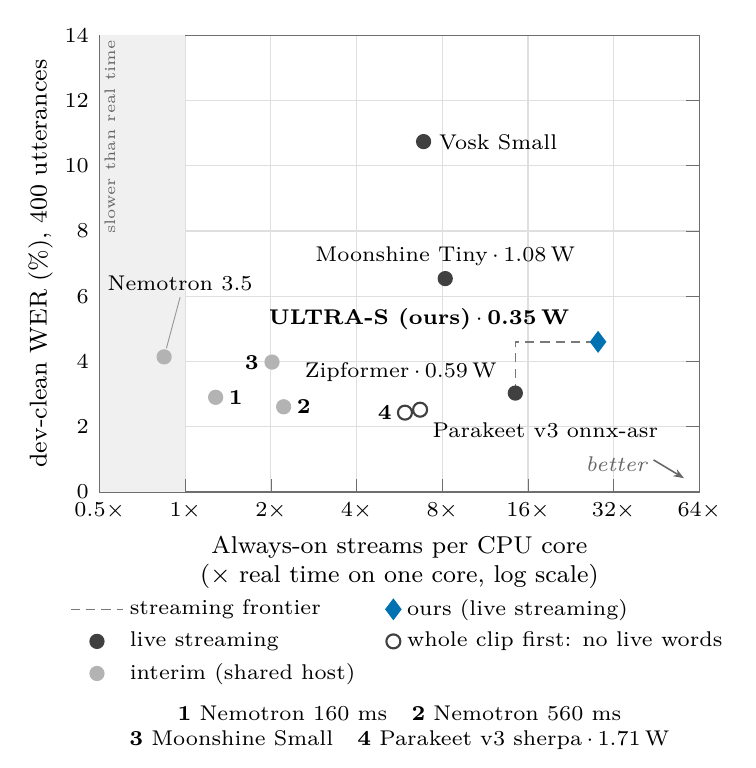

# ULTRA: always-on speech recognition on a fraction of one CPU core

[](https://github.com/neverhuman/jsr/actions/workflows/jankurai.yml)

ULTRA is a small streaming transducer and an integer-exact Rust CPU engine built to listen all the time: every second of audio, speech or not, on a small share of one core. Measured beside the published CPU recognisers on our own hardware and under one protocol, it is less accurate than most of them and costs a fraction of their CPU time and watts.

All numbers are exploratory: LibriSpeech DEV only, before the qualifying run (`docs/ultra/FREEZE.md`).

<!-- money-plot:start -->
<!-- Generated by `just paper-refresh` from docs/paper/data (evidence rows and receipts). Do not edit by hand. -->
- **Cost.** 3.5% of one CPU core per live stream: ULTRA-S (A1 step 30,000) runs at 28.2× real time on one quiet Zen 2 core, against 14.5× for Zipformer, 8.20× for Moonshine Tiny, 6.88× for Vosk Small, 6.69× for Parakeet TDT v3 on onnx-asr (whole clip) and 5.92× for Parakeet TDT v3 on sherpa-onnx (whole clip). An earlier checkpoint, H22ctl, runs at 77.2× on one Apple M3 Ultra core.
- **Watts.** 0.35 W per always-on stream (A1 step 30,000; core energy registers, same run), about 3.1 kWh per stream-year: 1.7× less than Zipformer (0.59 W), 3.1× less than Moonshine Tiny (1.08 W) and 4.9× less than Parakeet TDT v3 on sherpa-onnx (1.71 W).
- **Capacity.** 16 live streams on one core (H22ctl), 95th-percentile word lag 429–439 ms, flat from 1 to 16 streams; Zipformer holds 8 streams at 744–755 ms. Measured on one core; from the CPU cost the ceilings are about 26 and 12 streams.
- **Silence.** 0 words in 10 hours of digital silence and synthetic white, pink and brown noise at −40 to −20 dBFS (10 one-hour blocks, H22ctl); 4 words in the 17.06 h of pauses of the 27.56 h continuous stream (0.23 per hour: 1 in 8.61 h of digital silence, 3 in the noise gaps).
- **Endless.** Memory 62.35 MB at the start, 69.3 MB once loaded, never above 69.53 MB, 67.85 MB at the end of a 27.56 h continuous stream (5,567 utterances, one process, no restart, H22ctl); word lag p50 310 / p95 439 ms over 95,710 words; WER 9.85% in its first half and 9.95% in its second. With reset-with-replay (T = 1.5 s, R = 1.0 s), one continuous stream matches isolated decoding on the first stream hour: 8.51% against 8.46%, 204 utterances (9.36% without the reset); its full-length run is still going.
- **Same words everywhere.** 730 of 730 panel transcripts of H22ctl are identical on Zen 2 (AVX2), Xeon (AVX-512) and Apple M3 (NEON); INT8 costs nothing: on full dev (5,567 utterances) A1 step 20,000 scores 8.39% pooled WER in the INT8 engine against 8.41% in FP32 PyTorch (−0.01 pp, bounds −0.05 to +0.02).
- **Where we trail.** ULTRA-S (A1, step 30,000 of 49,000; training continues) scores 4.60% WER on the panel's dev-clean half, against 3.03% for Zipformer, 2.61% for Nemotron at 560 ms and 2.43% for Parakeet TDT v3 on sherpa-onnx; 7 of the 9 other systems drawn are more accurate. An optional n-gram LM lowers the pooled WER of H22ctl by 1.1 points in the engine (1.4 held out in PyTorch); no row here uses it.



**Figure 1 of [the paper](docs/paper/paper.pdf).** ULTRA-S (A1, step 30,000 of 49,000; training continues) is the fastest of the 10 systems, 2.0× the next streaming system on the same core, and 7 of the 9 others are more accurate. Each point is one cold process on one pinned Zen 2 core decoding the same 730 LibriSpeech DEV utterances, model load included, median of three runs; further right is faster, further down more accurate (dev-clean WER). Filled marks stream live; hollow marks need the whole clip first. Watts beside a name: W per always-on stream (core energy registers, same run).

| System | Class | Always-on streams per core (× real time) | W per always-on stream | dev-clean WER (%) | dev-other WER (%) | Pooled WER (%) | Peak memory (MB) | Host |
|---|---|---:|---:|---:|---:|---:|---:|---|
| **ULTRA-S (ours)** | streaming | 28.2 | 0.35 | 4.60 | 11.61 | 7.48 | 74 | H1 |
| Zipformer | streaming | 14.5 | 0.59 | 3.03 | 8.43 | 5.25 | 153 | H1 |
| Moonshine Tiny | streaming | 8.20 | 1.08 | 6.54 | 14.72 | 9.90 | 201 | H1 |
| Vosk Small | streaming | 6.88 | — | 10.74 | 20.86 | 14.90 | 257 | H1 |
| Parakeet v3 onnx-asr | whole utterance | 6.69 | — | 2.52 | 4.58 | 3.36 | 1684 | H1 |
| Parakeet v3 sherpa | whole utterance | 5.92 | 1.71 | 2.43 | 4.78 | 3.40 | 1403 | H1 |
| Nemotron 560 ms | streaming | 2.22 | — | 2.61 | 4.93 | 3.56 | 1290 | H0, interim |
| Moonshine Small | streaming | 2.02 | — | 3.98 | 8.73 | 5.93 | 476 | H0, interim |
| Nemotron 160 ms | streaming | 1.28 | — | 2.90 | 5.42 | 3.94 | 1287 | H0, interim |
| Nemotron 3.5 | streaming | 0.84 | — | 4.14 | 9.00 | 6.14 | 1277 | H0, interim |
| **ULTRA-S H22ctl** (ours), not drawn | streaming | 27.8 | 0.33 | 5.20 | 12.16 | 8.06 | 74 | H1 |

Hosts: H1 is the quiet host (one timed system at a time); H0 is a shared host whose rows are interim until their H1 rows arrive. Refresh the figure, this block and the PDF with `just paper-refresh`.
<!-- money-plot:end -->

## Read more

- The paper: [`docs/paper/paper.pdf`](docs/paper/paper.pdf). Every number in it and in the block above is generated from `docs/paper/data/` (receipts pinned in `docs/paper/data/raw/MANIFEST.txt`).
- Refresh the figure, the table, this block and the PDF: `just paper-refresh`.
- New contributors and external agents: start with [`CONTRIBUTING.md`](CONTRIBUTING.md) (rules, data, open workstreams).
- Status and plan: `docs/ultra/STATUS.md`, `docs/ultra/PLAN_TO_V1.md`; research waves: [`research/`](research/README.md); earlier results: [`docs/ultra/HISTORY.md`](docs/ultra/HISTORY.md).
- Specifications: `docs/ultra/specs/ULTRA_ASR_MASTER_ENGINEERING_SPEC.md` (controlling) and `docs/ultra/specs/cadence_ultra_v3_0_master_engineering_specification.md` (companion: AVX2 lookup-table kernels, integer PCEN front-end arm).

## Quick start

```bash
just fast          # fmt, clippy, tests
just venv          # Python trainer env (python/ultra)
just required      # full push gate, including security and jankurai audit
```

## Layout

| Path | What |
|---|---|
| `crates/ultra-core` | numeric contract (§5), output events and ledger (§3), lifecycle, receipts |
| `crates/ultra-kernels` | scalar reference, AVX2 and AVX-512 ternary and int8 kernels, bit-exact property tests |
| `crates/ultra-engine` | pure-Rust R1 inference engine: FP32, per-row INT8, S/S_MR/ternary, AVX2 and NEON |
| `crates/ultra-frontend` | float log-mel control (trainer-parity, portable path) and integer Cochlea |
| `crates/ultra-gp` | R1 bundle loader, greedy RNN-T state, `(asr …)` program tools |
| `crates/ultra-model`, `crates/ultra-stream` | runtime backends (sherpa R0, ORT R1, engine R1), scheduler, grid simulation, placement |
| `crates/ultra-eval` | normaliser, WER, delays, paced replay, process-tree CPU accounting, bootstrap, `ultra-measure` |
| `crates/ultra-bench` | the cost-law benchmark (`wstream` port) and kernel bake-off |
| `crates/ultra-bridge` | whole-service measured benchmark harness (M1/M2) |
| `crates/ultra-adapters`, `crates/ultra-cli` | external recogniser adapters; command-line tool and `ultra bench-suite` |
| `python/ultra/train/{speed_pack,diloco}.py` | GPU input pipeline and DiLoCo multi-node outer optimiser (merged, not yet wired into training; see `CONTRIBUTING.md`) |
| `python/ultra` | PyTorch trainer (`train/`, including `train/ops/` run scripts), data prep, waves |
| `docs/ultra` | STATUS, PLAN_TO_V1, FREEZE, DECISIONS, RULINGS, ledgers, specs, reviews |
| `python/ultra/tools/fleet_dashboard` | real-time training dashboard (aiohttp + WebSocket), `just dashboard` |
| `docs/paper` | IEEE two-column paper: sources, generated metrics, committed PDFs (`just paper`) |
| `research/` | research waves H1…Hn: experiment, results and pointers (summaries only) |

## Gates

`just required` runs fmt, clippy (`-D warnings`), the tests, pytest, the security lane and a jankurai audit. It must pass before every push.

Data, checkpoints and build output never go in git. On the maintainers' fleet they live on the data drive (`/mnt/xbabe3-external/jsr`); elsewhere, set `JSR_DATA` (see `CONTRIBUTING.md`).
