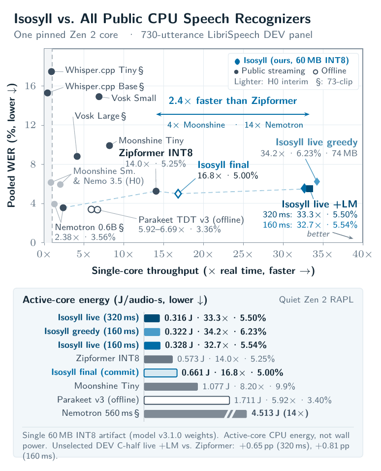

# Isosyll v4.0.0 — Executive Brief

> **Download formatted 2-page PDF:** [**`isosyll-v4-ceo-brief.pdf`**](isosyll-v4-ceo-brief.pdf) *(publication layout with the power-colormap hero chart and directional heat-map scoreboard)*

**Always Listening, Barely Computing: Speech Recognition on One CPU Core**



> **Bottom Line / Key Takeaways**
> - **What Isosyll does:** Turns live speech into text on **3.1% of one ordinary CPU core** per stream, with no cloud round trip, no GPU and no Python stack. One signed ~1.6 MB program for Linux (x86-64, arm64) and Apple-silicon Macs.
> - **Measured advantage:** Against Zipformer INT8, the fastest open streaming rival we measured, Isosyll delivers **2.33× the single-core throughput at 57% of its CPU-core energy per second of audio, using 72% of its memory**, timed side by side on the same core. The same core can transcribe 2.33× as much audio, for under 60% of the energy.
> - **Accuracy:** 5.54% word error rate live in 109 MB RAM (trailing Zipformer by +0.81 pp on the unselected half of DEV, bounds +0.62 to +1.02). An optional end-of-sentence commit pass on the same 60 MB weights reaches 5.00% errors at 16.8× speed when final polish is needed.
> - **Honest scope:** Exploratory results on LibriSpeech development data only. Isosyll v4.0.0 missed its pre-registered accuracy gates and was released by owner decision.

## 1. The Business Problem: Always-On Speech Has a Meter That Never Stops

An always-on recognizer — meeting capture, call-centre assist, in-car and wearable assistants, accessibility captions — must process every second of audio, whether anyone is speaking or not. That cost is paid continuously in cloud bills, battery life and heat. Streaming every microphone to a cloud GPU adds a network round trip, a per-minute bill, and a privacy question every customer and regulator asks: where does the recording go? Keeping speech on the device answers it, if an ordinary CPU can afford to listen.

## 2. What Isosyll Changes (Plain English)

Isosyll is a compact *streaming* recognizer: it writes words while the person is still talking at **32.7× real time** (an hour of speech in under two minutes), using **3.1% of one CPU core** and **109 MB of memory**.

- **Cheaper listening fleets:** 2.33× the single-core throughput of the fastest open streaming rival, so each CPU core transcribes 2.33× as much audio for under 60% of the core energy.
- **Private by default:** speech is recognized where it is captured; recordings never leave the building.
- **Zero-GPU power profile:** 0.328 W of CPU-core power per live stream rather than GPU accelerators (NVIDIA T4 70 W to A100 PCIe 250 W published board TDP; vendor datasheets, external context, not a benchmark measurement).
- **Optional final polish:** an optional utterance-end commit pass on the same 60 MB weights reaches 5.00% word errors at 16.8× real time (statistically level with Zipformer's 5.25%, at 115% of its core energy and 387 MB RAM).

## 3. Measured Scoreboard at a Glance

*730-utterance LibriSpeech DEV selection panel (87.7 min), one pinned AMD Zen 2 core, median of three runs, one scorer for every system. Showing our single fastest streaming model against public rivals.*

| Recognizer (mode) | Speed ↑ | Word errors ↓ | Core J / audio-s ↓ | Peak RAM ↓ |
| --- | ---: | ---: | ---: | ---: |
| **Isosyll** (streaming, 160 ms) | **32.7×** | **5.54%** | **0.328 J\*** | **109 MB** |
| Zipformer INT8 (streaming) | 14.0× | 5.25% | 0.573 J\* | 152 MB |
| Moonshine Tiny (streaming) | 8.2× | 9.90% | — | 201 MB |
| Vosk Small (streaming) | 6.9× | 14.90% | — | 257 MB |
| Vosk Large§ (streaming) | 4.1× | 8.80% | — | 7629 MB |
| Nemotron 0.6B, 560 ms§ (streaming) | 2.4× | 3.56% | — | 987 MB |
| Parakeet TDT v3 (offline, whole clip) | 6.7× | 3.36% | — | 1684 MB |
| Whisper.cpp Tiny§ (streaming) | 0.9× | 17.46% | — | 226 MB |
| Whisper.cpp Base§ (streaming) | 0.4× | 15.28% | — | 339 MB |

*\* Idle-subtracted CPU-core joules per second of audio (not wall power), timed side by side in the same interleaved blocks; other rivals ran in separate sessions. § Speed timed on a 73-clip subset; word errors on all 730. Optional utterance-end commit pass on the same 60 MB weights: 5.00% WER at 16.8× (0.661 J, 387 MB). Receipts: [`docs/paper/data/`](../paper/data/).*

## 4. What This Is Not — Honest Limits

> - **Exploratory, released by decision:** Isosyll v4.0.0 missed its pre-registered full-DEV edit gates and was released by owner decision; all results are exploratory.
> - **One benchmark, read English:** All accuracy is LibriSpeech development data (audiobooks). No test-set results are claimed; conversational, accented or noisy speech may rank differently.
> - **Live text trails slightly:** On the unselected half of DEV, live Isosyll makes +0.81 points more word errors than Zipformer (bounds +0.62 to +1.02). The optional end-of-sentence pass closes the gap (5.00% WER).
> - **Energy edge is live mode:** the optional end-of-sentence pass uses 115% of Zipformer's CPU-core energy and 387 MB of memory.
> - **Bigger models are more accurate:** 0.6B-parameter models (Nemotron, Parakeet) make fewer errors at far higher compute.
> - **Power scope:** Measured energy is CPU-core joules only (not wall/battery power); GPU TDP figures (70–250 W) are external hardware context, not a benchmark measurement. No latency claim is made here.

## 5. How to Pilot in 30 Days

1. **Install and try it today (Day 1):**
   ```sh
   curl -fsSL https://github.com/neverhuman/jsr/releases/latest/download/install.sh | sh
   isosyll transcribe meeting.wav
   ```
2. **Measure on your own audio and hardware (Weeks 1–2):** run it on a sample of your calls, meetings or field recordings on machines you already own, and compare word errors and CPU load with your current vendor.
3. **Size the business case (Week 3):** convert measured streams per core into fleet size, cloud spend avoided and battery hours.

**Read next:** [CTO Technical Brief](cto-brief.md) · [Paper (PDF)](../paper/paper.pdf) · [Install Guide](../install.md) · [Release Records](../ultra/releases/)
