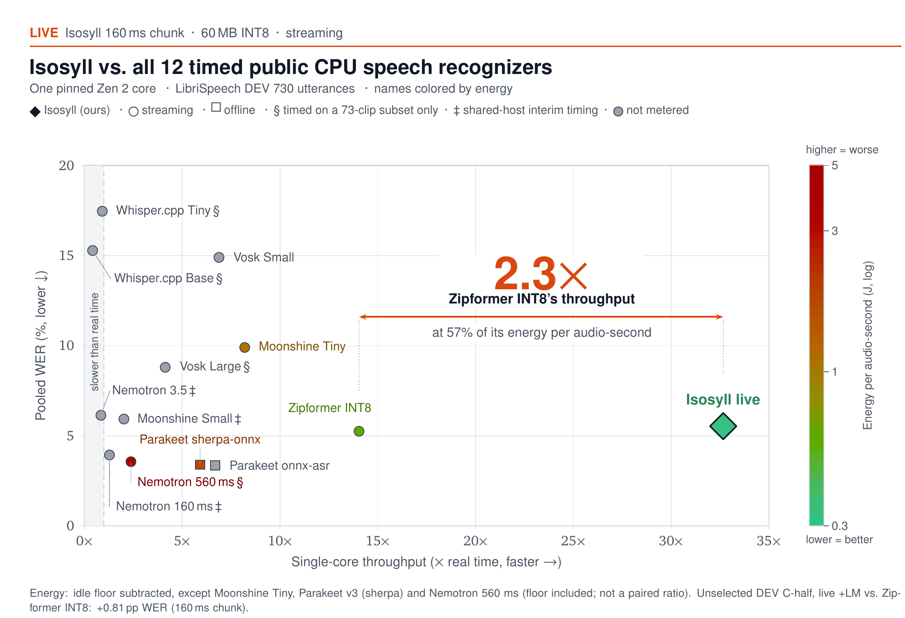

# Isosyll v4.0.0 — Technical & Architecture Brief

> **Download formatted 2-page PDF:** [**`isosyll-v4-cto-brief.pdf`**](isosyll-v4-cto-brief.pdf) *(publication layout with the power-colormap hero chart, bit-exact engine deep dive and directional heat-map comparison table)*

**A Bit-Exact Streaming Speech Recognizer in One Pure-Rust Binary**



## 1. Executive Technical Summary

- **One binary:** `isosyll` v4.0.0 is a ~1.6 MB Rust executable with no Python, PyTorch, ONNX Runtime or BLAS, for Linux x86-64 (glibc primary + static musl fallback), Linux arm64 and Apple-silicon macOS. The model is a 60 MB INT8 safetensors file plus compact n-gram LMs (~207 MB download).
- **Streaming live (160 ms, +LM):** 32.7× real time on one Zen 2 core (3.1% of the core), 5.54% pooled WER, 109 MB peak RSS, 0.328 J idle-subtracted core energy per audio-second.
- **Paired head-to-head vs. Zipformer INT8:** 2.33× throughput at 57% of its core energy and 72% of its memory, timed side by side in the same interleaved blocks on the same core (panel WER delta +0.28 pp, bounds −0.02 to +0.58).
- **Optional utterance-end commit pass:** reuses the exact same 60 MB weights (640 ms chunks, beam-16 + 5-gram LODR) to reach 5.00% WER at 16.8× (paired delta −0.26 pp vs. Zipformer, bounds −0.57 to +0.05; 0.661 J/s, 387 MB RSS).
- **Bit-exact:** byte-identical transcripts to the signed reference decoders on all 730 panel utterances on x86-64 and Apple silicon (NEON).

## 2. Architecture & Integer-Exact Engine

- **Model:** dense 16-block streaming Conformer RNN-T ($d = 384$, 6 heads × 64 with RoPE, causal depthwise conv kernel 15, stateless 2-token predictor, 320-wide joiner, 500-token BPE + blank). 80-band log-mel at 100 Hz; causal conv stem subsamples ×4 to 25 Hz. Streams 160 ms chunks (4 frames) with 128-frame left context and zero right context, fused with a compact live LM.
- **Per-row centred INT8:** weights quantise offline per output channel (`s_w = max|w| / 127`); activations quantise dynamically per frame row (`c = (x_max + x_min) / 2`, `s_a = (x_max − x_min) / 254`, round-half-even). Exact output recovery `y = s_a·s_w·Σ x_q·w_q + c·w̄ + b` (`w̄` precomputed) uses the full INT8 range for one-sided post-SiLU activations.
- **Exact integer kernels:** x86 AVX2 (`vpmaddubsw`), AVX-512 VNNI, ARM NEON (`sdot`/`smmla`) and a portable scalar reference. With `|x_q|, |w_q| ≤ 127`, pairwise products sum to at most 32,258 < 2¹⁵ (zero saturation), giving bit-exact int32 accumulation and batch invariance (verified batch sizes 1–32).
- **0-ULP portable front end & cross-ISA parity:** log-mel uses Cody–Waite reduction and polynomial sin/cos/log in unfused IEEE double arithmetic. 18 witness decodes on Intel AVX2, AVX-512 VNNI and Apple M3 NEON reproduce Zen 2 transcripts on all 730 panel utterances; forced scalar gives 0/730 differing live transcripts. Weights are SHA-256 verified at load.

## 3. Full Measured Comparison (730-Utterance LibriSpeech DEV Panel)

*One Rust scorer and normaliser for every system; 730 utterances (87.7 min; 400 dev-clean, 330 dev-other, every DEV speaker). Speed: median of 3 cold runs on 1 pinned Zen 2 core, model load included. Showing our single fastest streaming model against public rivals.*

| Recognizer (class) | Speed (× RT) ↑ | Core ↓ | Clean ↓ | Other ↓ | Pooled ↓ | Peak RSS ↓ | Model ↓ | Core J/s ↓ |
| --- | ---: | ---: | ---: | ---: | ---: | ---: | ---: | ---: |
| **Isosyll** (streaming, 160 ms) | **32.7×** | **3.1%** | 3.20% | 8.88% | **5.54%** | **109 MB** | 60 MB | **0.328\*** |
| Zipformer INT8 (streaming) | 14.0× | 7.1% | 3.03% | 8.43% | 5.25% | 152 MB | 73 MB | 0.573\* |
| Moonshine Tiny (streaming) | 8.2× | 12.2% | 6.54% | 14.72% | 9.90% | 201 MB | 45 MB | — |
| Vosk Small (streaming) | 6.9× | 14.5% | 10.74% | 20.86% | 14.90% | 257 MB | 71 MB | — |
| Vosk Large§ (streaming) | 4.1× | 24.2% | 5.97% | 12.85% | 8.80% | 7629 MB | 2866 MB | — |
| Nemotron 0.6B, 560 ms§ (streaming) | 2.4× | 42.0% | 2.61% | 4.93% | 3.56% | 987 MB | 700 MB | — |
| Parakeet TDT v3, onnx-asr (offline) | 6.7× | 15.0% | 2.52% | 4.58% | 3.36% | 1684 MB | 670 MB | — |
| Whisper.cpp Tiny§ (streaming) | 0.9× | 109.5% | 14.51% | 21.68% | 17.46% | 226 MB | 78 MB | — |
| Whisper.cpp Base§ (streaming) | 0.4× | 239.6% | 12.47% | 19.31% | 15.28% | 339 MB | 148 MB | — |

*\* Timed in the same interleaved R6 blocks; idle-subtracted CPU-core energy (not wall power). § Speed timed on a 73-utterance subset; WER on all 730. "Core" is CPU-seconds per audio-second. Optional commit pass on the same 60 MB weights: 16.8× RT, 5.00% WER (3.03 / 7.80), 387 MB RSS, 0.661 J/s. Unselected DEV C half (2,785 utt.): live trails Zipformer by +0.81 pp [+0.62, +1.02]. Receipts: [`docs/paper/data/metrics.tex`](../paper/data/metrics.tex), [`cold_dev.csv`](../paper/data/cold_dev.csv).*

## 4. Deployment, Supply Chain & Hardware Power Context

- **Targets:** Linux x86-64 (glibc primary + static musl fallback), Linux arm64, Apple-silicon macOS; AVX2, AVX-512 VNNI, NEON and scalar kernels.
- **CPU vs. GPU hardware power context:** All 12 comparators in Figure 1 ran on one CPU core; every joule figure in this brief is CPU-core energy from that setup. In production, 0.6B-class models such as Nemotron and Parakeet are often hosted on GPUs; published board TDPs run from 70 W (NVIDIA T4) to 250 W (NVIDIA A100 PCIe). Those are vendor datasheet figures, not measured here, and are not comparable to the CPU-core numbers above.
- **Signed release:** `SHA256SUMS` signed with the project SSH key; the installer verifies signature and checksums before installing.

```sh
curl -fsSL https://github.com/neverhuman/jsr/releases/latest/download/install.sh | sh
isosyll transcribe --mode live meeting.wav
isosyll transcribe meeting.wav
```

## 5. Hard Technical Limits & Open Frontier

> - **Exploratory, DEV only:** Isosyll v4.0.0 missed its pre-registered accuracy gates and ships by owner decision. No test-set results are claimed; LibriSpeech test sets were read before the benchmark freeze.
> - **In-domain read English:** LibriSpeech DEV is in-domain for both Isosyll and Zipformer; conversational, accented or noisy speech may rank differently.
> - **Live accuracy gap:** +0.81 pp behind Zipformer on the unselected half; error analysis points to acoustic discrimination of common words on hard audio, and the next lever is fresh audio and capacity.
> - **Optional commit-pass cost:** enabling the utterance-end commit pass reaches 5.00% WER (16.8×) at 115% of Zipformer's core energy and 387 MB RSS.
> - **Scope of claims:** Measured energy is CPU-core RAPL only (no wall power); GPU TDP numbers are published specs, not benchmark runs; no latency figures are claimed.

**Read next:** [CEO Executive Brief](ceo-brief.md) · [Paper (PDF)](../paper/paper.pdf) · [Measurement Data](../paper/data/) · [Release Records](../ultra/releases/) · [Install Guide](../install.md)
