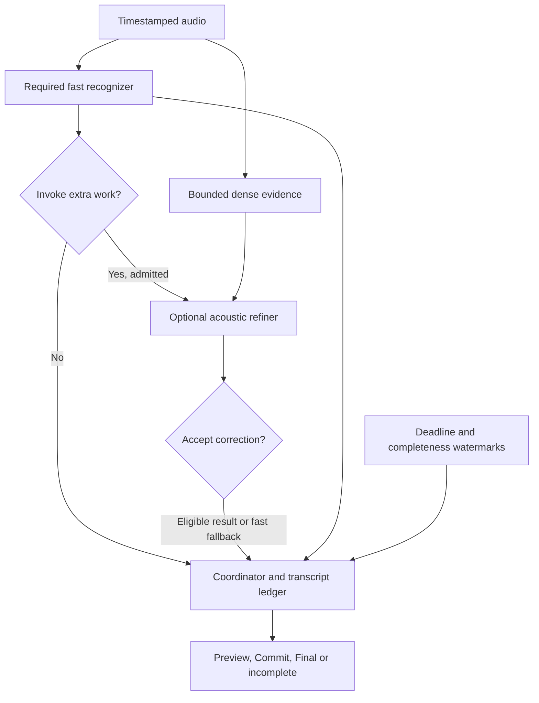
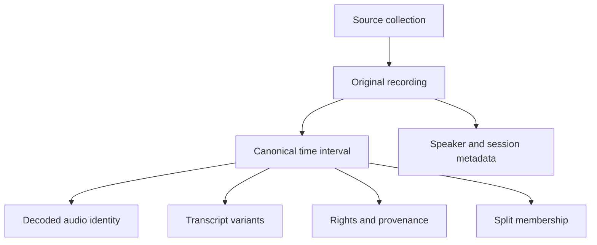

# ULTRA ASR

## Master engineering specification for high-throughput, accurate English speech recognition on CPUs

**Version:** 1.0 — November 20, 2026  
**Prepared for:** Jepson Taylor  
**Status:** Independently reviewed engineering plan; no custom ASR model has been trained or benchmarked in this review  
**Scope:** Five attached plans, a common 100-point audit, the resulting synthesis, and a complete agent takeover contract  
**Meaning of ULTRA:** This project's working specification name; it is not a claim of measured superiority.

---

## Executive decision

Build the best measured CPU recognizer at explicit accuracy and latency operating points. Preserve that working recognizer while testing improvements. The objective is a reproducible accuracy/cost frontier and a useful product, not a requirement that the original custom architecture must win.

The strongest implementation path has three stages:

1. **Deploy and measure.** Integrate two existing CPU recognizers, establish honest live/file/concurrent measurements, and package a usable local baseline. Add the remaining serious competitors through a bounded tournament.
2. **Improve the current winner.** Optimize scheduling, thread use, quantization calibration, decoder settings, domain data, and optional acoustic refinement. Keep improvements that survive complete-system evaluation.
3. **Build a student only where it has a credible advantage.** Reproduce a maintained streaming recipe, compare native multirate and dense controls, then investigate a compact shared acoustic backbone with optional, independently gated computation. Avoid making a new DSL, all-integer frontend, ternary kernels, sparse experts, or online self-training prerequisites.

The principal research hypothesis is **selective additional acoustic computation with preserved evidence**. A fast path produces useful text. A first controller decides whether additional computation is worth attempting under a real deadline. A second controller decides whether its resulting transcript should replace the mutable suffix. A dense feature/audio buffer preserves information that a sparse path may have missed. Both decisions are learned and evaluated on actual repairs, newly introduced errors, cost, and deadline behavior.

The strongest CPU hypothesis is **reducing expensive work without losing the decoder's time structure**, combined with supported mixed precision and deadline-aware batching. Fixed multirate encoders are the first control. Selective upper-layer work and restored dense output positions are later experiments. No frame-rate target, bit width, or parameter count is treated as an accuracy guarantee.

### Final scores under one rubric

| Plan | Score / 100 | Judgment |
|---|---:|---|
| CADENCE-CPU v2, the previous specification | **82** | Best supplied execution foundation; prior 88 was too generous about several operational contracts |
| KAIROS v0.2 | **70** | Strong project organization with significant inference, state, and numerical defects |
| TACTUS v1.0 | **67** | Better supplied microbenchmark evidence and useful batching ideas, but serious streaming and adaptation contradictions |
| Original APEX-ASR / CADENCE | **61** | Promising directions coupled to incorrect guarantees and incomplete cost/state models |
| Prior audit and synthesis scorecard | **43** | Useful questions; overconfident conclusions and incomplete whole-project coverage |
| **This ULTRA specification** | **89** | More concrete and internally consistent; actual hardware, model, training, and confirmation results remain unproved |

These are scores for the engineering basis of the project. They are not word accuracy, benchmark WER, or probabilities of success. Differences of a few points should not be overinterpreted. A longer document does not receive extra credit merely for length.

### Why the previous 88 becomes 82

The previous specification correctly rejected many unsupported claims. A fresh review still found gaps that matter to an implementing agent: a causal finalization deadline, latency acceptance that includes missing words, a practical confirmation/power budget, aggregate memory accounting, normative Commit/Final payloads, and an unambiguous two-adapter critical path. Section 7 itemizes the six-point correction; Section 41 explains why ULTRA earns seven points back without claiming that its hypotheses already work.

### What is materially better in ULTRA

| Change | Practical consequence |
|---|---|
| Reference evaluation clocks separated from runtime-observable clocks | The scheduler does not need the true end of speech to know whether a job can still finish |
| Correct-word coverage by deadline, alongside conditional latency | A system cannot look fast by omitting difficult words from its latency denominator |
| Separate invoke and accept controllers | Spending extra compute does not automatically authorize a transcript replacement |
| Dense evidence retention and a multirate control | Compression does not become the only acoustic evidence available to the correction path |
| Finite-batch, deadline-aware CPU scheduling | Throughput claims include actual queueing, padding, attention, and per-stream state |
| Fully specified transcript events and aggregate resource limits | Adapters can be implemented and tested without guessing client-visible semantics |
| Development screening separated from limited formal confirmation | The project does not require a new expensive holdout for every small experiment |
| Tail/transition-aware quantization calibration as a bounded arm | Accuracy at a fixed CPU format can improve before inventing a new model family |

### Reading routes

| Need | Sections |
|---|---|
| All scores, feedback, and source identities | 1–8 |
| Product targets, hardware, baselines, metrics, scheduling | 9–15 |
| Student, refinement, reduction, quantization, optional research | 16–23 |
| Data, labels, training, compute, storage, privacy | 24–28 |
| Evaluation, uncertainty, experiment decisions | 29–31 |
| API, packaging, work packages, first ten days, takeover prompt | 32–40 |
| Fair self-score, evidence, final recommendation | 41–43 |

**Agent entry point:** read Section 40, then execute P00 and P01. The first release does not depend on training a new acoustic model.

---

# Part I — Independent audits and synthesis

## 1. Review scope and evidence

All five attached plans were studied. The three legacy files and CADENCE-CPU v2 match their previous supplied versions byte for byte. TACTUS is the new substantive input. No plan is given credit for a self-score or for a reviewer's confidence alone.

| ID | Supplied filename | SHA-256 |
|---|---|---|
| P-K | KAIROS_V2_MASTER_PLAN(1).md | fe461512969186758ffb7c7ee7f17698254f15c16ccc6f84ad2bbd461a55bffd |
| P-A | apex_asr_codename_cadence_master_engineering_specification(1).md | 1b63962e547a8ece224cfe5df1c6c1cf31cc0e34436d84adbe9024cefbc23d4f |
| P-T | TACTUS_ASR_MASTER_PLAN.md | 6afebe0e05c9ae846465d4d384c425e7829b3f3b009e689cf93b16ebb59b6a01 |
| P-C | CADENCE_CPU_V2_MASTER_ENGINEERING_SPEC(1).md | dbd4bb37c2d62ceab04f8ebd2b53c6606283d2a244a705dbb81da9d4a71184f1 |
| P-R | asr_proposal_rubric_technical_audit_and_synthesis_scorecard(1).md | 17947ce764d702609894830ad0c3ffa3726e109fff225a57117bd58cacb0019d |

The earlier pretrained survey and LibriSpeech recommendation remain supporting context. They are not silently counted as additional attached plans in this round. Historical KAIROS v0.1, TEMPO, test2.md, repository archives, and JopeDime research results mentioned inside these files were not supplied as original artifacts here. Their historical scores are not independently replicated or averaged into this audit.

The review checked document logic, source claims, sizing arithmetic, and TACTUS's supplied regression data. TACTUS includes C benchmark source and 48 raw rows; the regression fits and sizing output reproduce to the supplied precision. Its C benchmark was not rerun, and no actual ASR inference or training was performed. Consequently its timings remain proposal-reported measurements, not independently reproduced measurements on the user's CPU.

The prior context mentions an RTX 3090 with 24 GB memory. That is a useful planning envelope for the GPU training pilot, not a verified inventory of currently available resources. CPU inference hardware remains H0 until inspected.

### 1.1 Evidence labels

| Label | Meaning |
|---|---|
| VERIFIED-SOURCE | Checked against a primary source; publisher results remain publisher results |
| DOCUMENT-REPORTED | Supplied in a plan; underlying run or repository state has not been independently reproduced |
| DERIVED | Arithmetic or a consequence of stated assumptions |
| DESIGN | A requirement chosen in this specification |
| TARGET | Desired result; not a prediction or achievement |
| HYPOTHESIS | A mechanism whose value must be tested |
| MEASURED | Executed on identified hardware with model, code, data, and measurement receipts |

No architectural forecast receives MEASURED status because its formula can be evaluated. Source citations [S1]–[S35] resolve in Section 42; P-K/P-A/P-T/P-C/P-R refer to the supplied files above.

## 2. Detailed common rubric

The scoring weights favor correctness, CPU realism, evaluation, and deployability. Novelty is rewarded when it supplies a credible, testable route to the objective; novelty alone receives no separate bonus.

| ID | Dimension | Weight | What earns full credit |
|---|---|---:|---|
| R1 | Objective and tradeoff definition | 8 | Explicit hardware, accuracy, latency, memory, and concurrency objectives; clear Pareto selection rules |
| R2 | Mathematical and algorithmic correctness | 15 | Correct tensor dimensions, losses, numeric semantics, state transitions, and boundary behavior |
| R3 | CPU runtime realism | 15 | Real execution paths; full-system profiling; bandwidth/compute distinction; actual CPU accounting and quantization overhead |
| R4 | Accuracy, data, and training | 12 | Credible training or pretrained path; domain coverage; leakage control; feasible distillation and label quality |
| R5 | Streaming and output semantics | 10 | Explicit audio clocks, lookahead, commit/revision meaning, endpointing, backlog, and continuity |
| R6 | Evaluation and statistical rigor | 12 | Frozen manifests/scorer; paired comparisons; uncertainty; meaningful controls; independent confirmation |
| R7 | Implementation and agent handoff | 10 | Interfaces, configurations, dependency ordering, acceptance criteria, artifact contracts, and recovery |
| R8 | Resources and execution feasibility | 8 | Measured budgets; storage accounting; bounded scope; useful fallbacks; realistic sequencing |
| R9 | Evidence discipline | 6 | Primary sources; reproducible claims; clear distinction between facts, extrapolations, and targets |
| R10 | Privacy, licensing, and reproducibility | 4 | Separate code/weights/data rights, local audio lifecycle, exact versions, and traceable artifacts |
| | **Total** | **100** | |

Scoring anchors: approximately 90–100 is unusually complete and well supported; 75–89 is strong with important unvalidated elements; 60–74 is useful but needs material repair; 40–59 is partial or unreliable as a whole-project foundation; below 40 lacks much of the required engineering basis. These are judgment bands, not statistical confidence intervals. Differences of a few points should not be overinterpreted.

### 2.1 Complete score matrix

| Dimension | Max | KAIROS | APEX/CADENCE | TACTUS | CADENCE-CPU v2 | Prior scorecard | ULTRA |
|---|---:|---:|---:|---:|---:|---:|---:|
| R1 Objective | 8 | 7 | 7 | 7 | 8 | 5 | 8 |
| R2 Correctness | 15 | 9 | 6 | 7 | 13 | 5 | 13 |
| R3 CPU realism | 15 | 10 | 8 | 11 | 11 | 6 | 12 |
| R4 Accuracy/data/training | 12 | 8 | 8 | 8 | 10 | 6 | 10 |
| R5 Streaming | 10 | 6 | 6 | 5 | 8 | 4 | 9 |
| R6 Evaluation | 12 | 9 | 9 | 8 | 9 | 7 | 11 |
| R7 Agent handoff | 10 | 9 | 8 | 8 | 8 | 4 | 10 |
| R8 Resources | 8 | 5 | 4 | 5 | 6 | 2 | 7 |
| R9 Evidence | 6 | 4 | 2 | 5 | 5 | 2 | 5 |
| R10 Rights/privacy/reproduction | 4 | 3 | 3 | 3 | 4 | 2 | 4 |
| **Total** | **100** | **70** | **61** | **67** | **82** | **43** | **89** |

The same weights apply to every row, including this new plan. The prior scorecard is evaluated as a whole-project engineering basis, with its narrower role explicitly acknowledged. Its lower number does not imply that criticism is useless.

The three unchanged legacy scores are retained because no new evidence overturns their technical findings. TACTUS receives explicit credit for supplied raw benchmark/source material. The previous v2 score is revised for newly identified contract and execution gaps; those corrections are itemized in Section 7.

## 3. Audit: KAIROS v0.2 — 70/100

### 3.1 What it gets right

KAIROS is the strongest supplied operating manual. Its task graph, source/evidence tags, independent scorer, experiment verdicts, baseline census, mixed hardware profiling, and explicit fallback choices are worth retaining. It recognizes that desktop cache behavior must be tested with the small and large networks interleaved. It also distinguishes model-file size from at least some runtime state and attempts to correct earlier training-budget optimism.

Appendix A's main parameter and packed-image arithmetic reproduces: the L preset has 278,877,696 modeled parameters and approximately 95.09 MB of modeled packed weights. That is useful engineering, although it is not a measurement of process RSS or latency. Appendix B appropriately admits that its re-run used the same class of cloud hardware.

The confirmed-label adaptation policy is a better default than trusting a model to train itself indefinitely. The final-mode tower, text-conditioned experiments, compiler ideas, and small hardware-specific kernels are legitimate research options.

### 3.2 Material defects and required corrections

| Location in KAIROS | Finding | Consequence | Required repair |
|---|---|---|---|
| Sections 1.4, 4.4, 7.4 | CTC feasibility is not guaranteed by choosing a larger Cortex vocabulary or firing on predicted Reflex tokens | The recognizer can lack a valid alignment for the true transcript, especially repetitions and fast speech | Require enough dense positions for auxiliary CTC; use a conventional transducer for aggressive event compression; instrument invalid paths |
| Section 7.4 | Falling back to dense mode when there are fewer events than reference tokens uses information unavailable at inference | Training and deployment follow different policies | Use only runtime-observable triggers, and evaluate training-only diagnostic fallbacks separately |
| Sections 3.3, 4.8, 5.3 | Self-teaching modifies Reflex, whose outputs control event gating and Cortex inputs | Committed text can change despite the claimed isolation | Freeze the shared acoustic/gating path or make an explicitly separate display-only branch |
| Sections 4.10, 5.3 | The router changes Cortex LHUC multipliers but is said not to affect committed text | The claimed causal boundary is false | Model the router as part of the committed recognition path and test it accordingly |
| Sections 4.11, 7.4 | Per-event early exit skips upper-layer KV state updates | Returning to full depth sees missing history | Fix depth for an utterance or implement and account for a trained state/replay policy |
| Section 5.3 | The written softmax procedure subtracts the maximum and then clamps to a nonnegative range | Read literally, all differences become zero | Index an exponential table by max_score minus score, or retain signed nonpositive differences |
| Sections 5.1–5.3 | A7z has zero point 64, but the displayed linear operation omits zero-point correction | Dot products can acquire a systematic offset | Apply sum(w*a) minus 64*sum(w), including scale/bias and overflow rules |
| Section 4.6 | A large margin among shortlisted tokens is treated as a reason not to score omitted tokens | A missing correct token can coexist with a large shortlist margin | Keep a full-head reference; measure shortlist recall; require a valid bound for exact pruning |
| Section 2.2 | 27 ms times eight configured threads is called measured CPU consumption | Reserved parallel capacity is confused with CPU time actually used | Measure summed process/thread user+system CPU time, and report reserved threads separately |
| Section 4.1 / Appendix A | The L traffic table effectively accounts for Reflex at 6.25 Hz, while the architecture runs it at 12.5 Hz | Traffic is understated before other omitted costs | Regenerate costs from actual per-layer schedules, not one coarse “Reflex pass” |
| Sections 4.6, 7.10 | Final attention, activation retention, output heads, and adaptation are not fully represented in the headline model | End-to-end cost and finalization tails can exceed the projection | Count final passes, attention QK/AV, caches, heads, allocators, and workers |
| Sections 7.1, 8 | Headline corpus hours are added without a verified unique-audio union | Training scale, licensing effort, storage, and teacher cost may be overstated | Build a recording/segment provenance graph and count the deduplicated union |

For CTC, with U reference tokens and R adjacent identical-token pairs, a necessary condition is T >= U + R. Alignment restrictions can require still more usable positions. For example, two consecutive identical tokens need a separating blank. A predicted-token gate cannot guarantee coverage of an unrecognized word. This is a structural requirement, not a preference for one decoder family. See the original CTC formulation [S13].

The traffic discrepancy is visible from KAIROS's own numbers:

~~~text
Reported L traffic ≈ 69.1274 MB/event * 5 events/s
                   + 8.3072 MB/reflex-pass * 6.25 passes/s
                 ≈ 397.56 MB/s

Using the stated 12.5 Hz Reflex schedule:
                   69.1274 * 5 + 8.3072 * 12.5
                 ≈ 449.48 MB/s
~~~

This is a consistency check of its coarse accounting, not a corrected hardware-counter prediction.

### 3.3 Feedback

**Retain:** experiment governance, explicit task ownership, counter-based profiling, source tags, confirmed corrections, training-throughput pilot, and fallback matrices.

**Change:** decoder feasibility, adaptation dependency boundaries, numeric contracts, model-state accounting, CPU-cost measurement, and data union accounting.

**Defer:** the DSL, five target kernels, specialist router, text-event synthesis, and all custom integer DSP until a baseline and a small student demonstrate why those additions are needed.

**Why it is not 88:** implementation detail is valuable, but correctness defects occur on the normal inference path. A detailed task list cannot compensate for a state machine or loss that does not implement the stated behavior.

## 4. Audit: APEX-ASR / CADENCE v1 — 61/100

### 4.1 What it gets right

CADENCE identifies relevant opportunities: weight traffic, fewer expensive encoder steps, small always-on computation, low-bit weights, a later acoustic pass, and strict experiment controls. It improves on the pure event-CTC idea by choosing a transducer capable of emitting multiple tokens at one encoder position. Its A7 dot-product range bound is valid under the explicitly stated operand ranges.

The proposal also correctly wants the shipped runtime, not a floating-point surrogate, to determine the value of searched policies. Separate per-ISA kernel qualification and a bit-identical disabled-adapter path are useful concepts.

### 4.2 Material defects and required corrections

| Location in CADENCE | Finding | Why it matters |
|---|---|---|
| Sections 1, 2 | A two-point timing fit is treated as proof that CPU ASR is memory-bound | The arithmetic fits an affine model; it does not identify the source of the intercept or establish a universal bottleneck |
| Sections 1, 3.4 | More total MoE parameters are treated as a solution to accuracy capacity | Active compute, routing, training data, quantization, and expert specialization determine effective capacity |
| Section 3.3 | Pooling every frame is described as discarding no information | Weighted pooling is many-to-one and loses order and detail even when every frame contributes |
| Sections 3.4, 8.1 | Auxiliary CTC remains on the compressed event grid | Main-decoder TDT does not make the auxiliary CTC paths feasible |
| Section 3.5 | TDT is said to eliminate all duplication/drop and latency problems | It removes one structural count restriction; segmentation, decoding loops, duration carry, alignment errors, and information loss remain |
| Sections 3.5, 8.1 | FastEmit, restricted TDT, and cross-teacher posterior KL are combined without a full compatible loss definition | Teacher tokenization and transducer alignment lattices need a common support; coefficients alone do not define a valid objective |
| Section 3.6 | A 50.3M-parameter, 50-event Echo is projected below 25 ms at an 80 GMAC/s reference rate | The stated dense linear work alone is about 31.4 ms at that rate, before attention and decoding |
| Section 4.2 | Fourteen i16 LUT entries are described as fitting a 16-byte lookup table | Fourteen i16 values occupy 28 bytes; byte shuffles require a concrete low/high-byte or other implementation |
| Section 3.4 | Session-expert weights are said to remain pinned in L3 | Selection persistence does not reserve cache; the remaining model and concurrent streams can evict them |
| Section 5.1 | A d-by-32 low-rank output parameterization is described as a tiny solve | The displayed normal matrix is still d-by-d; at d=1024 its factorization and stats are substantial |
| Section 5.2 | The leave-fold-out formula indexes utterance blocks into a feature-space inverse | The dimensions are inconsistent; the proposed guard is not implementable as written |
| Section 5 | Lower hidden-state MSE is treated as a no-harm WER guarantee | A representation change can improve MSE and worsen token decisions; a frozen teacher can also be wrong |
| Section 5.1 | Bidirectional Echo is called a causal anchor | Its weights may be frozen, but its output depends on future audio within the utterance |
| Section 8.2 | A cross-Gram with floating-point reference activations is called exactly integer-associative | This holds only after both sides are represented on an explicitly fixed integer grid, with overflow bounded |
| Sections 4.3, 6.3 | Per-event early exit and changing second-plane masks are called easy or free runtime changes | Upper-layer state and untrained alternate precisions require separate compatibility/training proofs |
| Sections 7, 12 | Hundreds of thousands of headline hours and many independent inventions are packed into an aggressive schedule | The document does not establish the resources, uniqueness, label quality, or engineering capacity needed |

### 4.3 Correct leave-block-out identity

For ordinary ridge regression with fixed features X, fixed lambda > 0, and targets Y, with the relevant block system invertible:

~~~text
A = X^T X + lambda I
S = X A^-1 X^T                       # sample-by-sample smoother
Yhat = S Y
E = Y - Yhat

E_leave_block_B = (I - S_BB)^-1 E_B
~~~

For fixed diagonal weights W, perform the corresponding calculation on sqrt(W)X and sqrt(W)Y and map residuals back to the original target units. The block is a **sample block**. It is not a block of the feature-space inverse A^-1. The identity avoids refitting the entire ridge model under its assumptions; it is not constant-time, and the block solve still costs work.

Even the corrected identity estimates the selected regression loss. It does not prove ASR WER non-regression, validate pseudo-labels, or remove the selection bias from tuning lambda and eta on the same folds.

### 4.4 Feedback

**Retain:** mixed precision, full-system gates, explicit acoustic timing, transducer feasibility, future-context refinement as a hypothesis, disabled-mode parity, and the idea of profiling the exact shipped representation.

**Repair before any implementation:** the adaptation mathematics, LUT layout, output contract, TDT state transitions, auxiliary CTC placement, shortlist validation, and CPU accounting.

**Remove as mandatory architecture:** MoE, three teachers over the entire pool, 5 Hz event rate, all-integer DSP, self-label adaptation, and a new DSL.

**Why it is not 94.5:** the plan gives high confidence to several mechanisms whose costs are unmeasured and whose guarantees are incorrect. Its components may still be valuable after isolation and testing.

## 5. Audit: TACTUS v1.0 — 67/100

### 5.1 What it improves

TACTUS supplies the best raw microbenchmark material among the original custom-model proposals: the C source, 48 observations, regression fits, and executable sizing arithmetic. Its distinction between **weight passes** and **events per pass** is useful. A reduction in event count need not produce the same reduction in weight traffic. Cross-stream batching is therefore a serious direction rather than an incidental optimization.

The sizing output and 12,300 GPU-hour sum reproduce. The six supplied cost-law fits can be recomputed from the printed observations to rounding. This earns evidence credit. It does not turn a synthetic width-1024 matrix benchmark into a measurement of the full ASR stack.

The plan also improves explicit fallback sequencing, identifies a conventional frame-clock control, discloses several assumptions, acknowledges cross-machine comparisons, and gives many work packages concrete acceptance criteria.

### 5.2 Material findings

| ID | Location in TACTUS | Finding | Engineering consequence and repair |
|---|---|---|---|
| T01 | Sections 0.1, 3.5 | The mission says text within 160 ms, while the described path includes chunk collection, compute, and a later commit policy | Define word-end-to-output delay separately from chunk size; qualify the actual distribution |
| T02 | Section 3.5 | Commit is append-only and never revised, but Final explicitly replaces committed text | Choose an immutable ledger or editable previews; ULTRA defines both policies without contradiction |
| T03 | Section 9.4 | An empty-event chunk returns before the endpoint check | Endpoint timers must run on the audio/control clock, even when no expensive encoder work occurs |
| T04 | Sections 3.5, 7.2 | CTC operates on a sparse event grid; average pieces/second is used as reassurance | Check T >= U + adjacent repeats; keep auxiliary CTC on dense positions and measure repetitions/fast speech |
| T05 | Section 3.5 | Commit uses events since alignment without defining a deployable online alignment | Distinguish supervised forced alignments from hypothesis timestamps available at inference |
| T06 | Sections 3.3, 3.4, 5.3 | Pooling is described as discarding nothing; metadata says zero lookahead although events attend across their chunk | Pooling is lossy; record the complete dependency horizon and source-time positions |
| T07 | Sections 3.4, 3.8 | The adapted eager head is shared by intermediate self-conditioning | Adaptation changes Cortex states, which change Echo's input even when Echo weights are frozen |
| T08 | Sections 3.5, 3.8 | Echo uses the same transducer, while the commit head is adapted | Specify parameter ownership; a shared adapted head cannot be an untouched teacher |
| T09 | Section 3.8 | The ridge solution is d-by-V, but its column-vector application is written DeltaW*h | The application requires DeltaW-transpose*h, or an explicitly transposed storage convention |
| T10 | Section 3.8 | Rank <=128 and whole-utterance leave-out are asserted without their factorization/block solve | Specify the reduced coordinates, solver, block holdout, cost, and actual WER guard |
| T11 | Section 7.2 versus 7.3 | An event-budget loss is included while gradients through the hard gate are prohibited | Realized event count has no training gradient through that gate; use a declared surrogate or make it a search constraint |
| T12 | Sections 3.10, Appendix B | Echo is calculated separately but omitted from headline CPU-s/audio-s | Count all final passes and actual invocation rates in the product cost |
| T13 | Appendix B | One-event and three-event scenario formulas are labeled p50 and p99 | A scenario is not a measured quantile; label estimates and measure the event/service distribution |
| T14 | Sections 3.7, Appendix B | Streams/core removes fixed costs asymptotically | Finite batches still pay weight passes, padding, per-stream attention/state, queueing, and deadlines |
| T15 | Section 4 | Dot-product range bounds are presented as a nearly complete numeric contract | Also bound requantization products, residual scales, zero points, pooling, norms, and reductions |
| T16 | Sections 3.7, 7.3 | Live gate/grid/plane changes are assumed safe because settings were sampled by utterance | Train actual transition schedules or switch at safe boundaries; define cache migration/replay |
| T17 | Section 6.3 | Teacher agreement defines Gold while a wrong-label canary must be classified Reject at >=95% | A corrected teacher consensus can legitimately disagree with a poisoned label; separate label-error detection from audio rejection |
| T18 | Section 10.5 | A training null arm winning is called an instrument failure | Random variation can make a null win; investigate without selectively invalidating unfavorable results |
| T19 | Section 1.4 and Appendix C | The stated +0.10-point noninferiority margin becomes a +0.20 upper-bound allowance | Use one authoritative margin and apply the specified bound to PASS |
| T20 | Sections 6–8, 12–13 | Very large PCM pools, teachers, kernels, DSL, and cross-target parity precede a usable custom baseline | Separate a two-adapter product track from optional research and budget the unique data actually used |

These are normal-path implementation issues, not objections to researching low-bit speech models or event reduction.

### 5.3 Three particularly important corrections

**A frozen teacher's parameters do not isolate its inputs.** The actual dependency is Dossier -> eager head -> intermediate self-conditioning -> Cortex features -> Echo. This remains a feedback path even if the Echo tensor file never changes. A safe experimental teacher consumes an independently fixed representation or the original audio, and is evaluated against human references.

**A confidence interval must establish the claimed margin.** TACTUS's illustrative difference of +0.07 WER points with interval [+0.01, +0.13] does not establish noninferiority at +0.10. A lower observed point estimate is insufficient when the decision rule requires an upper bound below the margin. ULTRA stores the margin once and derives the decision from it.

**Threshold equality is part of the program.** If the related documents' strict step(a,c) = [a > c] convention applies, some expressions implement 400 ms instead of 320 ms and five-of-five instead of four-of-five. The actual repository was not available to verify that operator. This is a conditional finding. ULTRA requires tests immediately below, at, and above every integer threshold, rather than assuming either interpretation.

### 5.4 Score rationale and feedback

| Dimension | Score / max | Reason |
|---|---:|---|
| Objective | 7 / 8 | Concrete tiers, but incompatible latency meanings and inherited certainty |
| Correctness | 7 / 15 | Output, alignment, adaptation, gradient, and numeric-contract defects |
| CPU realism | 11 / 15 | Good supplied source/raw rows; incomplete whole-pipeline and finite-batch accounting |
| Accuracy/data/training | 8 / 12 | Conventional control and staged losses, but sparse CTC, label provenance, and scale assumptions remain |
| Streaming | 5 / 10 | Commit contradiction, event-dependent endpointing, and undefined online alignment |
| Evaluation | 8 / 12 | Useful paired controls and ledgers; margin mismatch and null-arm interpretation need repair |
| Agent handoff | 8 / 10 | Substantial tasks and source code; inherited repository assumptions and missing runtime semantics |
| Resources | 5 / 8 | Honest placeholder budgets, but large critical path and incomplete storage/fleet feasibility |
| Evidence | 5 / 6 | Strongest original microbenchmark disclosure; full model and target-host evidence absent |
| Rights/privacy/reproduction | 3 / 4 | Licenses and local profiles recognized; persistence and release details remain incomplete |
| **Total** | **67 / 100** | Original self-score: 86 under a different rubric |

**Retain:** weight-pass accounting, real-shape kernel experiments, deadline-aware multistream batching, same-checkpoint controls, raw measurement disclosure, and explicit fallback branches.

**Repair first:** output semantics, endpoint control flow, alignment observability, adaptation ownership, complete CPU accounting, and margin consistency.

**Defer:** a general GP speech language, four-target integer parity as a release prerequisite, full-pool triple-teacher generation, and live-changing numerical representations. These are independent options, not mandatory steps to the first useful recognizer.

## 6. Audit: prior scorecard — 43/100 as a whole-project engineering basis

The scorecard identifies several legitimate concerns: CTC alignment, AVX2 saturation, decode boundary behavior, and the need to distinguish estimates from results. It is useful as a hypothesis checklist.

Its central weakness is that it accepts its own synthesis as having repaired the weaknesses without demonstrating that the repair is correct. Examples include:

1. The claim that a 223M ternary network is necessarily too small to beat a 600M model. Parameter count alone cannot establish this.
2. Calling the Echo improvement of at least 0.5 WER points nearly free, without a measured model or complete cost calculation.
3. Treating a token-aligned event representation and text injection as having closed an acoustic-data gap.
4. Calling representation regression drift-proof or no-harm.
5. Claiming the design patches every bug despite the matrix and kernel-layout defects above.
6. Awarding nearly full marks for repository verification and measurements whose underlying artifacts are absent from this submission.

The original KAIROS and TEMPO scores differ substantially between the two supplied reviews. They are historical opinions under different rubrics, not additional independent measurements. Do not average them or treat the 94.5 score as a prior on expected WER.

**Recommended use:** preserve the list of concerns, replace the conclusions with explicit experiment requirements, and keep the neutral comparison rubric in Section 2.

This scorecard primarily discusses earlier KAIROS/TEMPO material. It is not treated as a direct audit of the supplied KAIROS v0.2. Its scores use a different, more novelty-oriented rubric.

## 7. Audit: CADENCE-CPU v2 — 82/100, revised from 88

### 7.1 What remains strong

This is still the best supplied foundation. It correctly separates a usable pretrained product from custom-model research, defines profile-specific Pareto selection, distinguishes publisher reports from measurements, preserves immutable text, accounts for all CPU workers, deduplicates data by recording identity, and gives agents substantive tasks and fallbacks.

It already specifies paired cluster bootstrap, dataset strata, separate training-seed uncertainty, multiplicity adjustment, fresh confirmation, inaccessible reference labels, and honest public-test limitations. It would be unfair to award ULTRA points for pretending those provisions were absent. It also already has lifecycle, FFI, gap recovery, and per-profile budgets.

The new deductions concern unresolved implementation choices and the feasibility of executing its stated protocol. They do not arise merely because no model was trained; that limitation applies equally to ULTRA.

### 7.2 Full score breakdown and correction

| Dimension | Max | Previous assessment | Fresh assessment | Reason for the change or remaining deduction |
|---|---:|---:|---:|---|
| R1 Objectives | 8 | 8 | 8 | Clear profile constraints and separate accuracy/efficiency goals |
| R2 Correctness | 15 | 13 | 13 | Conventional mathematics is sound; actual loss/export/state contracts still need executable checks |
| R3 CPU realism | 15 | 12 | 11 | No model-by-rate feasibility ledger; aggregate refiner/adapter memory and finite-batch costs are underdefined |
| R4 Accuracy/data/training | 12 | 10 | 10 | Strong data discipline; student recipe, useful refinement complementarity, and fresh-domain data remain unproved |
| R5 Streaming | 10 | 9 | 8 | No concrete runtime-observable finalization anchor; correct-word latency is not coupled to missing-word coverage |
| R6 Evaluation | 12 | 11 | 9 | Narrow margins and fresh confirmation per wave lack a power/label budget; checkpoint and training-method claims need sharper separation |
| R7 Agent handoff | 10 | 9 | 8 | Commit/Final payloads remain sketches; task dependencies conflict with the stated two-model first milestone |
| R8 Resources | 8 | 7 | 6 | Correct equations but no actionable small-job envelope or budget for independent confirmation labels |
| R9 Evidence | 6 | 5 | 5 | Good evidence labels; no new target-host or acoustic-model results |
| R10 Rights/privacy/reproduction | 4 | 4 | 4 | Complete written separation of rights and local-data behavior |
| **Total** | **100** | **88** | **82** | **Six points corrected under the same rubric** |

### 7.3 Detailed findings and ULTRA repairs

| ID | Prior section | Gap | Required change in ULTRA |
|---|---|---|---|
| C01 | 9.4, 12.4, 18.3 | Finalization slack is measured from reference speech end, but no causal runtime anchor is specified | Use a detector-derived evidence timestamp for admission; score separately against true reference EOS |
| C02 | 12.3–12.4 | Correct-word latency reports coverage but can still improve when hard words disappear | Add correct-and-stable coverage at fixed deadlines with every reference word in the denominator |
| C03 | 18 | Invoking a refiner is not explicitly separated from accepting its transcript | Train/evaluate pre-compute invocation and post-compute acceptance as different decisions |
| C04 | 17.2–17.3 | The proposed M student runs all 20 macaron blocks at 25 Hz | Compare supported 12.5 Hz/multirate controls and generate a rate-by-layer cost ledger before choosing shapes |
| C05 | 9.4, 12.1, 15.3 | A process RSS cap is ambiguous when adapters and refiners live in multiple processes | Apply one aggregate service budget and specify how shared pages are counted |
| C06 | 10.1, 29–31 | A +0.10-point margin and fresh confirmation for many waves may exhaust available independent labels | Use cheap development screening, power planning, and a small frozen release family |
| C07 | 30.5 | Fixed-checkpoint and repeatable training-method claims are not fully separated | State the claim unit; seed variation is required for a method claim, not replaced by speaker resampling |
| C08 | 13.2, 33.2 | Only Preview has a concrete example; Commit/Final bytes, revision preconditions, and duplicates are underdefined | Supply normative event variants and one transcript reconstruction function |
| C09 | 19.3–19.5 | A finite cache/replay window may be mistaken for sufficient history to reconstruct dense state | Require a compatible checkpoint, an explicit complete reset, or a labeled approximate recovery |
| C10 | 36–37 | P09 depends on optional adapters that the prose says should not block the first release | Split a two-adapter mini-tournament from catalog expansion |

**The deadline issue is operational, not cosmetic.** An implementation could otherwise wait 600 ms for an endpoint and then incorrectly grant itself another full 800 ms. Or a replay harness could accidentally use reference EOS to schedule work. ULTRA keeps evaluator labels out of the runtime and has an independent coordinator that finalizes at the causal cutoff.

**The statistical issue is affordability, not rejection of paired inference.** A 0.10-percentage-point margin can require much more independent data than a small pilot provides. ULTRA estimates uncertainty before committing to a confirmatory claim and does not spend a fresh holdout on every harmless runtime edit.

**The rate issue is a measured choice, not proof that the model is too large.** From v2's own approximation, 20 blocks at width 512 contain 120,586,240 main linear weights. At 25 Hz they perform about 3.015 billion linear MACs per audio-second before heads, attention, and the frontend. A 0.25 CPU-s/audio-s target would require about 12.06 effective GMAC/s during service for those terms alone. Some CPUs can support useful rates, but the actual shapes and runtime must establish that. Lower-rate/multirate controls deserve earlier consideration.

**A per-layer context cap is not the complete network's historical dependence.** Cached upper representations may already encode older lower-layer context. Replaying 5.12 seconds from an arbitrary empty cache is not generally an exact reconstruction of an always-dense run. The recovery mode must identify its starting state.

### 7.4 Feedback

Keep the main program, data discipline, evidence labels, and independent scorer. Make the product contracts executable before expanding the research menu. Spend the next engineering effort on rate-aware baselines, full event semantics, causal admission, useful correction opportunity, and an affordable evaluation protocol. Those are the changes ULTRA makes.

## 8. Synthesis of all scores and feedback

### 8.1 Keep, repair, defer

| Idea or practice | Source contribution | ULTRA decision | Where implemented |
|---|---|---|---|
| Independent scorer, same-weight controls, receipts, no-lift outcomes | KAIROS, TACTUS, v2 | Keep, with concise records proportional to the decision | 29–31, 36–40 |
| Weight-pass overhead separated from per-frame work | TACTUS | Keep as a measured per-shape model; no universal memory-bound claim | 15.1, 15.5 |
| Cross-stream batching | TACTUS | Keep with finite batches, deadline reservations, and independent state | 15.5 |
| Low-bit weights and mixed precision | All full plans | Keep supported INT8/INT4 controls; custom ternary must beat them | 20 |
| Fixed/multirate efficient encoder | v2 plus primary research | Move before novel event clocks in the student selection order | 17 |
| Sparse upper computation | KAIROS, APEX, TACTUS | Preserve dense lower evidence and optional dense output restoration; train actual state path | 19 |
| Later acoustic pass | APEX, TACTUS, v2 | Separate invocation from acceptance; spend compute only when expected useful and timely | 18 |
| CTC on a highly compressed event grid | Legacy plans | Remove from required architecture | 17.6, 19 |
| Committed text later replaced | Legacy plans | Remove; Preview stays editable, Commit/Final stay immutable | 13, 33 |
| Frozen-teacher/no-harm adaptation claims | Legacy plans | Remove; trace dependencies and evaluate future-session harm | 22 |
| All-integer DSP and four-target bit parity | KAIROS, TACTUS | Optional portable-exact lane; do not block best CPU quality/performance | 20.3–20.4 |
| Corpus-hour addition and teacher consensus as Gold | Legacy plans | Replace with unique-audio union and separate label provenance | 24–25 |
| Confirmation across research waves without an explicit screening/power budget | v2 | Make existing DEV screening concrete with evidence tiers and a limited formal release family | 30.3–30.9 |
| New DSL, MoE, text-event injection, broad GP search | Legacy plans | Defer until a measured bottleneck and working control justify the branch | 21–23 |
| Domain phrases and confirmed corrections | KAIROS, v2 | Keep optional, local, and separately scored | 22 |
| Lexical-tail/transition calibration | New primary-source review | Add a small actual-artifact PTQ experiment; no assumed ready implementation | 20.8 |

### 8.2 Research order

The order is: instrument -> two usable models -> actual bottleneck/error audit -> supported runtime/precision improvements -> complementary refinement assay -> compact recipe reproduction -> fixed multirate controls -> optional sparse upper work. Teacher scale, custom kernels, and policy search come after evidence that they address the remaining bottleneck.

A strong whole-file CPU model may win finalized dictation. A cache-aware compact model may win continuous captions. A batched configuration may win server throughput. Preserve these separate operating points rather than forcing one architecture to win every metric.

### 8.3 What this plan does not claim

There is no proven universal maximum-throughput/minimum-WER architecture, no mathematical no-harm guarantee from teacher agreement or regression, and no measured ULTRA WER. The contribution of this specification is a concrete system and research program that can discover, verify, and ship improvements while keeping a useful baseline available.

---

# Part II — Product contract and the measured baseline

## 9. Scope and priorities

### 9.1 Required scope

- English speech recognition on local CPUs.
- One live microphone stream as the first product workload.
- A separate completed-file throughput workload.
- A separate concurrent-stream capacity workload.
- Rust orchestration, streaming API, benchmark runner, and native integration.
- Reuse of C/C++/ONNX kernels where they deliver the best measured result.
- GPU training and teacher generation are allowed by this design; CPU-only applies to the deployed inference path and every CPU benchmark.
- Punctuation/capitalization and technical vocabulary support, with their costs and accuracy measured separately.
- Local operation without a network service at inference.

The immediate request does not require rewriting every inference kernel in Rust. A pure Rust implementation can be an additional backend, but language purity must not silently replace the stated accuracy and CPU-performance objective.

### 9.2 Excluded from the first release

Multilingual recognition, speaker identification, speaker diarization, translation, generative summarization, automatic cloud training, and a general audio DSL are outside the critical path. Overlapping speakers remain a diagnostic slice; no claim of robust multi-speaker transcription is made without a suitable model and evaluation.

### 9.3 Hardware profiles

Do not invent the owner's CPU. The first runnable task records the actual deployment machine and binds H0.

| Profile | Purpose | Required inventory | Initial sweep |
|---|---|---|---|
| H0 | Actual deployment CPU; primary selection | Exact CPU/SoC, physical/SMT cores, RAM, cache topology, OS, governor/power mode, ISA, thermal state | 1, 2, and 4 physical performance cores where present |
| H1 | Portable x86 | AVX2 without reliance on AVX-512 | Same 1/2/4 sweep |
| H2 | High-throughput x86 | VNNI/AVX-512 only if the machine actually supports it | One core, one cache domain, then whole socket |
| H3 | Arm desktop/laptop | NEON and actual dot-product capability; CPU backend verified | 1/2/4 performance cores where available |
| H4 | Small Arm device | Raspberry Pi-class or another explicitly identified device | 1/2/4 cores; sustained thermal measurement |

Missing hardware is marked UNTESTED. It does not prevent work on available hardware and does not justify extrapolated measurements.

### 9.4 Three operating profiles

These are provisional engineering targets. Bind them to H0 before the confirmatory evaluation. If a target is infeasible, retain the measured frontier and record the miss rather than redefining success after seeing the sealed test.

| Profile | User experience | Main constraint | Initial target |
|---|---|---|---|
| LIVE | Captions or an interactive transcript | Low delay and bounded backlog | At most four total physical inference cores and <=1.0 CPU-s/audio-s; correct first partial p95 <=500 ms from first reference-word end; stable-word delay p95 <=750 ms; finalization p95 <=800 ms after speech ends |
| EFFICIENT | Coexists with other desktop work | Minimum CPU cost at accepted WER | One inference core preferred; target <=0.25 CPU-s/audio-s; stable-word delay p95 <=2.0 s; finalization p95 <=1.5 s; no accumulating backlog |
| ACCURATE | Best finalized dictation or file transcript | Lowest WER under a larger budget | Up to four total physical inference cores for live use; target <=1.0 CPU-s/audio-s; stable-word delay p95 <=1.5 s and finalization p95 <=1.5 s; completed-file mode reported separately |

Shared initial limits: aggregate service resident footprint <=1.5 GiB for a pretrained baseline under Section 15.3, no silent dropped audio, bounded buffers, and no GPU/NPU execution. The <=512 MiB compact-student target covers the entire deployed student service, including any refiner. CQ noninferiority from Section 12.6 is also required. These are initial targets, not measurements.

An additional **COMMIT** policy is available for applications that act on text before an utterance ends. Its irreversible words are scored independently. It may have a different WER/latency tradeoff from editable dictation.

No model is advertised as meeting these targets until measured.

## 10. Define the optimization problem precisely

For an exact candidate configuration m, hardware h, output policy p and workload w, collect:

~~~text
W_domain(m,p)   = normalized WER on the specified fresh target-domain set
W_public(m,p)   = fixed macro average across the declared public datasets
W_critical     = declared name/number/negation/technical-term error metrics
C_cpu(m,h,w)   = whole-service user+system CPU seconds / input audio seconds
L_stable       = conditional p95 correct-word-end to stable-output delay
CQ(D)          = correctly stable reference words by deadline D / ALL reference words
L_final        = p95 reference-speech-end to Final delay
M_peak         = peak aggregate service resident footprint under Section 15.3
N_slo(m,h,w)   = greatest tested concurrent-stream count meeting all profile gates
E_audio        = joules/audio-second, only where directly measured reliably
~~~

The efficient configuration minimizes C_cpu subject to accepted quality, CQ, conditional latency, memory, backlog, and backend restrictions. The accuracy configuration minimizes W_domain within its declared CPU/memory/deadline budget and critical-slice guards. File mode and live mode are separate operating points. A configuration may dominate one workload and lose another.

Report public and domain quality separately. For a broad public claim, the stated public protocol must support it; for the actual microphone product, fresh domain performance is primary. Do not create an arbitrary scalar that trades an extra wrong number against a millisecond without an explicit product decision.

Choose each profile's initial quality reference as the most accurate first-wave candidate satisfying that profile on DEV; break a practical tie by lower measured CPU cost. Freeze the full reference before confirmation. If none is feasible, report the missed target and the measured frontier. Do not redefine the reference on the sealed results.

### 10.1 Initial promotion rules

These are design choices to bind before confirmation, not literature constants. Section 30 specifies evidence tiers, claim units and multiplicity. An exploratory result is not a confirmed pass.

| Claim | Initial practical improvement | Quality/statistical requirement | Other requirements |
|---|---|---|---|
| Quality-preserving runtime speed | At least 10% lower whole-service CPU cost | Appropriate E1 equivalence evidence, or E3 WER noninferiority: upper bound on treatment minus reference WER <= +0.10 percentage points | CQ noninferiority, profile latency/memory/backlog and critical guards |
| Accuracy improvement at a comparable cost | At least 3% observed relative WER reduction | Adjusted one-sided upper bound on WER difference < 0 | Added CPU <=15% and still within profile; CQ and critical guards |
| Research compression | At least 15% lower whole-service CPU cost | Same WER noninferiority rule | Actual export, all routing/packing/replay overhead, CQ and profile gates |
| ACCURATE frontier point | Lowest confirmed WER at the separate declared budget | Evidence for the stated comparison, without pretending it is equal-cost | Full CPU/latency/memory budget disclosed |
| Operational release | Useful, reproducible profile-compliant recognizer | Meets the declared quality rule for its qualification scope | All applicable release gates; no requirement to beat a publisher headline |

The statistical bound uses the family-adjusted level from Section 30, not an unadjusted 95% bound after testing many candidates. A significant decrease with a 3% observed relative reduction does not establish that the population improvement is at least 3%; that stronger claim requires a bound on that margin.

For selective refinement, use Section 18's explicit alternatives: a useful accuracy gain within the <=15% extra-CPU envelope, or preservation of always-refine quality with a material CPU saving. Both remain subject to profile, CQ and critical-slice gates.

Initial CQ noninferiority allows at most 0.5 percentage points degradation at the profile's primary D. Critical-slice endpoints and margins are bound after the pilot identifies realistic sample support, before confirmatory access. Unsupported slices are disclosed, not declared safe. Do not loosen a margin after observing an unfavorable result.

A change from 8.0% to 7.6% WER is -0.4 percentage points and a 5% relative reduction. Report both. INCONCLUSIVE remains the outcome when data cannot resolve the stated margin. More evaluation audio does not remove training-seed variation; checkpoint and method claims are different.

## 11. Candidate catalog and admission process

### 11.1 Candidate catalog; first wave selects two

Every row is a family of exact configurations, not a universal rank. Begin with one supported quality baseline and one contrasting compact candidate under P04/P05. The remaining catalog is optional expansion, not a release prerequisite.

| Candidate | Role | Initial settings to test | Qualification |
|---|---|---|---|
| Nemotron Speech Streaming EN 0.6B / NeMo-Speech.cpp | Cache-aware quality reference | English checkpoint; Q8_0; supported 160 and 560 ms streaming configurations; CPU forced | Published CPU figures and model-card WER come from different evaluations [S1, S2] |
| Moonshine v2 Small and Medium | Compact streaming alternatives | Shipped quantized runtime; actual partial-update policy; CPU forced | Evaluate deployed streaming, not the floating-point whole-utterance headline [S3] |
| One streaming Zipformer via sherpa-onnx | Small native baseline and reproducible training reference | Pin exact checkpoint, tokenization, training corpus and chunk context | “Zipformer” without a checkpoint is not a reproducible candidate [S8, S14] |
| FUTO ASR4ALL Medium/Large | Efficiency-oriented alternatives | Short/default and higher-context tiers; correction component both counted and ablated | Different latency tiers and custom weight terms must remain visible [S7] |
| Phonon-2.5 English | Low-bit finalized-transcript challenger | CPU file mode; bounded live wrapper; optional final pass | Its published seven-set WER is not directly comparable to an eight-set streaming score [S5] |
| Granite Speech 5.0 TurboCTC | Finalized-transcript and CTC throughput challenger | Checkpoint explicitly supported by the tested runtime | Do not pair an older runtime speed result with a newer checkpoint's WER [S6] |
| Parakeet Unified EN 0.6B | Higher-context streaming challenger | Supported 320/560 ms operating points, with true buffer accounting | Current documented pipeline recomputes left context [S4] |
| Parakeet Redux | Existing ternary CPU baseline | Packed CPU runtime; file and bounded live modes separately | Strong file performance does not establish immediate streaming; noise degradation needs testing [S15] |

Whisper small.en INT8 is a useful ecosystem control if resources permit. Parakeet EOU 120M is a useful endpointing control if its supported runtime integrates easily. These should not delay the initial two-candidate comparison. Earlybird is an optional compact early-output research control if its current code/runtime is practical; its reported early predictions must be evaluated with revisions, insertions, CQ and final WER, not latency alone [S31].

The catalog is refreshed once at project kickoff and then frozen for a comparison round. New releases enter a later round; the project must not chase moving model cards indefinitely.

### 11.2 Pin the complete candidate, not just its model name

~~~yaml
schema: ultra.candidate.v1
candidate_id: nemotron_en_q8_live_160
model:
  repository: nvidia/nemotron-speech-streaming-en-0.6b
  revision: REQUIRED_RESOLVED_IMMUTABLE_REVISION
  artifact_sha256: REQUIRED
  tokenizer_sha256: REQUIRED
runtime:
  repository: https://github.com/NVIDIA/NeMo-Speech.cpp
  commit: REQUIRED
  compiler_and_flags: REQUIRED
  backend: cpu
  quantization: Q8_0
  runtime_options_sha256: REQUIRED
stream:
  requested_chunk_ms: 160
  actual_right_context_ms: REQUIRED_FROM_RUNTIME
  left_context_policy: REQUIRED
  revision_policy: editable_until_final
  endpoint_policy_id: REQUIRED
resources:
  intra_op_threads: 1
  inter_op_threads: 1
  affinity: REQUIRED
licenses:
  code_id: REQUIRED
  weights_id: REQUIRED
  distribution_status: internal_evaluation_only_until_resolved
~~~

The schema contains intentional REQUIRED fields. An executable run refuses unresolved values. This is a specification template, not a fabricated lockfile.

### 11.3 Fair but realistic comparison

Run two views:

1. **Controlled recognition view:** common audio, identical reference normalization, comparable context budgets, external segmentation where applicable, no personalization.
2. **Product view:** each runtime's best supported end-to-end path, including its VAD, endpointing, text formatting, and buffering, under the same user-facing deadlines.

A common wrapper must not unnecessarily cripple a native streaming model. Conversely, runtime-specific conveniences must not hide latency, hardware acceleration, discarded audio, or a second model.

## 12. Benchmark harness

### 12.1 Adapter boundary

Each backend implements the same logical operations:

- Load a pinned model and report effective backend/capabilities.
- Begin a stream with an explicit output policy.
- Accept timestamped PCM.
- Poll or deliver transcript events.
- Flush end of input.
- Export timing, CPU, memory, and configuration receipts.

Use process isolation for the first integrations. It simplifies incompatible dependencies and accounting. After selecting a winner, an in-process Rust/C ABI can reduce IPC costs if profiling justifies it.

The harness owns audio pacing, reference data, clocks, metrics, and scoring. Backends receive audio and explicitly allowed contextual vocabulary. They do not receive reference transcripts, test filenames containing text, or scoring labels.

### 12.2 Workloads

| Workload | Purpose | Method |
|---|---|---|
| Unpaced single file | Completed-audio throughput | Audio is available immediately; measure end-to-end wall time and CPU time |
| Paced single stream | User latency and backlog | Feed audio on its original timeline, normally in 10 or 20 ms capture packets |
| Paced concurrent streams | Capacity | Independent staggered streams; increase N until the declared SLO fails |
| Cold load | Startup cost | New process, separately record cached versus uncached file residency where controllable |
| Warm sustained stream | Long-term operation | At least one hour with speech, silence, speaker changes, and continuous segments |
| Coexistence | Tail latency under useful competing work | Fixed, recorded CPU/memory background workload; separate from uncontended benchmark |

Paced end-to-end elapsed time is approximately audio duration by construction. Do not report its reciprocal as inference throughput. Use unpaced throughput, per-job service times, CPU consumption, and paced deadlines for their distinct purposes.

### 12.3 Required measurements

For each run record:

- WER, substitutions, deletions, insertions, reference words, and utterance count.
- Per-domain WER and critical entity metrics.
- First correct partial delay, first-any-text delay, stable-word delay, and final-event delay.
- Correct-word timing coverage: how many reference words were matched and eligible for latency scoring.
- Commit errors and revision rate, with the selected output policy.
- CPU user+system time for the entire process tree, including refiners and background workers.
- Unpaced wall time, per-job compute p50/p95/p99, queue wait, and maximum backlog.
- Model load time, RSS, PSS when available, allocator high-water mark, model bytes on disk, expanded weights, and per-stream state.
- Effective backend, CPU affinity, all configured and observed worker threads.
- Cache/memory counters when available; do not infer DRAM bytes directly from parameter count.
- GPU/NPU activity checks appropriate to the platform; explicit CPU configuration is mandatory.

If the adapter cannot expose a metric reliably, mark it UNAVAILABLE. Do not fill it with a model-card number.

### 12.4 Latency accounting

Use sample indices for the audio clock and a monotonic clock for observed execution. Let a reference word end at sample e on a 16 kHz timeline:

~~~text
t_ref_end = stream_start_monotonic + e / 16000
word_delay = time_word_became_stable - t_ref_end
final_delay = final_event_time - reference_speech_end_time
backlog = oldest_unprocessed_audio_age_at_each_scheduler_tick
~~~

Reference timings come from human-checked alignments on the latency panel. Keep alignment uncertainty and its audit sample in the report. Words that are wrong or deleted cannot disappear from the quality assessment merely because only correct words have a meaningful match.

For editable dictation, “stable time” is a retrospective metric: the first appearance of the final matched word after which it is not revised. It is not a promise made to an application at that earlier instant. For COMMIT mode, use the actual irreversible Commit event.

Count all algorithmic future context, capture framing, model chunking, endpoint delay, decoder emission lag, queueing, IPC, and formatting. Do not add them twice if a runtime already reports an aggregate.

### 12.5 Repetitions and hardware discipline

Use a fixed warm-up policy, alternate candidate/baseline order in blocks, and collect at least five independent timing repetitions for finalists. Record host utilization, thermal state, frequency policy, power source, and process affinity. Use physical performance cores first; test SMT separately.

Keep uncontended and coexistence results separate. Qualifying a host must happen before inspecting which system won, so disqualification cannot selectively remove unfavorable runs.

Benchmark on the actual supported instruction set. Do not compile a portable AVX2 binary with host-native flags that silently introduce AVX-512 requirements.

### 12.6 Couple correctness to deadlines

Conditional latency over correctly recognized words remains useful, but it is not sufficient for PASS. A system can make that subset easier by deleting difficult words.

For each reference word i, let e_i be its human-checked acoustic end and s_i the observed time it became correctly stable under the selected output policy. A word never correctly produced receives no finite s_i. Define:

~~~text
CQ(D) = count(reference words correctly stable by e_i + D)
        / count(all reference words)
~~~

Deleted/substituted/never-stable words remain in the denominator and contribute zero. Report CQ at 250, 500, 750, and 1,500 ms descriptively, plus the profile-specific primary deadline. Report false insertions and final WER alongside CQ: a system cannot compensate for invented words by also emitting many correct ones.

For LIVE, use CQ at 750 ms as the initial primary deadline-quality endpoint; EFFICIENT uses 2,000 ms and ACCURATE live uses 1,500 ms. Initial noninferiority margin: 0.5 percentage points below the frozen profile reference. Bind this margin and its required sample support before confirmation. Critical-word deadline coverage is separately reported and becomes a formal gate only when preregistered with sufficient support.

Use a fixed final transcript/reference minimum-edit alignment and deterministic tie-breaking for repeated words. Map its matched word occurrences back through recorded revisions with a frozen alignment algorithm; ambiguous appearance times use the conservative later compatible time. Check the scorer on manually constructed repetitions, insertions, revisions, and moved words. Reference timing and retrospective stability never enter the runtime.

Editable-preview CQ uses retrospective stability. COMMIT CQ uses the actual irreversible event. These are different metrics and must have different labels. Negative delays are allowed for correct early predictions, but prediction revisions, false insertions, and final WER remain visible. Do not clamp negative observations to zero or call a confident prediction an irrevocable fact.

No infinite latency is assigned an arbitrary finite number. Also do not require finite p95 over an artificial distribution that assigns infinity to all ASR errors: a model above 5% error could never pass that construction. Report conditional latency, coverage-by-deadline, and final quality together.

### 12.7 Finalization coverage uses reference episodes

Measure completion against all independently annotated reference speech episodes in the latency panel, not only model-predicted endpoints. For each episode, map its source interval to the emitted ownership ledger. Its completion time is the earliest time by which successful Final events cover the required owned portions of the episode. Several legitimate forced segments may jointly cover one episode. A missing, incomplete, or never-finalized portion means the episode did not successfully complete; a false split remains a separate error metric.

Define FC(D) as the fraction of all reference episodes successfully finalized by reference EOS + D. Initial observed acceptance is FC(D) >=95% at the profile's finalization deadline, alongside the conditional finalization quantiles, sample support and uncertainty. If claiming a population SLO, require a preregistered lower confidence bound supporting that SLO; an observed fraction alone does not establish it. Never omit unmatched episodes to improve a final-delay percentile.

Required-path failures and unprocessed accepted audio are correctness defects at a qualified load, even when aggregate FC still passes. Explicit cancellation by the test driver is evaluated in a separate lifecycle test and is not inserted into a quality benchmark to excuse hard segments. Report both natural reference-EOS and forced-boundary/end-of-input timing; a system-controlled forced cut cannot redefine the natural-EOS denominator.

## 13. Output contract

“Committed” has one meaning here: **the recognizer will never change those bytes within the API stream**. Output policy and resource profile are separate axes. LIVE can use editable dictation or COMMIT; the benchmark must name both.

| Event | Meaning | Transcript effect |
|---|---|---|
| Preview | A new full snapshot of one open segment | Replaces only its mutable suffix |
| Commit | A snapshot with a longer immutable prefix | Appends newly immutable bytes once |
| Final | A final snapshot and successful segment closure | Commits the remaining suffix once |
| CorrectionSuggested | An optional alternative for a closed segment | No automatic transcript change or action |
| Gap | Missing/discontinuous input and incomplete segment closure | Preserves committed bytes; explicitly discards mutable text |
| SegmentIncomplete | Required processing could not successfully complete an owned interval | Preserves committed bytes; reports the unfinished interval and reason |
| Status | Lifecycle, backlog, degradation, endpoint, or configuration information | No text mutation |

Section 33 is normative for revision preconditions, byte offsets, retransmission, and lifecycle. Applications construct the irreversible transcript from newly committed byte ranges, not by concatenating whole event snapshots.

### 13.1 Editable dictation

Use Preview while speech is ongoing. A qualified refinement may replace only the mutable part of the open segment. Finalize the best eligible snapshot when an endpoint is accepted and the scheduled finalization rule requires completion. The coordinator enforces that rule independently of slow inference workers. A late worker cannot reopen a finalized segment.

The runtime estimates deadlines from available audio evidence; the evaluator measures against independently annotated speech ends. Section 18.6 defines this distinction. A missed or delayed endpoint remains a measured miss.

### 13.2 COMMIT mode

The streaming recognizer can commit an early prefix. Refinement must preserve its exact bytes and may alter only the suffix. The committed transcript, including errors that an offline pass could repair, is the transcript scored in this mode.

Start with a simple declared policy: greedy irreversible emission, or beam-prefix agreement with an age threshold. Compare the policies on actual committed WER and CQ(D). Stability and repeated agreement are evidence, not guarantees of correctness.

If a refiner cannot produce a valid continuation of the immutable prefix, reject that correction or emit a separate suggestion. Do not splice incompatible tokenizations using substring matching. Punctuation and inverse text normalization cannot rewrite an already committed number, name, space, or case choice.

### 13.3 Boundaries and continuous speech

Variable transport packets do not change the logical inference stride. The default editable segment has a 20-second soft cap and a 30-second hard cap, initially. Preserve native encoder/decoder continuity where supported. Prefer a suitable word or low-energy boundary near the soft cap; a hard forced cut has explicit ownership and completeness rules.

Maintain source sample intervals and context-versus-output ownership. A word crossing a cut is emitted once by the declared owner segment; context replay grants no additional ownership. If a backend cannot reliably localize a boundary token, keep its native segment/context policy within the memory limit and report that capability, rather than inventing accurate timestamps.

Word IDs in mutable previews are revision-local. Stable public ownership IDs are assigned only at Commit/Final, with a mapping to the actual emitted byte range. Attempting to preserve one word ID through arbitrary retokenization creates false continuity. Optional internal alignment IDs must not override the public revision contract.

Intersegment separators are explicit output bytes owned by the later segment. Clients concatenate committed byte ranges exactly; they do not add guessed spaces or silently remove duplicate strings. The scorer checks phrases that cross cuts, repetition at boundaries, punctuation, and continuous speech without silence.

## 14. Endpointing, VAD, and input handling

### 14.1 Audio contract

- Internal timebase: mono 16 kHz signed PCM, with a declared amplitude scaling.
- Accept supported capture rates such as 44.1/48 kHz through a stateful, anti-aliased resampler.
- Record channel conversion and resampler delay.
- Reject unsupported or malformed formats explicitly.
- Preserve monotonic sample counters across variable transport packets.
- Detect dropped/duplicated packets and clock discontinuities.
- Keep capture callbacks nonblocking; do no neural inference or disk I/O inside them.

The exact frontend required by a pretrained checkpoint is part of that candidate. Do not replace log-mel, normalization, padding, or centering without an accuracy experiment.

### 14.2 VAD policy

VAD is a scheduling hint, not a transcription oracle. Retain a 300 ms pre-roll buffer initially, and keep sufficient hangover to avoid clipping weak final consonants. Tune those values on development speech.

A conservative first implementation continuously advances the normal frontend/streaming state. A later silence-skip optimization may avoid model work only with a declared state policy and a matched WER test. A periodic heartbeat and explicit endpoint handling must not depend on perfect VAD confidence.

Test near-whispers, low gain, breathy speech, music, fans, keyboard noise, speech immediately after long silence, and a speaker who pauses in the middle of a name or number.

### 14.3 Endpoint policy

Start with explicit silence/EOU thresholds from the selected model/runtime. Sweep a small development grid rather than inventing a complicated controller.

Measure false splits, merged utterances, finalization delay, and lost first/last words. An EOU token is useful evidence but is not infallible. For long speech with no endpoint, the segment cap bounds memory and final-pass work. The coordinator runs endpoint/timer checks even when the acoustic path emits no selected event. Use the causal deadline rule in Section 18.6; reference speech ends are unavailable to the runtime.

## 15. CPU system design and scheduler

### 15.1 Use a measured cost model at actual shapes and rates

Generate an operator ledger from the exported graph. For every stage record tensor shapes, precision/packing, source-time rate, invocation counts, logical bytes, measured service time, and workspace. Include frontend, normalization, attention score/value products, decoder blank/nonblank calls, formatting, IPC, and every optional worker.

An explanatory lower-bound model is max(bytes/effective_bandwidth, work/effective_compute_rate). A useful empirical fit may separate dispatch/weight-pass overhead from per-position work. Neither identifies a universal bottleneck without counters and actual-layer evidence.

TACTUS's fixed-width sweep is a useful starting fixture. Extend it to the real projection shapes, sequence lengths, attention/cache sizes, decoder calls, and finite batches. Validate a cost model on held-out shapes/workloads, with its prediction error reported. If it is inaccurate, use measured lookup tables; do not block a usable recognizer merely because one affine law misses an R-squared threshold.

~~~text
linear_work_per_audio_second = sum_l(linear_MAC_per_position_l * positions_per_audio_second_l)
total_cost = measured_frontend + measured_encoder + measured_decoder
           + scheduling + copies + formatting + all_optional_work
~~~

Logical reads are not measured DRAM traffic. Cache residency, prepacking, tensor layout, CPU ISA, thread count, and batch shape determine actual behavior. Fixed intercepts can include unpacking and reductions as well as memory traffic.

### 15.2 Required work has priority; optional work needs admission

Use a bounded scheduler with three queues: control/capture bookkeeping, required streaming inference, and optional refinement. Capture callbacks copy or enqueue timestamped audio and return; they never perform inference, model loading, or disk writes.

Each required job carries its input interval, model/state epoch, readiness time, configured service deadline, and measured service bucket. Its runtime deadline is based on observable audio availability and the chosen pipeline budget; reference-word and reference-EOS clocks belong only to evaluation.

Start with one inference worker and no optional jobs. Sweep one, two, and four physical cores only after a working trace exists. Disable nested thread-pool oversubscription. The configured total includes frontend, decoder, refiner, correction, and runtime helper workers.

For optional jobs use Section 18.6's causal admission rule. Reserve a worker slot, memory, and actual CPU capacity. An average utilization below one does not imply that a burst of long finalization jobs can meet deadlines. If there is one core and a backend call cannot yield, only launch it when its qualified service bound fits before the next required work; otherwise skip it. With multiple cores, compare dedicated optional capacity with a shared pool under paced load.

The coordinator remains responsive even while an inference worker is inside a native call. It services endpoint timers, explicit end-of-input, cancellation, queue limits, and finalization every control tick, including silent/empty chunks.

### 15.3 Aggregate service memory

The memory limit applies to the complete ASR service: orchestrator, every model/decoder/refiner process, shared-memory segments, cached/prepacked weights, controller, retained audio/features, queues, and canceled-but-running jobs. Per-process RSS is diagnostic and is not the whole budget.

On systems with suitable accounting, use the contemporaneous sum of each service process's PSS as the aggregate proportional resident footprint. PSS already includes private pages: report private/unique resident memory separately and do not add it again. Also report per-process RSS and the measurement method. Shared mappings with external processes can change proportional attribution; record that condition and use the same method across candidates. Where PSS is unavailable, use a conservative summed-RSS bound and explicitly label double-counted shared pages. A cgroup/job memory peak is useful but its treatment of mapped/page-cache memory must be documented. Sampled peaks can miss short transients; combine them with allocator/workspace high-water marks where available.

Initial aggregate budget: 1.5 GiB for the pretrained service, 512 MiB for a compact student service. These are targets to bind on H0, not assertions that all listed models fit. A two-model cascade must pass the combined limit. Exceeding it disables that configuration; it does not silently waive the budget.

Report shared model cost, incremental per-stream state, and finite-batch workspace independently. Load/prepack warm-up is measured separately and contributes to cold-start memory. Never expand all low-bit weights to float and then report only the packed download size.

### 15.4 Overload and mode changes

The first overload policy is to reject optional work and preserve required streaming work. Next use only a prequalified cheaper operating mode at an explicitly compatible boundary. If input cannot be accepted, return a bounded Backpressure result or emit an explicit Gap for data actually lost.

No hot switch of depth, frame clock, precision, frontend, or vocabulary is assumed safe. A mode change needs the state contract in Section 19.5. Chunk boundaries alone do not erase previous KV, convolution, predictor, or normalization dependencies.

A permanent backlog, dropped accepted samples, increasing memory, or repeated deadline misses makes a profile infeasible. Do not report only the segments that happened to complete on time.

### 15.5 Finite-batch multistream execution

Batch only compatible operations: same model/precision/runtime graph, compatible context/mask shapes, and individually valid per-stream state. Share weights; never share acoustic or decoder state across users. Group ready work by compatibility and dispatch before the earliest job would lose its remaining service slack.

Initial batching wait cap: 5 ms, then a small development sweep including zero. The actual cap is the smaller of that setting and the earliest remaining qualified slack after service/dispatch guards. Padding, ragged packing, scatter/gather, decoder variability, cache transfers, and synchronization all count.

For batch size B, a planning model is:

~~~text
cost_per_stream(B) = (fixed_pass_cost + measured_batch_work(B)
                    + padding_state_scheduler_cost(B)) / B
~~~

Fixed cost never vanishes at a finite B. Attention still attends within each stream only. A common weight pass is possible for some linear operators, not a proof that the complete network needs one identical pass for every stream. Native runtime batching support is tested rather than inferred from matrix algebra.

Qualify with independent staggered audio streams, varied speech/silence ratios, short/long segments, asynchronous endpoints, and overload. Increase concurrency until the selected profile fails, then report the largest sustained passing N_slo. Include the failed neighboring load point. A compute-only asymptote is labeled as a bound/estimate, not stream capacity.

Integer kernels can support exact batching parity only when arithmetic, per-stream schedules, masks, tie rules, and state updates are also unchanged. The performance lane permits documented floating numerical differences and evaluates their actual output/quality effect. Cross-stream contamination is never permitted in either lane.

### 15.6 Cold start, thermal limits, and coexistence

Measure cold model load, first-audio startup, warm sustained service, and coexistence separately. Record CPU topology, SMT, NUMA placement, ISA, power source, thermal state, and frequency policy. Long tests must include endpoint/refinement bursts and background work representative of the intended deployment.

An AVX-512 server result does not qualify an AVX2 laptop or Arm CPU. Missing targets stay UNTESTED. A browser/WASM backend is a later deployment lane unless it is the actual H0 requirement.

# Part III — The research architecture

## 16. Two tracks with one selection process

### Track A: improve a deployed recognizer

Keep the measured pretrained winner continuously usable. Optimize its integration, graph execution, thread count, buffering, contextual vocabulary, and supported quantization. If its final transcripts need improvement, test a bounded acoustic second pass.

This track can produce the first useful release without any successful custom training.

### Track B: build a smaller student that earns deployment

Reproduce a supported cache-aware streaming recipe before changing its architecture. A streaming Zipformer recipe or a cache-aware Conformer/transducer recipe is an appropriate control [S14, S16].

The student must beat Track A at a declared operating point. Reproducing a good LibriSpeech result is an intermediate training milestone, not sufficient justification for deployment.

Distillation, data quality, mixed precision, and conditional compute are investigated in that order. Do not make the first student depend on a new loss, a new encoder clock, a new kernel format, and online adaptation simultaneously.

## 17. Reference student and rate-aware architecture selection

### 17.1 Reproduce a maintained recipe before defining a new family

The first student is a supported streaming Zipformer or cache-aware Conformer/transducer recipe with an existing CPU export path [S14, S16, S17]. Pin its optimizer, tokenizer, frontend, context mask, and decoder. A recipe's native 12.5 Hz or multirate execution is a first-class control.

Do not silently replace a pretrained model's frontend, subsampling, activation function, predictor, or positional encoding. Such changes are new trained configurations. A custom ULTRA student is warranted only if the reproduced recipe exposes a useful gap in quality, cost, memory, or integration.

### 17.2 Controlled architecture families

| Family | Purpose | Temporal schedule |
|---|---|---|
| NATIVE | Reproduced public recipe | Its supported dense/multirate schedule unchanged |
| DENSE | Simple custom comparison | Dense 25 Hz acoustic encoder; dense auxiliary CTC; RNN-T |
| MULTIRATE | First custom efficiency arm | Dense lower features, trained fixed 2x middle reduction, restored 25 Hz output with a skip connection |
| SELECTIVE | Later research | Dense lower/base path with selective expensive upper work and explicit source-time restoration |

Select NATIVE versus DENSE/MULTIRATE from actual H0 and development evidence. Do not run all sizes/families merely because a table lists them. SELECTIVE is Section 19 and is not part of the first student milestone.

### 17.3 Initial custom shapes

These are starting experimental shapes, not trained model claims.

| Item | S control | M primary capacity candidate | L only if a measured capacity gap remains |
|---|---:|---:|---:|
| Width | 384 | 512 | 640 |
| Total blocks | 16 | 20 | 24 |
| Attention heads / head width | 6 / 64 | 8 / 64 | 10 / 64 |
| FFN expansion | 4 | 4 | 4 |
| Causal depthwise kernel | 15 | 15 | 15 |
| DENSE block cadence | 25 Hz | 25 Hz | 25 Hz |
| MULTIRATE lower / middle / final blocks | 4 / 10 / 2 | 6 / 12 / 2 | 8 / 14 / 2 |
| MULTIRATE cadence | 25 / 12.5 / 25 Hz | Same | Same |
| Per-layer source-time cache ceiling | 5.12 s | Same | Same |
| Initial logical chunk choices | 80 and 160 ms, plus recipe-native modes | Same | Same |
| Additional lookahead experiment | None, then one explicitly bounded 80 ms arm | Same | Same |
| Decoder vocabulary | 4,096 learned pieces plus blank | Same | Same |
| Stateless predictor | Last two nonblank tokens, 256-d embeddings | Same | Same |
| Joiner width | 320 | 320 | 384 |
| Initial CPU format | Supported INT8; reference FP32 export | Same | Same |
| Approximate parameter envelope | 60–70M | 125–140M | 235–255M |

The exact tensor manifest is authoritative. A small recipe may be the better final product; M is a capacity candidate, not a default deployment entitlement.

### 17.4 Block, reduction, and restoration definitions

For the custom Conformer control use two half-residual feed-forward modules, chunk-masked or causal attention, a causal convolution module, and normalization. Reuse a tested implementation. Its leading parameter terms at width d are:

~~~text
two FFNs: 16*d*d
attention projections: 4*d*d
convolution pointwise: 3*d*d
depthwise convolution: kernel*d
leading block total: 23*d*d + kernel*d
~~~

Biases, normalization, positions, embeddings, stem, reduction/restoration projections, and heads are counted from actual tensors. Attention QK/AV work and repeated decoder calls are additional runtime work.

The first MULTIRATE arm uses a trained projection of two consecutive lower positions into one middle position. Restore the middle result to both original positions with a learned projection and add the corresponding dense lower skip feature before the final two blocks. Learn and evaluate this actual path; do not assume that duplicated middle states recreate lost information.

The first position in a pair waits for the second. Its additional availability delay is recorded. Restoration preserves output slots but is not zero-lookahead by construction. The graph's sample-dependency metadata includes stem windows, pairing, chunk visibility, and any explicit halo.

### 17.5 Rate and memory ledger

Derived leading linear work from 23*d*d per block:

| Shape | All-dense linear GMAC/audio-s | Illustrative MULTIRATE linear GMAC/audio-s | Scope |
|---|---:|---:|---|
| S | 1.3566 | 0.9327 | Leading block terms only |
| M | 3.0147 | 2.1103 | Leading block terms only |
| L | 5.6525 | 4.0038 | Leading block terms only |

The M example reduces those terms by 30%; it does not establish a 30% CPU speedup or unchanged WER. Smaller matrices, changed batching, restoration, memory layout, and attention may change the result. A 0.25 CPU-s/audio-s envelope requires at least 8.44 effective GMAC/s while serving the M multirate linear terms alone. Profile before committing to scale.

For the dense M control, float32 attention KV alone is 2*20*128*512*4 = 10,485,760 bytes. With eight 25 Hz blocks retaining 128 positions and twelve 12.5 Hz blocks retaining 64 positions, the analogous multirate KV payload is 7,340,032 bytes. These are derived cache payloads, not process memory. Add all convolution histories, positional metadata, projection buffers, decoder state, feature bank, workspace, and prepacked weights.

### 17.6 Causality and CTC feasibility

Use one explicit logical chunk partition throughout the graph. Additional future context is a total bound; it cannot silently expand by one halo per layer. Store earliest/latest source samples affecting every eligible output block and test that perturbing samples beyond that horizon leaves earlier output unchanged.

Acoustic sample rate, frontend hop, encoder cadence, inference stride, chunk span, and total future dependence are distinct fields. A 160 ms chunk is not a 160 ms end-to-end word latency guarantee.

Attach auxiliary CTC before optional thinning, normally on the dense lower or restored 25 Hz grid. Verify every supervised target against T >= U + adjacent repeats. If necessary, use an earlier denser tap or explicitly omit/count that sequence's auxiliary loss while retaining its valid transducer supervision. Never silently zero an infinite CTC loss and call it successful training.

### 17.7 Decoder and output formatting

Start with the reproduced RNN-T decoder. For a custom stateless predictor, concatenate the two 256-d token embeddings and project the resulting 512-d vector to joiner width; pin token order and beginning-of-sequence padding. A recurrent predictor remains a valid separately named control.

Blank advances encoder time. Nonblank updates predictor state. Preserve hypotheses/cursors across transport and model chunks. Begin with greedy decoding, the full vocabulary head, and a separately timed small beam. The initial nonblank expansion cap is eight per encoder position. In the custom greedy reference, hitting the cap advances one encoder position without an extra predictor update and increments a forced-advance counter. Compare with a larger cap; the cap is an approximation whose quality effect must be negligible under the declared gate.

Keep raw lexical text and display formatting distinct. Punctuation/case may be native or a measured small formatter. A punctuation token is not generally equivalent to blank if it affects predictor history. Formatting cannot rewrite immutable bytes or erase meaningful numeric/negation distinctions in the product-fidelity score.

### 17.8 Capacity diagnostic before expansion

If the student misses quality, compare a full-context/full-precision control at the same capacity before adding parameters. If that control is good, investigate streaming context, quantization, export, or training mismatch. If both fail, examine data/labels and then a controlled capacity increase. A larger L model is not a substitute for diagnosing why M failed.

## 18. Selective acoustic refinement: invoke, compute, then accept

This is the highest-priority conditional-compute hypothesis after the baseline error/cost audit. Its value is not assumed. Cascaded acoustic encoders and confidence-controlled second passes have prior art [S25, S30]. ULTRA's proposed contribution is the complete CPU, evidence-retention, deadline, and transcript-transaction contract around that direction.

The coordinator is authoritative. The diagram does not make the fast recognizer wait on optional work; a completed eligible fast result remains available when refinement is skipped, rejected, late, or cancelled.

### 18.1 Establish complementary opportunity first

Freeze one fast recognizer F and one candidate refiner R. On development sessions, run both to collect actual transcripts, edit counts, source intervals, CPU consumption, memory, and completion time. Use the exact quantized artifacts and decoding settings being considered for release.

For segment i with human reference y_i:

~~~text
eF_i = edit_count(F_i, y_i)
eR_i = edit_count(R_i, y_i)
gain_i = eF_i - eR_i
harm_i = max(eR_i - eF_i, 0)
~~~

Report repaired errors, newly introduced errors, ties, affected speakers, critical-token changes, conditional service-time distributions, and opportunity per unit of extra CPU. Global WER superiority does not imply that R is better on every segment.

The oracle selecting the lower-edit whole transcript is a diagnostic for this fixed pair and selection granularity. It is not deployable and is not an upper bound on every future model or every possible word-level merge. If even this pair-specific opportunity is too small under the deadline/cost budget, stop the branch before training a controller.

### 18.2 Two distinct controllers

**Invoke controller:** before extra computation, estimate expected edit reduction, probability/severity of harm, conditional CPU/service cost, and deadline feasibility. Inputs may include fast-model uncertainty, blank/length/rate diagnostics, acoustic energy/noise features, disagreement between cheap heads, segment duration, endpoint state, and currently reserved resources.

**Accept controller:** after R completes, decide whether the new transcript is preferable to the currently eligible fast transcript. Additional inputs may include the actual disagreements, acoustic alignment/support, calibrated comparative confidence, changes to numbers/negation/names, prefix compatibility, and the exact revision/state epoch.

The controller cannot use a reference transcript, reference word count, true EOS, or reference-derived error category at runtime. They are training/evaluation labels only. Mean confidence over emitted words is insufficient: a model can confidently omit a phrase. Include deletion-related evidence and evaluate it under noise/domain shift [S28, S29].

Start with a calibrated small linear/tree model or a tiny MLP with a measured runtime. Do not create a second large language model merely to choose between two transcripts. Calibration and thresholds are bound to the actual model/runtime/precision/decoder configuration.

A planning utility is expected net edit reduction minus a penalty for conditional CPU cost and harm. The penalty is tuned on development data to the selected budget. It is not a universal conversion between WER and CPU time. The final decision is evaluated as a complete routed recognizer.

### 18.3 Training and comparison design

Partition policy data by independent speaker/session/recording groups into fitting, calibration, and selection portions. Freeze the recognizers before producing these examples, or use out-of-fold recognizer outputs. Fit the invocation policy without features only available after R. Fit the acceptance policy with the information actually available at completion. Freeze both before formal confirmation.

Required controls:

1. Always use F.
2. Invoke R for every eligible segment and accept its eligible output.
3. Random invocation at matched realized CPU cost, with a fixed acceptance rule.
4. A simple entropy/length heuristic with the same resource admission policy.
5. Learned invocation with unconditional eligible acceptance.
6. Learned invocation plus learned acceptance.

The controls need not all receive a fresh formal holdout; they are development screening arms. Freeze only a small finalist family. Train acceptance on diverse paired outcomes, including segments that the final invocation gate might skip; otherwise selection can hide recoverable errors or harms. Any later shadow audit of skipped segments is separately authorized, bounded, local by default, and fully charged.

### 18.4 Three implementations with increasing engineering cost

| Stage | Input to refinement | Purpose | Main limitation |
|---|---|---|---|
| A: two existing recognizers | Retained bounded PCM | Establish useful complementary errors with minimal model research | Separate weights and repeated frontend/encoder work |
| B: shared student refinement | Dense lower-encoder features plus permitted context | Reduce marginal work after a student exists | Requires joint/distillation training; arbitrary pretrained models cannot consume these states |
| C: selected-window refinement | Bounded uncertain windows with context and ownership | Reduce long-segment work | Window boundaries, insertions, and cross-window dependencies require separate validation |

A full-segment replacement is the initial selection granularity. Word-level transcript fusion is optional and must have a defined alignment/ownership algorithm; string overlap is not enough.

For B, retain a dense lower-encoder feature bank independently of optional upper thinning. A first research arm uses two or four additional blocks at the student width, trained on bounded completed segments. Compare a projection of dense lower features, a projection of fast upper features, and their learned combination. The stronger path must have access to useful evidence, not merely a different head over information already irreversibly pooled away. Bound bidirectional attention by the segment/window cap and include its quadratic score/value work.

### 18.5 Evidence bank and transaction identity

Retain only what the active product policy needs: bounded PCM, dense lower features, source-sample mappings, optional compatible state checkpoints, and the mutable transcript. For a 30-second segment, 25 Hz * 512 channels * 4 bytes is 1,536,000 bytes of dense float32 features; mono 16 kHz int16 PCM adds 960,000 bytes. These are derived payload sizes, not complete runtime RSS.

Each refinement request contains:

~~~text
job_id, stream_id, segment_id, state_epoch,
base_revision_id, immutable_prefix_hash,
source_interval, context_interval, ownership_interval,
fast_candidate_id, refiner_candidate_id,
estimated_deadline, service_bucket, resource_reservation
~~~

A completion is eligible only if its stream/segment/state epoch still exists, the prefix is unchanged, its base revision is still the selected comparison target, and its deadline has not expired. The first implementation rejects stale completions; a later rebase mechanism needs its own validation. All rejected work remains in CPU/memory accounting.

Feature buffers cannot be freed while a worker references them. Canceling a job releases its output eligibility immediately; releasing its memory/CPU reservation waits for actual worker completion or confirmed termination.

### 18.6 Causal finalization deadline

The runtime does not know reference EOS. It knows only already observed samples and detector outputs.

At an endpoint candidate, record the last source sample positively identified as speech by the configured causal detector:

~~~text
t_evidence = capture_clock(last_positive_speech_sample)
D_est = t_evidence + profile.finalization_budget
cutoff = D_est - measured_accept_and_emit_guard
~~~

The guard includes acceptance, event serialization, IPC, and scheduling allowance. Initial planning value: 20 ms, replaced by measured tail behavior before qualification. At the endpoint candidate, freeze the proposed ownership interval and retain explicit accepted-through, required-fast-processed-through, and flush-complete watermarks. A successful Final is legal only if required fast processing and flush have completed for every accepted sample owned by that segment. Word confidence alone cannot establish this completeness.

If now >= cutoff, close with the best eligible complete fast result and mark endpoint_budget_exhausted; do not start a refiner or grant a fresh full budget after endpoint detection. If the required fast path is itself incomplete, emit SegmentIncomplete with a deadline-miss reason and the unprocessed interval, preserve the immutable prefix, and report failure. Do not relabel missing accepted audio as a successful Final. Default recovery cancels/drains the lagging worker under bounded accounting and starts a new segment only through the validated reset/backpressure policy. Any later output is diagnostic or a separate suggestion, not a mutation of the incomplete segment.

Admit R only when a real worker/core/memory reservation exists and:

~~~text
now + upper_predictive_queue_wait
    + upper_predictive_service_time(selected_job, assigned_resources)
    + accept_and_emit_guard
<= D_est
~~~

Use an empirically calibrated upper service quantile for the selected duration/conditions/load bucket, not an unconditional mean or CPU-seconds divided by configured threads. Cold, unsupported, or out-of-distribution buckets default to skipping refinement. Quantile coverage and miss rates are themselves measured.

A coordinator independent of the native inference call owns the cutoff timer. It closes with a complete fast result, or explicitly incomplete status under the watermark rule, if R has not produced an eligible accepted result. New speech can revoke an endpoint candidate and advance the state epoch according to the segment policy; the revoked job cannot later mutate text.

Nonpreemptible jobs run behind a bounded worker interface. At cutoff, either terminate under a tested process policy or let the job finish while charging its cost and withholding that slot. Never queue a growing tail of obsolete refinements. Required streaming work has priority over optional work.

This is an admission policy based on an estimated speech endpoint, not a hard guarantee relative to unknown true EOS. False/late endpoint detections, missed weak speech, and overshot service predictions still count as actual quality/latency failures in the evaluator.

If no positive speech sample exists, `t_evidence` is absent. Skip optional refinement and continue the required recognizer; VAD alone cannot establish an empty transcript. An explicit finish-input or forced-boundary request supplies a separate close trigger and a bounded required-flush budget. In paced live mode its anchor is the accepted ownership boundary on the capture clock; in unpaced file mode use the observed close-request time and report a file-flush metric. Never grant repeated new budgets while waiting. Record the anchor type and apply the same completeness rule. These fallback deadlines are not represented as natural reference-EOS guarantees.

### 18.7 Complete cost and acceptance criteria

~~~text
C_total = (CPU_fast + CPU_invoke + CPU_all_attempted_refinement
         + CPU_accept + CPU_frontend_formatting_IPC_scheduler)
         / input_audio_seconds
~~~

Count overlapping context, canceled/late/rejected jobs, retries, and all worker processes. A planning shortcut C_fast + q*C_refine_conditional is allowed only when q represents selected audio duration and C_refine_conditional is measured on that selected workload. Hard selected audio may cost more than average.

Average throughput is not deadline feasibility. A hypothetical refiner costing 0.12 CPU-s/audio-s consumes 2.4 CPU-seconds for a 20-second segment; its assigned-core wall time must be measured before treating it as an 800 ms finalizer. A bounded shorter-window or shared-feature arm may help, but its resulting text must be scored.

Promote a frozen routed system if it satisfies the common statistical/product gates and either:

- Shows at least 3% observed relative primary WER improvement with at most 15% extra total CPU cost over F; or
- Is noninferior to the eligible always-refine control while reducing total CPU cost by at least 20%.

The first clause establishes evidence of improvement plus an observed effect, not a confidence guarantee that the true effect exceeds 3%. All critical-slice, correct-by-deadline, memory, and finalization gates also apply. Report false accepts, missed repairs, rejected corrections, expired jobs, and the same statistics by domain.

### 18.8 Avoid replay amplification

If a growing-prefix decoder costs r*t CPU-seconds on t seconds and runs every h seconds through length L, its cumulative work is approximately r*L^2/(2h). This is a derived warning about repeated work, not a model-specific runtime forecast.

Use native caching when supported, one bounded pass per completed segment, or explicitly bounded context windows and update frequency. Include overlap and the final pass. Never advertise the cost of a single file decode as the cost of the live preview wrapper.

## 19. Optional selective upper computation with dense evidence

Run this experiment only after a conventional dense or fixed-multirate student is competitive enough to justify optimization. CTC-guided reduction, blank regularization, and Skipformer's skip/recover direction provide relevant precedents [S18, S26, S27]. Their reported compression or speedups do not establish a causal CPU result for ULTRA.

### 19.1 First compare fixed rates

Controls are a reproduced dense model, the recipe's supported lower-rate/multirate model, and a fixed trained reduction of comparable retained work. These precede a learned/symbolic gate. If a simple fixed schedule wins the actual frontier, retain it.

The dense lower acoustic encoder and a sufficiently dense auxiliary CTC head advance on every valid source position. Optional reduction affects an expensive upper branch. It never makes a correct-word timing denominator, endpoint clock, or reference loss depend on whether an event happened to fire.

### 19.2 Proposed dense-bypass arm

For dense lower representation h_t, selection mask m_t, and selected upper outputs u:

~~~text
h_t = lower_encoder(audio)_t
u = upper_encoder(select(h, m), source_time_metadata)
z_t = P_base(h_t) + m_t * P_extra(scatter_to_source_positions(u)_t)
~~~

Every decoder position retains the learned cheap base representation. Selected positions receive extra context. The mask and source indices are explicit. No in-place overwrite hides which path contributed. Train this exact architecture and compare against matched dense/fixed-rate controls.

This retains positions, not all information or dense-upper equivalence. A 25 Hz grid can still be too short for a particular CTC target; the ordinary feasibility check remains. The main RNN-T can emit multiple labels at a position, subject to its measured expansion cap.

Start with retained-work targets 100%, 75%, and 50%. A fixed 5 Hz objective is not required. Gate inputs are inference-observable blank/uncertainty/rate/acoustic-change features. Use cheap fixed rules before a learned controller. A hard event count is a search constraint or metric unless an explicit gradient estimator is introduced and validated.

### 19.3 Source-time and context contract

Each selected item carries dense frame indices, source start/end samples, emission availability, elapsed source time, and any pooling weights. Position encodings use real source-time differences. A 128-event cache is not a fixed number of seconds; enforce both position and source-time limits.

The first gate experiment permits no speech gap above 160 ms before forcing a source-time keepalive. Larger gaps are separate arms. Endpoint and end-of-input flush run independently of the gate. Pooling weights, accumulator types, normalization, and overflow bounds are explicit; including every frame in a sum is not lossless retention.

Every admitted upper event updates every active upper layer. Event-index convolution changes its physical-time receptive field under thinning, so its behavior is trained and measured. Comparisons use the same intended source-time context; extended-context variants are reported separately.

### 19.4 Training and fairness

Use a same-checkpoint mask intervention to measure immediate sensitivity and separately trained controls with matched data/optimization budgets. The first alone can unfairly penalize an untrained sparse path; the second alone can hide extra training. Record both.

Do not reuse upper logits from another mask as if the encoder had seen the new event sequence. Recompute downstream state. If gate training uses forced alignments to protect onsets, anneal/remove that aid before final training/evaluation and count any residual training-only behavior. Runtime never reads reference token counts.

Keep repetition, spelling, weak consonants, fast speech, names/numbers, and noise in the development panel. Report deletion changes and deadline coverage. Sparse work that mostly deletes difficult speech is not a speed improvement.

### 19.5 Mode and recovery semantics

The initial implementation keeps one precision/depth/gate-policy configuration for a qualified segment/state epoch. The policy may select different frames based on audio, as trained; its parameters and state interpretation do not change opportunistically under load.

If a later mode switch is needed, choose and declare one of:

1. **Exact replay:** start from a checkpoint compatible with the target mode and replay every required input since that checkpoint. Stored lower features are valid only when the frontend, lower graph, weights, numerical path and sample/subsampling phase are unchanged or proven target-compatible. A change to those components requires retained PCM plus compatible frontend/lower state and recomputation, or another explicitly verified equivalent input. Charge all replay, storage and elapsed time.
2. **Trained reset:** reset all affected state at a declared boundary using a reset policy present during training and evaluation. This is not equivalent to continuous full-context inference.
3. **Approximate continuation:** use a trained state mapping/mixed-history policy and evaluate it as a distinct model configuration.

A finite per-layer cache horizon does not bound the full stacked model's history. Resetting 5.12 seconds of buffers or replaying only the current segment is not automatically exact. A sparse checkpoint is not automatically a valid dense checkpoint. A segment boundary is not a reset if encoder state carries across it.

Every reset/replay increments a state epoch, invalidates stale optional jobs, preserves committed text, and records a discontinuity or qualified continuation. If no compatible recovery is available, finish the segment in its current mode or retain the standalone dense fallback for a new segment.

### 19.6 Pass and stop rules

Require at least 15% measured whole-pipeline CPU reduction, the common WER noninferiority condition, unchanged required output semantics, and all deadline/critical-slice gates. Include auxiliary heads, selection, packing, scatter, dense bypass, metadata, replay, and cache costs.

If it fails, ship the best fixed-rate or multirate control. Do not compensate by loosening quality after seeing confirmation data. A useful research result can be that supported multirate execution already captures most of the available savings.

## 20. Quantization and kernel strategy

### 20.1 Optimization order

1. Profile the real graph and remove redundant copies/recomputation.
2. Tune threads, packing, fusion, and cache reuse.
3. Test the runtime's supported INT8 path with per-channel weight quantization.
4. Measure sensitive layers and conditions.
5. Test mixed INT4/INT8 or another supported low-bit format only where there is an efficient CPU kernel.
6. Use QAT if PTQ misses the quality margin.
7. Investigate custom ternary/LUT kernels only if the selected model and hardware still have an identified bandwidth bottleneck.

ONNX Runtime documents datatype-dependent quantization behavior and the AVX2 U8S8 saturation concern; it also exposes different low-bit operator paths. The actual exported graph and kernel dispatch must be inspected [S21].

### 20.2 Calibration

Build a training-only calibration set with quiet, noisy, clipped, low-volume, accented, fast, long, and technical speech. Start with 5–20 hours and test whether a larger calibration set changes the quality outcome. Never calibrate on the sealed test.

Measure ranges at real streaming boundaries and with carried caches. Offline utterance calibration may miss streaming-state behavior.

Keep first/last projections, normalization, softmax, sensitive attention operations, and decoder logits at higher precision when needed. The optimal tensor precision depends on the runtime and model.

### 20.3 Preserve the three distinct parity questions

| Question | Required comparison |
|---|---|
| Is the kernel implementing its declared quantized arithmetic? | Bit-exact against a scalar integer oracle where the arithmetic is defined exactly |
| Does quantization preserve the trained model well enough? | Quantized versus floating-point WER and downstream behavior |
| Does the deployed system reproduce across supported backends? | Defined numeric tolerance and transcript disagreement rate, or bit-exact output only for a fully specified exact path |

Do not require cross-ISA bit-identical full inference as an initial product goal if it forces a worse model or expensive rewriting. Require strict determinism on the qualified build/configuration and a documented backend equivalence test. A later exact-integer product variant can add the stronger contract.

### 20.4 Integer arithmetic contract

For every integer tensor/kernel specify:

- Signedness, valid range, zero point, scale, and dimension bounds.
- Accumulator width and a worst-case overflow bound.
- Bias location and scaling.
- Rounding for positive and negative inputs, including ties.
- Saturation/wrapping behavior; wrapping is not an implicit default.
- Shift-by-zero and invalid-shift behavior.
- Packing order, padding values, and invalid-code rejection.
- Table generation algorithm and stored table hashes.

For A7z, defined as unsigned values 0–127 with zero point 64, and symmetric weights:

~~~text
dot = sum_i(w_i * a_i) - 64 * sum_i(w_i)
~~~

For an exponential LUT indexed by nonnegative distance from the maximum:

~~~text
distance_i = clamp(max_score - score_i, 0, table_limit)
exp_i = exp_lut[distance_i]
prob_i = normalized(exp_i)
~~~

Specify the scale represented by one LUT index. Equal logits, extreme logits, and all-zero inputs have explicit test vectors.

Require exp_lut[0] > 0, a denominator accumulator wide enough for the maximum attention length, and an explicit probability rounding/normalization convention.

### 20.5 Low-bit format experiment

Compare existing packed formats first. A new ternary LUT format must include the cost of:

- Packing/unpacking or bit extraction.
- LUT construction per input group.
- Sign recovery and low/high-byte reconstruction.
- Widening and accumulation.
- Scale/zero-point application.
- Padding and memory alignment.
- Small-batch versus large-batch execution.

A 14-entry i16 table takes 28 bytes before padding. A byte-shuffle implementation needs a concrete representation. Do not infer speed from nominal bits/weight.

T-MAC provides relevant LUT-kernel prior art; GPTQ provides approximate second-order quantization methods. Neither establishes the result of applying a new format to this ASR model [S22, S23].

### 20.6 Mixed precision as an optimization problem

For each layer or block, record measured extra error and measured runtime/memory cost under supported formats. Search a small set of configurations:

~~~text
minimize measured end-to-end CPU cost
subject to measured WER margin and memory limit
choices per block: qualified int8 / low-bit / higher-precision fallback
~~~

Layer errors are not generally additive, so layer sensitivity is a proposal generator. Final candidates must be measured end to end. Start with greedy restoration of the most harmful quantized blocks; use a bounded search only if it improves on that simple method.

### 20.7 Residual precision branch

An optional second precision plane can be trained and measured as a further experiment. Removing it at runtime is valid only for a trained operating mode with declared state compatibility. Store the residual values for every row that a candidate mask may enable; changing an arbitrary mask cannot conjure untrained/unpacked weights.

Default to a fixed per-utterance precision configuration. Dynamic precision requires sequence-level training and complete cache accounting.

### 20.8 Calibrate for difficult speech before inventing a new format

Once a supported packed format runs correctly, compare four bounded calibration arms on identical model/decoder/export settings:

1. Representative valid-frame calibration with padding excluded.
2. A deliberately naive uniform control, including its exact masking policy.
3. Transition-weighted valid frames, with a nonzero base weight and bounded normalized weights.
4. Stratified lexical-tail/name/numeral coverage or a reproduced tail-aware weighting method.

TARQ and DiffAQ motivate these experiments [S32, S33]. Their evidence does not establish a ready production implementation or the same gain for a causal transducer. Verify available code and the actual packed format; a W4G128 accuracy result and a different Q4 runtime speed result cannot be combined into one candidate identity.

For transition weighting, define the difference norm, padding mask, zero-difference denominator guard, weight clipping, and normalization. Quiet/steady frames retain nonzero mass. For tail weighting, define terms using training/calibration data only; never mine sealed references for rare words. Record realized calibration mass by source and condition.

Test arms separately before combining them. Improvements can overlap or interfere. Evaluate the exported CPU artifact, aggregate WER, rare-word/entity errors, deletions, noise, fast speech, memory, and CPU cost. A better reconstruction loss is not itself an ASR result.

### 20.9 Local exactness and product parity are different contracts

The default performance lane uses the fastest qualified CPU implementation, including supported floating-point frontend/norm operations. It promises the documented transcript/state API and measured quality, not identical bits across arbitrary CPUs.

An optional portable-exact lane may require integer kernels, specified tables, tie rules, overflow proofs, and identical hashes across named targets. Prove local arithmetic and then test the complete graph; do not infer whole-model equivalence from an A7 pair bound. For example, WASM relaxed-dot exactness also depends on operand ranges and overflow conditions [S34].

Either lane rejects cross-stream state contamination, invalid memory ownership, unsupported ISA execution, and unreported changes to the model graph. A float-versus-quantized quality comparison remains separate from scalar-versus-SIMD arithmetic parity and from cross-target reproducibility.

## 21. TDT and output-head research

### 21.1 When to investigate TDT

TDT predicts token and duration and can reduce decoder work [S20]. Introduce it after profiling shows that joiner/predictor calls are a material fraction of CPU cost. It does not skip the cost of an already-computed dense encoder automatically.

Use the reproduced implementation/loss as the starting point. Do not combine a novel event clock, a new alignment restriction, and FastEmit in the first TDT experiment.

Required streaming semantics:

- Blank with zero duration is forbidden.
- Nonblank zero-duration emissions have a declared cap and diagnostic counter.
- Predicted duration that crosses a model chunk persists as duration debt.
- Predictor history persists across chunks.
- End-of-stream flush defines how remaining duration debt and padding are handled.
- Changing input transport chunking does not change logical decoder state.
- Endpoint detection does not discard a pending token.

FastEmit is a latency regularizer, not a strict wall-clock bound [S19]. Any adaptation of the regularizer to a different TDT objective must be defined and validated against the baseline loss.

### 21.2 Shortlist only after measuring the full head

The full vocabulary projection is the first implementation. If it is a bottleneck, evaluate low-rank factorization, vocabulary redesign, or approximate shortlisting.

For a shortlist, record full-head winner recall and transcript disagreements by rare word, numeric token, accent, and noise. A margin among selected tokens cannot certify that an omitted token was worse.

An exact pruning mode requires a mathematical upper bound on omitted logits. Otherwise label it approximate and apply the normal WER gate.

## 22. Contextual vocabulary and personalization

### 22.1 First release: explicit vocabulary biasing

Support user-supplied names, product terms, acronyms, and code identifiers. Compile them with the exact tokenizer. Cap the number and length of phrases, bound the score bonus, and test distractor phrases that were supplied but not spoken.

Report both recall of intended phrases and false insertions. A recognizer that forces every ambiguous sound into a supplied company name has not improved general accuracy.

### 22.2 Confirmed corrections

Store corrections only when enabled by the user's application setting. A correction includes original audio/feature interval if retention is allowed, original hypothesis, corrected text, model identity, and timestamp.

First use corrections for:

- a local phrase list;
- supervised offline fine-tuning or a small adapter evaluated on later held-out sessions;
- targeted collection of pronunciation and acoustic failures.

Do not train on test corrections and then describe the resulting number as unadapted recognition.

### 22.3 Online self-learning

Off by default. If later explored, treat it as a separate product mode with:

- an immutable unadapted reference path for evaluation;
- bounded state and explicit deletion;
- causal order of adaptation and scoring;
- future-session holdout;
- per-user and per-condition harm rates;
- rollback and a versioned adapter hash.

A hidden-state regression objective or a frozen teacher does not supply a WER no-harm theorem. Keep any display-only experiment downstream of all shared features, gates, caches, and committed decoding if it is claimed to have no effect on final recognition.

## 23. Bounded policy search and JopeDime integration

First inspect the actual checkout, its AGENTS.md, build/CI contracts, model-object format, and applicable repository policies. Record the source commit. The historical paths and H-wave lessons in the attachments are leads to investigate, not authority to modify a current repository.

If JopeDime's typed expression and search infrastructure is available and appropriate, reuse it for:

- endpoint thresholds;
- confidence/refinement gates;
- decoder beam and biasing parameters;
- qualified precision configuration selection;
- batching/deadline policies;
- event-retention thresholds.

Do not add a general audio dialect before a fixed configuration works. Initially use typed configuration files with validation. If a DSL later improves reproducibility or search throughput, preserve existing wire IDs and codecs and follow the actual registry contract.

Search only on development data. A candidate that changes encoder inputs or state must rerun the encoder. Cached logits are suitable only for policies whose intervention is truly downstream of those logits.

Use a bounded search budget and an independent confirmation set. Keep simple controls: hand-set thresholds and random search. A sophisticated search algorithm earns adoption by finding a better confirmed frontier per unit of compute.

---

# Part IV — Data, supervision, and training

## 24. Data progression

### 24.1 Ordered stages

| Stage | Starting material | Purpose | Expansion gate |
|---|---|---|---|
| D0 | Small training-only smoke subset | Validate ingestion, labels, losses, export, and streaming state | A tiny subset can be overfit; evaluation pipeline is independent |
| D1 | LibriSpeech train-clean-100 | Reproduce a manageable training recipe | Stable training, valid alignments, export parity, and recorded throughput |
| D2 | LibriSpeech full 960-hour train union | Reproducible acoustic baseline | Development results reproduce the chosen recipe within an explained tolerance |
| D3 | Loquacious small/medium, then qualified clean | Introduce broader speech and conditions | Incremental unique hours, label audit, rights, and domain benefit pass |
| D4 | Qualified additional conversational/domain data; MLS/Libriheavy as useful | Address measured error modes and acoustic coverage gaps | Gain per added training cost beats another dose of existing data |
| D5 | Selected licensed unlabeled audio with pseudo-labels | Scale after labels and training work | Pilot quality, source diversity, uniqueness, and budget are demonstrated |

The process does not automatically proceed to 150,000 or 345,000 hours. A model may benefit more from a smaller amount of diverse, accurate, domain-relevant speech.

MLS provides a large English audiobook resource, with substantial download/storage requirements; it is not a substitute for spontaneous speech coverage [S11]. Libriheavy uses Libri-Light audio, so these are linked transcript/audio sources, not additive independent corpora [S24].

### 24.2 Audio identity graph

Maintain canonical entities:

Each interval has a stable recording ID, exact time range, audio fingerprint, and decoded-content hash where available. Dataset rows are references to intervals; they are not automatically independent audio.

Unique hours are computed from the union of allowed intervals on canonical recordings after overlap resolution. Report:

- Gross downloaded hours.
- Exact duplicate hours removed.
- Overlapping intervals merged.
- Near-duplicate/uncertain hours quarantined.
- Unique admitted hours.
- Speaker/session counts and hours by domain.

Do not count a resegmented version, a different transcript, or a lossy re-encoding as new acoustic diversity.

### 24.3 Split rules

Training, quantization calibration, development search, confirmation, and sealed testing have separate immutable manifests. Split by the strongest available grouping: source recording/session, speaker, and where appropriate book/show.

Training and test membership are checked across sources, including composite datasets. Decontaminate by canonical IDs, audio fingerprints, and transcript similarity. Text n-grams are useful alerts but are not sufficient proof of audio identity; ordinary phrases can recur independently.

A restricted scorer may perform matching against sealed labels. Builders receive exclusion IDs and summaries, not test answers. The contamination audit must not become a route for hyperparameter tuning on the test set.

For pretrained checkpoints, upstream training overlap may be unknown. Label that limitation. Using a new local test split cannot prove that the external model never saw an older public benchmark.

### 24.4 Per-example manifest

~~~json
{
  "schema": "ultra.audio-record.v1",
  "record_id": "source-specific-stable-id",
  "canonical_recording_id": "resolved-id",
  "start_sample": 0,
  "num_samples": 160000,
  "sample_rate": 16000,
  "channels": 1,
  "pcm_sha256": "required-at-materialization",
  "source_revision": "immutable-source-revision",
  "speaker_group": "known-id-or-explicit-unknown",
  "session_group": "recording-group",
  "domain": "read_or_spontaneous_or_other",
  "transcript_id": "separate-transcript-record",
  "supervision_origin": "aligned_book_text",
  "human_review_status": "not_individually_reviewed",
  "teacher_agreement_status": "not_assayed",
  "license_record_id": "resolved-terms-record",
  "split": "train",
  "allowed_uses": ["training"],
  "dedup_status": "admitted",
  "duration_seconds": 10.0
}
~~~

Unknown metadata stays unknown. Do not fill speaker IDs or human-review status by inference.

## 25. Label quality and pseudo-labeling

### 25.1 Keep provenance separate from confidence

Use independent fields for:

- Human-authored text versus professional verbatim transcription.
- Automatic alignment.
- Individual human review.
- Teacher-generated transcript.
- Teacher agreement.
- Noise/quality flags.

A human reference does not become “gold” because teachers agree, and a correct unusual name does not become wrong because models disagree.

### 25.2 Pilot before factory

Begin with the 25-hour L0 envelope in Section 27.6. A subsequent 100–500-hour pilot of candidate unlabeled or noisy-labeled audio requires a measured cost estimate and an available run budget. Stratify a human audit across source, accent, noise, speech rate, and teacher agreement.

Run one strong teacher over the pilot. A second independent-family teacher is used on an informative subset or uncertain segments. Add a third only if its measured labeling value exceeds its cost.

Phonon and Redux share Parakeet ancestry; calling them independent architectures would exaggerate consensus diversity. Record teacher lineage, tokenizer, training-source disclosure, and exact revision.

### 25.3 Admission policy

Fit a quality estimator against audited label errors. Teacher agreement, duration, alignment scores, language checks, and acoustic quality can be features.

Keep a stratified reserve of difficult/disagreeing speech for human review and future improvement. Do not remove nearly all accented or rare-term speech merely because the current teachers find it hard.

Select a pilot threshold with an explicit error/coverage tradeoff. Report accepted hours, estimated label error, subgroup coverage, and rejected-source composition.

Synthetic corruption detection is a useful unit test. An AUROC against injected noise does not establish quality on naturally occurring transcript errors.

### 25.4 Distillation compatibility

Sequence-level supervision works across different tokenizers: transcribe to text, normalize under the declared policy, and tokenize for the student.

Posterior KL is allowed only when teacher and student probabilities have an explicitly compatible vocabulary and alignment support. RNN-T posteriors live on a time/prefix lattice; framewise vectors from unrelated systems are not automatically comparable.

For sparse teacher posteriors, keep blank and a residual probability-mass bucket. The student's matching tail probability is the sum of its probabilities outside the teacher's retained token set, not a new independently learned token probability. Renormalizing the top ten tokens without accounting for the tail changes the objective and must be declared.

Hidden-state distillation requires a learned projection, a defined temporal mapping, and a masked comparison on valid positions. It is optional, not a prerequisite for the first student.

## 26. Training recipe

### 26.1 Reproduction before invention

Pin the public recipe, framework versions, tokenizer, source manifests, and export path. Reproduce a modest model on D1/D2. Preserve that checkpoint as the control.

If starting from a compatible pretrained model, fine-tune/distill it before training a new network from scratch. A smaller architecture with incompatible shapes cannot inherit arbitrary parent weights without an explicit initialization scheme.

### 26.2 Initial student objective

For the custom conventional transducer arm:

~~~text
L = L_RNNT(human_or_qualified_sequence_targets)
  + 0.3 * L_CTC(dense_valid_positions)
  + lambda_distill * L_distill
~~~

Start lambda_distill at zero while validating the supervised path. Then test a small preregistered grid, for example 0.1 and 0.3, with the distillation objective fully specified.

Normalize per-sequence losses consistently, report their magnitudes separately, and freeze the averaging convention. Loss weights are initial experimental choices, not externally proven constants.

Use a tested efficient transducer loss implementation. Avoid materializing an unbounded batch*time*target*vocabulary tensor. If using pruned RNN-T, first validate pruning settings against an unpruned small-fixture reference.

### 26.3 Optimization defaults

Use the reproduced recipe's optimizer/schedule initially. For a new Conformer arm, AdamW with a warm-up and cosine decay is a reasonable starting design; sweep learning rate in a narrow range on development data.

Suggested initial range: 1e-4 for fine-tuning to 5e-4 for a new small model, weight decay 1e-2, gradient clipping at a declared global norm, and one EMA if it helps the reproduced recipe. These values are priors to test.

Do not import a large schedule/optimizer search from a different task merely because it worked in a JopeDime wave. First verify loss convergence, input throughput, and model quality.

### 26.4 Duration-based batching

Use audio-second and frame budgets, not a fixed utterance count. Bucket by length. For a 24 GB training GPU, begin with short segments and a small microbatch, measure peak allocated/reserved memory, and increase until a safety margin remains.

Gradient accumulation can provide a larger effective batch. Log the effective audio seconds per optimizer update. Increasing accumulation changes optimization dynamics and wall-clock cost; it is not free training throughput.

### 26.5 Augmentation

Start with a small auditable set:

- Gain and clipping.
- Additive environmental noise.
- Room impulse responses.
- Codec/bandwidth effects.
- Speed/tempo changes with consistent labels and timing.
- SpecAugment or the recipe's standard masking.

Keep clean examples in every training phase. Preserve labels and update time alignments when timing changes. Evaluate augmentation doses rather than assuming more distortion is always useful.

Add long concatenated sessions with carried state only after short-stream correctness works. Validate reset behavior, normalization state, and chunk masks.

### 26.6 Data mixture

Compare duration-proportional mixing with a capped/tempered source distribution. Limit domination by one audiobook narrator or source family without forcing one equal vote per tiny source.

Report realized hours and effective sample size by source/speaker. A hand-written percentage table is not evidence that the loader sampled that mixture.

Hard-example sampling starts as a bounded fraction, initially no more than 20% of a batch stream. Keep a broad anchor distribution. Rare difficult speech should be reviewed rather than repeatedly training on mislabeled segments.

### 26.7 Quantization-aware phase

Freeze the floating-point checkpoint and evaluation result. Introduce one precision change at a time:

1. Per-channel weight quantization.
2. Activation quantization where supported.
3. Sensitive-block restoration.
4. A short low-learning-rate QAT recovery.
5. Optional lower-bit weights in qualified layers.

Match training simulation to exported runtime arithmetic. If export uses an approximation different from the training fake-quant operator, evaluate the actual export.

### 26.8 Checkpoint and recovery contract

Store model, optimizer, scheduler, EMA, random-generator states, data-sampler position, precision phase, and manifests. Use atomic completion markers and checksums.

On resume, record whether the run is bitwise reproducible or only statistically reproducible. GPU training is not universally bit-exact across kernels, hardware, or framework versions. Do not promise identical checkpoint hashes without controlling and testing that environment.

Non-finite loss, exploding gradients, repeated OOM, or a changed data manifest pauses the affected run and preserves diagnostics. Repeatedly skipping bad batches can bias training; log and bound the skip rate.

### 26.9 Training for output timing without inventing hard guarantees

After the supervised control converges, compare one established emission-latency technique at a time. FastEmit and alignment-restricted RNN-T provide relevant research directions [S19, S35]. Keep alignment generation training-only and audit its errors; neither a training objective nor an internal token timestamp replaces measured user-facing deadlines.

Training chunks, subsampling phases, right-context masks, positional coordinates, cache reset policies, and decoder termination must match the exported streaming path. Include random transport fragmentation only at the transport layer; do not accidentally randomize a checkpoint's model scheduling. If multiple context modes share weights, train and validate each transition policy explicitly or restrict selection to validated boundaries.

Invoke and accept controllers are trained separately from the acoustic student, as specified in Section 18. Generate their outcomes with frozen recognizers on out-of-fit recordings. A later acoustic checkpoint invalidates old confidence calibration unless transfer is measured. Controller success does not justify silently changing the underlying recognizer during confirmation.

## 27. Resource model and budget gates

### 27.1 No assumed fleet

The supplied proposals assumed large GPU and CPU fleets. This specification supports three resource envelopes:

| Envelope | Useful work | Constraint |
|---|---|---|
| CPU workstation only | Baseline tournament, runtime optimization, quantization calibration, controller training, evaluation | Large acoustic-model training is deferred |
| One 24 GB GPU plus workstation | Small/medium reproduction, fine-tuning, distillation, QAT pilots | Measure activation/loss memory; use bounded audio batches and cached teacher transcripts |
| Multi-GPU plus CPU workers | Larger student, more data, broader ablations | Scale only after measured throughput and a useful small-scale learning curve |

No cloud spend is implied. The takeover agent uses available authorized resources and a written run budget; it does not provision a paid fleet from this document alone.

### 27.2 Audio storage arithmetic

Decoded 16 kHz, mono, 16-bit PCM requires:

~~~text
16,000 samples/s * 2 bytes * 3,600 s/hour
= 115,200,000 bytes/hour
= 115.2 MB/hour, using decimal units
~~~

| Audio hours | Raw PCM only |
|---:|---:|
| 100 | 11.52 GB |
| 960 | 110.592 GB |
| 13,000 | 1.4976 TB |
| 25,000 | 2.88 TB |
| 100,000 | 11.52 TB |
| 150,000 | 17.28 TB |
| 345,000 | 39.744 TB |

Original archives, replicas, features, teacher outputs, checkpoints, and temporary extraction are additional. Loquacious's published storage guidance also illustrates why full extraction must be budgeted [S10].

Store compressed authoritative audio and use a bounded local PCM cache unless profiling proves permanent decoding is worth the footprint. Initial cache ceiling: the smaller of a configured quota and 25% of available free disk. Refuse to evict unrelated files.

### 27.3 Teacher and training costs

For unique audio hours H and measured per-worker throughput r audio-hours per wall-hour:

~~~text
teacher worker-hours = H / r
total CPU core-hours = worker-hours * measured average active cores
~~~

For multiple teachers, sum their actual costs; do not multiply by configured threads and call it measured CPU use.

For training:

~~~text
GPU-hours = unique_training_hours * effective_passes
            / measured_audio_hours_per_GPU_hour
~~~

Measure the numerator actually consumed by the sampler. Distillation generation, validation, QAT, failed experiments, and export are separate budget lines.

As an illustration, 25,000 hours consumed ten times at a measured 300 audio-hours/GPU-hour costs about 833 GPU-hours for that run alone. The 300 rate is a hypothetical input; the pilot supplies the real value.

### 27.4 Memory planning

Optimizer state often dominates raw weights during training. Budget all model/gradient/master/moment tensors according to the exact implementation, plus activations, attention, transducer loss workspace, dataloader staging, and framework overhead.

Do not infer training feasibility from a 100 MB inference bundle. A 130M-parameter Adam-style training run can have multiple gigabytes of parameter-related state before activations.

### 27.5 Resource gates

Before each scale increase, require:

- A measured pilot throughput and memory report.
- Estimated full cost with a 30% contingency.
- A manifest of incremental unique audio.
- A development learning curve showing why the scale increase is worthwhile.
- A written compute/storage ceiling and automatic termination/resume behavior.

If the budget is absent, continue code, small-data validation, and benchmark work. Do not block all progress waiting for permission to launch a large training run.

### 27.6 Initial local work envelopes

Use these conservative starting ceilings when no more specific authorized project budget exists. They organize work on already available local resources; they do not authorize purchasing compute or sending private audio to a provider.

| Stage | Initial ceiling | Product of the stage | Continue/stop rule |
|---|---|---|---|
| B0 instrument/smoke | 2 measured CPU core-hours; 10 GiB task-owned scratch | Known-answer scorer, one model load, five-minute smoke panel | Fix correctness or unsupported backend before widening |
| B1 two-adapter tournament | 24 measured CPU core-hours total; up to 100 GiB task-owned artifacts if space is available | Two exact candidates, 30-minute development panel, timing/quality receipts | Freeze an initial baseline; expand only useful comparisons |
| T0 training overfit/pilot | Up to 4 GPU-hours on one available GPU; up to 100 source audio-hours | Small-set overfit, memory/throughput estimate, export smoke | No automatic full training run from a failed or unmeasured pilot |
| L0 label pilot | 25 unique audio-hours with one teacher; a stratified second-teacher subset | Human-audited label-error/coverage sample and actual generation cost | Scale only if label value and rights justify it |
| E0 policy/precision screen | One small family, at most four numeric choices per mechanism | DEV report, cost and harm curves | No new confirmation partition for every losing arm |

A ceiling is a stop/resume boundary, not a target to consume. Reduce it to the actual available memory/disk/resource quota. Keep at least the configured system disk reserve; never delete unrelated files to make a run fit. Download only the next admitted model/data subset, with resumable checksums.

For a 24 GB GPU, inventory currently free VRAM and begin with a low audio-duration microbatch and at least 15% measured headroom. Existing unrelated workloads remain untouched. The previously mentioned 3090 is not assumed idle or accessible.

After T0, generate a concrete run budget from consumed audio-hours, measured throughput, intended effective passes, export/evaluation work, and contingency. The owner need only resolve a consequential budget or rights issue; the agent continues all authorized independent code, benchmark, and documentation work meanwhile.

### 27.7 Budget labels and independent data as real resources

Maintain separate budget lines for annotation, adjudication, latency alignment, calibration data, policy fitting, development, formal confirmation, and release testing. Audio-hours are not independent-speaker counts. Existing public tests do not become fresh simply because they are downloaded again.

Begin with 2–5 hours of natural microphone development speech where available. Use Section 30.8's variance/power plan before setting the formal confirmation size. An unaffordable narrow margin is a reason to report uncertainty or collect more evidence, not to secretly relax the claim after inspecting results.

If fresh product recordings are unavailable, the agent can still produce a public-benchmark-qualified experimental recognizer. It must not claim fresh target-domain superiority. Recording requests and annotation instructions can be prepared; contacting or recruiting people requires the owner's authorization.

## 28. Rights and privacy

Maintain separate records for source audio, transcripts, derived labels, model weights, runtime code, and redistribution. A permissive runtime license does not determine the weight or training-data license.

For each admitted dataset/teacher, save the exact terms version and allowed use decisions. SPGISpeech's posted agreement restricts access/use; it is not treated like an unrestricted commercial training corpus [S12]. Excluding it from a benchmark changes the benchmark definition and must be visible.

Default inference behavior:

- No audio or transcript upload.
- Raw audio retained only in bounded in-memory buffers required for the active segment.
- No transcript text in routine telemetry.
- Explicit opt-in for recordings, corrections, or persisted adaptation.
- Per-user profile isolation and an erase/reset operation.
- Model/configuration receipts may use IDs/hashes; avoid logging content-bearing filenames.

Do not interpret a local microphone stream as authorization to repurpose that audio for training. A user's explicit product setting can authorize collection; record scope and retention.

---

# Part V — Evaluation, promotion, and research decisions

## 29. Evaluation suites

### 29.1 Frozen roles

| Suite | Contents | Allowed use |
|---|---|---|
| TRAIN | Admitted training recordings and labels | Gradient updates, supervised vocabulary/tokenizer training |
| CALIBRATION | Training-only coverage sample | Quantization and operating-range calibration |
| DEV | Public development splits plus disjoint domain development audio | Model/policy iteration and error analysis |
| CONFIRM | Held-out speakers/sessions, separate from development search | Confirm shortlisted changes after settings freeze |
| PUBLIC-TEST | Exact public benchmark splits | Report comparability under a declared protocol |
| DOMAIN-SEALED | Newly recorded target-domain test, unseen during development | Final product-quality endpoint |
| ADAPT-TEST | Earlier enrollment/correction sessions and later test sessions | Separate personalized-mode evaluation |
| PARITY | Small redistributable or licensed fixtures, unrelated to quality selection | Kernel, state, serialization, and boundary invariants |

Public benchmark tests are familiar to the research community. They are not equivalent to a fresh unknown holdout, even if this project controls its own access to them.

### 29.2 Public benchmark definition

Start with the familiar eight-set English suite: LibriSpeech test-clean/test-other, AMI, Earnings-22, GigaSpeech, SPGISpeech, TED-LIUM, and VoxPopuli. Record exact dataset versions, subsets, channel choice, segmentation, filtering, and normalizer.

The suite is a project definition. Some newer model reports use seven or nine sets or changed segmentation. Do not treat their averages as interchangeable.

If a dataset cannot be lawfully accessed or reproduced, report it as unavailable and label the smaller suite distinctly. Never silently divide by seven and retain an eight-set label.

### 29.3 Fresh domain set

Begin with a practical pilot of 2–5 hours if that is what is available; use it for development only. A stronger product test should cover multiple sessions, microphones, environments, speaking rates, accents, and vocabulary.

For a broadly deployed product, 10–20 hours across dozens of consenting speakers is a useful collection-planning starting point, not a guarantee of adequate confirmation power. Size the formal set from observed paired variance, source/speaker dependence, intended margin and multiplicity under Section 30.8. For a personal dictation product, reserve later recording days from the actual user and avoid claiming population-wide performance from them.

Required categories:

- Quiet natural dictation and spontaneous self-correction.
- Casual conversation and interruptions.
- Technical terms, names, code symbols, abbreviations, and letter spelling.
- Dates, prices, percentages, addresses, and phone-like digit sequences.
- Low-volume and far-field speech.
- Background noise and mild reverberation.
- Fast speech and repeated words/wordpieces.
- Long uninterrupted speech.
- Silence, non-speech sound, and music.

Human transcription instructions specify treatment of fillers, false starts, contractions, unintelligible spans, and overlap. Double-review the latency panel and a stratified subset of the accuracy set.

Do not substitute synthetic speech for the whole fresh set. Synthetic cases are useful unit/stress fixtures, not independent evidence of real microphone performance.

## 30. Scoring, uncertainty, and an affordable evidence plan

### 30.1 Quality estimands

WER = (substitutions + deletions + insertions) / reference words. Pool counts within each dataset. Report both a frozen-weight public macro average and pooled WER; they answer different questions. The product primary is pooled fresh-domain WER unless a different domain weighting is declared before selection.

For silence with zero reference words, WER is undefined. Use inserted words/hour and false-transcript episodes/hour. Never create a zero denominator workaround that makes hallucinated silence look correct.

The benchmark-normalized view uses the pinned public scorer. The product-fidelity view preserves important distinctions such as numbers, names, negation, spelling, and self-corrections. Score punctuation/case separately when relevant. A normalization change creates a new evaluation identity; it cannot erase errors after results are known.

### 30.2 Score the actual output and actual deadline policy

Use the exact immutable ledger reconstructed by Section 33 and the actual Preview history for the selected product policy. A late offline result cannot replace the production transcript in scoring. Keep diagnostic refiner output as a separately labeled view.

Report final WER, Commit WER, conditional correct-word latency, CQ(D) and FC(D) from Section 12, insertions, endpoint errors, false splits, and discarded/expired job counts. A detector's runtime endpoint estimate is not substituted for the human-checked reference speech end. A system with late endpointing fails the reference-EOS SLO even if its internal scheduler met its estimated deadline. Missing/incomplete episodes remain in FC's independently annotated denominator.

### 30.3 Three evidence tiers

| Tier | Use | Required evidence | Fresh labels? |
|---|---|---|---|
| E1: output-preserving engineering | Copies, scheduling, packing or kernels with an established equivalent numerical/state contract | Known-answer/property checks, packetization/state equivalence, actual output comparison, controlled timing and memory | No new transcription set solely to reconfirm identical text |
| E2: exploratory quality change | New precision, decoder, model, gate, data mix, adaptation or controller | Shared DEV, cross-validation where appropriate, uncertainty, error analysis, fixed experiment budget | Reuse DEV; label conclusions exploratory |
| E3: formal release comparison | A small frozen family of quality-affecting finalists | Power-planned independent confirmation and the declared release suite | Yes, or explicitly acknowledge that a fresh-domain claim is unavailable |

E1 is not granted merely because two short outputs happened to match. A floating reassociation, changed quantizer, or approximate kernel that can alter numerical decisions normally belongs in E2 even if a fixture is unchanged. No mathematical equivalence is claimed from testing alone.

Routine bug fixes and local profiling need concise receipts, not a new formal preregistration ceremony. Preregistration is required when making a formal selection/claim that would otherwise benefit from hindsight.

### 30.4 Paired cluster uncertainty

For a fixed candidate/control pair, resample the same independent speaker/session/recording clusters for both. Shared meetings, rerecordings from the same session, and duplicated source intervals stay linked. Choose the cluster by dependence rather than convenient file boundaries.

For a domain pooled score, sample the original number of clusters with replacement and recompute the edit-count ratio in each replicate. For a public macro score, preserve frozen dataset weights. When datasets are independent, resample within each dataset. When global clusters link datasets, group clusters by their dataset-membership pattern, resample within each such stratum, and carry every linked record together. Recompute each dataset ratio and then the fixed macro average. Do not resample duplicate representations as independent evidence.

Report cluster counts per stratum, words, corpus weights, and sparse strata. A single cluster provides no empirical within-stratum variance estimate; a large word count cannot fix that. If support is insufficient, label the interval/claim limited or INCONCLUSIVE. The fresh-domain primary avoids relying on a complicated correlated public suite for every product decision.

Use a fixed analysis seed. For one-sided alpha_eff, use at least max(10,000, ceil(200/alpha_eff)) replicates so the relevant tail is not represented by only a handful of draws. Monte Carlo resolution is separate from statistical validity. Bootstrap coverage can be poor with few clusters, extreme ratios, or unrepresentative samples; no distribution-free guarantee is claimed.

Report absolute WER-point change, relative change, paired bounds, cluster support, S/D/I changes, and per-domain harm. Keep the per-speaker distribution visible without pretending speakers with very few words provide precise individual WER estimates.

### 30.5 Claim unit: checkpoint versus training procedure

A fixed released artifact can be qualified by paired evaluation clusters. A claim that a training method reliably improves models also needs training variation. Use paired treatment/control seeds and comparable data orders; report each result and at least three seeds when feasible. Three is still a small sample.

Selecting the best seed and bootstrapping test speakers describes that chosen checkpoint. It does not prove a repeatable training-method effect. A larger evaluation set cannot remove uncertainty from an unreplicated training procedure.

Identical inference A/A checks test the instrument. Different-data-order training controls can legitimately differ; a null arm winning by chance is not automatic evidence that the instrument broke. Keep and report such outcomes.

### 30.6 Formal family and decision rule

Freeze at most three quality-affecting release finalists initially. More candidates require an explicit reason and power budget. Development arms do not all become formal claims.

For m fixed candidate-versus-control comparisons, the default one-sided alpha_eff is 0.05/m. Use that bound, not an unadjusted companion interval, for the formal decision. A speed candidate's upper WER-difference bound must be <= the declared noninferiority margin, initially +0.10 percentage points. An accuracy candidate's upper bound must be <0 and its observed relative improvement must meet the declared practical threshold, initially 3%.

The latter supports evidence of improvement plus an observed 3% effect. To claim that the true improvement exceeds 3%, test the corresponding minimum-effect margin itself. Do not confuse those claims.

Required CQ noninferiority, primary WER, supported critical slices, and SLOs must all pass for a candidate to qualify. This is a conjunction of conditions; do not mechanically multiply the candidate family by every descriptive metric. If separately claiming multiple metric improvements, predeclare that larger claim family and its adjustment. A validated alternative testing method can replace the default only before outcomes are inspected.

For CQ define Delta_CQ = CQ_treatment - CQ_reference. Its paired one-sided lower bound at the candidate-adjusted level must be >= -0.5 percentage points initially. Resample the same independent clusters for both systems and retain all unmatched reference words as zero successes. A point estimate above the margin is insufficient. Equivalently, define degradation as reference minus treatment and use an upper bound <= +0.5 points; never mix the sign conventions.

The initial CPU gain thresholds are observed practical effects backed by repeated paired timing blocks. Also require a one-sided timing bound consistent with a positive improvement; report uncertainty and host/run variation. Five blocks are a starting measurement budget, not a guarantee of precise p99 or tiny speed differences. Expand only if timing uncertainty could reverse the decision.

### 30.7 Confirmation retirement and release use

Use DEV freely within the declared search budget. E3 begins only after model, precision, policies, normalization, resource settings, margins, family, and analysis are frozen. Evaluate a fixed family together.

Once confirmation results influence a later architecture or threshold, that partition becomes development evidence for the later decision. Fresh confirmation is required for a new formal adaptive claim. A ledger does not make reused data fresh.

Reserve one untouched DOMAIN-SEALED release set where feasible. Public tests support comparability but are not unknown to the field. Unknown pretrained overlap remains UNKNOWN. If independent data is unavailable, deliver the best supported experimental configuration with honest limits; do not invent fresh-domain evidence or block unrelated implementation work.

### 30.8 Plan power and annotation cost before narrowing the margin

Use the DEV pilot to estimate paired cluster variation, differences between likely finalists, critical-slice support, annotation effort, and a minimum detectable effect. Generate a power/precision report before allocating fresh recordings.

For an approximate pooled-ratio diagnostic, let d_g be candidate-minus-control edit counts and n_g reference words for independent cluster g. With Delta_hat = sum(d_g)/sum(n_g), a cluster influence approximation is:

~~~text
SE_hat^2 = [G/(G-1)] * sum_g[(d_g - Delta_hat*n_g)^2] / [sum_g n_g]^2
~~~

Use this only for planning under the stated cluster assumptions; validate final intervals by the preregistered paired procedure. Simulate proposed sample sizes using the pilot's cluster/source structure and plausible effect scenarios, including no improvement. Re-estimate when the production domain differs materially.

Illustration only: with independent per-word paired disagreement q=0.05, a 0.001 proportion margin, a four-comparison one-sided z near 2.24 and 80% power z near 0.84, q*(2.24+0.84)^2/0.001^2 is about 475,000 words—roughly 53 hours at 150 words/minute, before dependence effects. Actual disagreement may be much smaller. This is why a fixed 10–20-hour target cannot guarantee resolution of every +0.10-point claim.

If the required data is unaffordable, choose a larger practical margin before confirmation, collect more independent data, narrow the claimed population, or retain INCONCLUSIVE status. Do not change the margin after seeing the confirmation result. A clearly scoped operational choice can still be useful without a formal superiority claim.

### 30.9 Scorer and leakage checks

Known S/D/I, repeated words, zero-reference audio, macro weighting, revisions, and incomplete segments have exact expected fixtures. Corrupting scorer-only labels changes scores, never model output. Opaque IDs cannot carry reference text. Stateful session grouping is declared; arbitrary batch order cannot silently change a supposedly stateless result.

Backends cannot read evaluation labels. Fingerprints and source identity detect overlap, but no local test proves that an opaque pretrained model never saw public test audio. A poisoned-label canary tests a particular path, not general contamination absence.

Every report names its evidence tier, claim unit, family, margins, data reuse state, timing uncertainty, and any unsupported slices. PASS, NO_LIFT, INCONCLUSIVE, INSTRUMENT_FAILURE, RESOURCE_BLOCKED, and RIGHTS_BLOCKED remain distinct outcomes.

## 31. Research waves and kill gates

Run only the next experiment needed to resolve a concrete bottleneck. The table orders hypotheses; it does not require every wave to run. W00/W02 may qualify as E1 when their equivalence conditions truly hold. Most architecture/precision/search arms begin in E2 on DEV. Only the small frozen release family enters E3; do not consume fresh confirmation data for every losing development arm.

| Wave | Question | Minimum control | Promotion evidence | Failure action |
|---|---|---|---|---|
| W00 Instrument | Does the harness measure the intended quantities? | Known transcripts, deterministic backend, null timing fixtures | Correct scoring, CPU accounting, event ordering, and real-time replay | Repair instrument before comparison |
| W01 Baselines | Which available recognizer defines each useful frontier? | Exact first-wave catalog on H0 | Reproducible WER/cost/latency matrix; frozen profile reference | Ship best feasible baseline or document missed SLO |
| W02 Runtime | Can graph/thread/copy changes lower cost? | Same model/configuration | Same-output or declared-equivalence check plus >=10% CPU improvement | Keep simpler runtime |
| W03 PTQ | Which supported precision/calibration preserves quality? | Floating/reference export and Section 20.8 calibration controls | E2 screen, then finalist noninferiority and system cost/memory | Restore sensitive tensors or keep existing format |
| W04 Student | Does a compact reproduced student offer a useful frontier? | Pretrained winner and recipe control | Convergent training; comparable domain quality or clear efficiency tradeoff | Continue pretrained track |
| W05 Distillation | Do teachers improve the same student budget? | Same architecture/data/training effort | Confirmed accuracy gain; label provenance intact | Keep supervised or hard-label baseline |
| W06 QAT | Can training recover the harmful quantization gap? | Qualified PTQ export | Gain justifies training cost; actual CPU export passes | Restore precision |
| W07 Refinement | Does a second acoustic path have useful complementary errors? | Never-refine and always-refine | Repair/harm table and deadline-feasible benefit | No cascade |
| W08 Controller | Can separate invoke/accept policies preserve repair value cheaply? | Never/always-refine, simple threshold and cost-matched random policies | Section 18 promotion gate on actual routed workload; CQ and deadlines | Keep fixed policy or no refinement |
| W09 Reduction | Does native-rate/multirate work help, then selective upper work? | Native recipe, same-capacity dense, fixed multirate controls | Sections 17/19, actual CPU and source-time matched context | Keep the best conventional rate plan |
| W10 Low-bit kernel | Does a new representation outperform existing kernels? | Shape-matched qualified INT8 and existing low-bit engine | Scalar arithmetic parity, whole-system gain, robust WER | Existing backend |
| W11 Decoder | Does TDT/beam/head optimization address a measured bottleneck? | RNN-T/full head | Same operating-point WER, improved total cost/latency | Conventional decoder |
| W12 Vocabulary | Do contextual phrases help without insertions? | Bias off and distractor list | Entity recall gain, bounded false insertions, macro guard | Lower bonus or off |
| W13 Personalization | Do confirmed earlier corrections help later sessions? | Unadapted model plus phrase-only control | Held-out later-session improvement and harm limits | Phrase-only mode |
| W14 Policy search | Does bounded search beat simple policies? | Hand defaults and random search | E2 search value; only a selected release claim enters E3 | Simple policy |
| W15 Scale | Is more data/capacity worth the resource cost? | Equal extra compute on current model/data | Confirmed learning-curve benefit per cost | Stop scale; collect targeted data |
| W16 Release | Does the frozen artifact satisfy the product contract? | Frozen profile references | Sealed report, runtime invariants, reproducible bundle | Keep prior qualified release |

### 31.1 Preregistration template

~~~yaml
schema: ultra.experiment.v1
experiment_id: WXX_unique_name
status: preregistered
evidence_tier: E1_OR_E2_OR_E3
claim_unit: fixed_checkpoint_OR_training_method
hypothesis: REQUIRED
primary_endpoint: REQUIRED
control_candidate_id: REQUIRED
treatment_candidate_ids: []
source_commit: REQUIRED
model_hashes: []
train_manifest_sha256: REQUIRED_OR_NOT_APPLICABLE
dev_manifest_sha256: REQUIRED
confirm_manifest_sha256: REQUIRED_FOR_E3_OTHERWISE_NULL
confirmation_family_id: REQUIRED_FOR_E3_OTHERWISE_NULL
power_support_report: REQUIRED_FOR_E3_OTHERWISE_NULL
margin_definition_version: REQUIRED
hardware_profile_sha256: REQUIRED
normalizer_sha256: REQUIRED
random_seeds: []
parameters_frozen_before_read: {}
primary_margin: {}
critical_slice_margins: {}
statistical_method: DECLARE_APPROPRIATE_TO_EVIDENCE_TIER
multiple_comparison_policy: REQUIRED
timing_repetitions: 5
resource_ceiling:
  cpu_core_hours: REQUIRED
  gpu_hours: REQUIRED
  disk_bytes: REQUIRED
permitted_revisions_after_confirmation_access: 0
fallback: REQUIRED
builder: REQUIRED
scorer: REQUIRED
retained_artifacts: []
~~~

A revision produces a new experiment identity; it does not overwrite an unfavorable verdict.

### 31.2 Verdicts

PASS, NO_LIFT, INCONCLUSIVE, INSTRUMENT_FAILURE, RESOURCE_BLOCKED, RIGHTS_BLOCKED, and STOPPED_BUDGET are distinct. A no-lift result is useful evidence and remains in the ledger.

---

# Part VI — Agent implementation contract

## 32. Repository layout and integration rules

The names below are proposed paths. If integrating into JopeDime, map them to the actual workspace after inspection. Do not assume these crates already exist.

~~~text
crates/ultra-core/       # public stream/events/config types; bundle validation
crates/ultra-runtime/    # frontend, scheduler, backend adapters, stream state
crates/ultra-eval/       # replay, CPU/memory accounting, scoring, reports
crates/ultra-cli/        # inventory, transcribe, stream, bench, verify
research/ultra/          # recipe configs, trainer, distillation, experiments
configs/ultra/           # pinned candidate and profile configurations
datasets/ultra/          # manifests and provenance only
docs/ultra/              # decisions, status, experiment ledger, model cards
artifacts/ultra/         # locally cached or referenced content-addressed results
~~~

Start with these boundaries; split kernels or bindings into separate crates only when ownership or build constraints justify it.

Before editing an existing repository:

1. Inspect current instructions and current branch state.
2. Preserve unrelated work.
3. Record baseline build/CI status.
4. Use an isolated branch/worktree when appropriate.
5. Reuse established manifests and CI lanes where possible.
6. Respect actual registry and model-format compatibility.

If the repository is unavailable, the benchmark/interface design can proceed in a standalone workspace. Historical repository claims do not justify inventing file contents or policies.

## 33. Streaming API and event schema

### 33.1 Logical Rust boundary

This is an interface sketch to implement and compile, not a claim of existing code. Concrete types have versioned serialization and bounded allocations.

~~~rust
pub trait Backend: Send + Sync {
    fn capabilities(&self) -> BackendCaps;
    fn create_stream(&self, cfg: &StreamConfig)
        -> Result<Box<dyn AsrStream>, AsrError>;
}

pub enum PollResult {
    Pending,
    Event(TranscriptEvent),
    Ended(TerminalOutcome),
}

pub trait AsrStream: Send {
    fn push_pcm(&mut self, start_sample: u64, pcm: &[i16])
        -> Result<PushReport, AsrError>;
    fn poll_event(&mut self) -> Result<PollResult, AsrError>;
    fn finish_input(&mut self) -> Result<(), AsrError>;
    fn cancel(&mut self) -> Result<(), AsrError>;
    fn metrics(&self) -> StreamMetrics;
}
~~~

A stream has one mutable owner. Share immutable model weights where the backend permits it. A nonreentrant native backend uses a worker/process pool; a Rust trait cannot make it thread-safe by assertion.

Lifecycle: ACCEPTING -> DRAINING -> FINISHED, with CANCELLED and FAILED terminal alternatives. `finish_input` is idempotent, schedules exactly one flush, and rejects subsequent audio. `cancel` is idempotent and invalidates all pending inference transactions. No terminal outcome is later converted into success. After events drain, `Ended` returns the same terminal outcome on every poll; `Pending` never means end-of-stream.

`push_pcm` reports the explicit accepted sample range and queue status. Partial acceptance is allowed only when declared in capabilities and returned unambiguously. On backpressure the caller retries the unaccepted range; the runtime must not silently drop it. A true input loss produces Gap. A successful call alone does not mean the entire supplied buffer was consumed.

The independent coordinator owns deadlines and terminal state. Blocking inference cannot block polling, cancellation, endpoint timers, or the event ledger. Size limits, queue bounds, and maximum concurrent streams belong in StreamConfig and the bundle capabilities.

### 33.2 Common envelope and transcript updates

All events have `schema`, `stream_id`, monotonically increasing `event_sequence`, `segment_id` where applicable, `state_epoch`, `observed_monotonic_ns`, and `model_config_id`. The public event type is a tagged enum. Only Preview, Commit, Final, and incomplete-closure events participate in the segment text revision protocol.

Each segment starts at text revision 0 with empty text and immutable length 0. A text update has `base_revision == current_revision` and `revision == base_revision + 1`. `state_epoch` binds inference to the current model/state generation; it is not a substitute for revision checks. Unknown or stale worker output never goes directly to clients.

Example Commit; byte counts are exact for the ASCII snapshot shown:

~~~json
{
  "schema": "ultra.transcript-event.v1",
  "stream_id": "example-stream",
  "segment_id": 12,
  "event_sequence": 87,
  "state_epoch": 3,
  "event_type": "Commit",
  "base_revision": 4,
  "revision": 5,
  "snapshot_utf8": "hello world",
  "immutable_before_utf8_bytes": 6,
  "immutable_after_utf8_bytes": 11,
  "ownership_start_sample": 1840000,
  "ownership_end_sample": 1936000,
  "observed_monotonic_ns": 123456789000,
  "model_config_id": "example-only-resolved-in-real-run",
  "output_policy": "commit",
  "profile": "live"
}
~~~

The prior immutable prefix in this example must be exactly `hello `, six UTF-8 bytes. The new immutable addition is exactly `world`. The client never appends the whole `hello world` snapshot again.

For every update validate, in this order:

1. The stream/segment exists, is open, and the expected sequence/revision/state generation is valid.
2. `before` equals the receiver's existing immutable byte count; both offsets are valid UTF-8 boundaries.
3. `snapshot[0:before]` equals the old immutable prefix byte-for-byte.
4. `0 <= before <= after <= snapshot.len_bytes()` and configured text/time bounds hold.
5. The event-specific transition below is allowed.

| Event | Required transition | Ledger operation |
|---|---|---|
| Preview | `after == before`; segment stays open | Replace displayed mutable suffix; append nothing |
| Commit | `after > before`; segment stays open | Append `snapshot[before:after]` exactly once |
| Final | `after == len(snapshot)`; segment closes successfully | Append `snapshot[before:after]`, possibly empty; close once |

All snapshots are segment-local. A successful Final additionally requires the accepted/owned and required-processed/flush watermarks in Section 18.6 to establish complete required processing of that ownership interval. A final empty/silent segment is valid when processing is complete and appends no words. Events never use native token offsets as UTF-8 byte offsets. Native tokens, confidence, alignments, and word timing are optional typed diagnostics, with their source and uncertainty stated.

After a Final, no subsequent Preview/Commit/Final for that segment is legal. CorrectionSuggested references the closed segment and its final revision/hash, carries an alternative, and has no text-mutation authority. An application may explicitly accept it through a separate application-level edit operation; it is not a recognizer revision.

### 33.3 Delivery, duplicates, gaps, and recovery

Within one ordered transport, event sequence numbers strictly increase. Retransmission of an identical already-applied `(stream_id, event_sequence, canonical_payload_hash)` is a no-op. Reuse of that sequence with different content is a protocol error. A future sequence received with missing predecessors is buffered only within a configured bound, then triggers explicit resynchronization or failure; never apply it against an invented base revision.

A resynchronization snapshot is a separate authenticated/trusted protocol message carrying the full committed ledger hash, current open-segment snapshot/revision, last applied sequence, and terminal state. It does not reopen old segments or license changes to previously committed bytes. On a hash mismatch the consumer reports divergence. In a local in-process adapter, a simpler reliable ordered channel may avoid the resynchronization protocol entirely.

Coalesce unconsumed Preview events only before sequence assignment, preserving the eventual base revision contract. Never drop an assigned Commit, Final, Gap, or terminal event to make queue space. Bound event retention and apply backpressure; event history used for evaluation is captured by the harness, not an unbounded runtime log.

Gap records known missing/duplicated/out-of-order sample ranges and a reason. If the true length is unknown, represent it as unknown rather than inventing a timestamp. Gap closes the affected open segment as INCOMPLETE, keeps its immutable prefix exactly, discards the mutable suffix explicitly, and increments the revision once. The payload identifies `base_revision`, `revision`, preserved prefix/hash, and the discontinuity; it appends no newly guessed text.

SegmentIncomplete uses the same revision/prefix-preservation closure for unfinished required processing, a required-path deadline miss, or a backend failure without an input discontinuity. It records accepted/owned and processed-through watermarks, unfinished interval, reason, and whether retained work is being drained or cancelled. Cancellation also closes an open segment incompletely. These events are not Final and cannot be counted as successful finalizations. Late recovered text may be a diagnostic or CorrectionSuggested, never a retrospective successful close.

Default recovery resets frontend, encoder, decoder, predictor, duration debt, endpoint state, and adaptation context as required by the backend, increments the state epoch, and begins a new segment only when bounded resources are available. A validated replay/state-import policy may replace that reset. Cancellation or a worker failure preserves the committed prefix; neither emits a successful Final for unprocessed input.

Pending refiners carry the stream/segment/epoch/base revision/prefix hash described in Section 18. Their results must pass a coordinator compare-and-apply check. A late, duplicate, cancelled, or mismatched result is rejected, with its actual CPU and memory still counted.

### 33.4 FFI and process adapters

Use opaque handles, explicitly versioned C structs, and documented ownership. Audio is copied/consumed within the call unless a retained-buffer protocol explicitly defines lifetimes and completion. Do not unwind Rust panics or C++ exceptions across an ABI boundary. Translate failures to stable error codes and diagnostics. Destroy/cancel waits for or terminates owned workers before releasing referenced model/state memory; retained memory remains accounted until actually released.

For process adapters, use length-delimited versioned messages, bounded payloads and requests, sample indices, effective configuration receipts, and supervision of exits/timeouts. Prefer process isolation for first integrations. Move in-process only when measured IPC cost warrants the extra ownership/build complexity.

A restarted worker starts a new qualified state or a verified replay. It cannot claim its old cache survived. Capabilities explicitly state CPU backend, supported quantization, context policy, output policies, cancellation behavior, timestamps, exact-state import/export, and unsupported features. Unsupported fields remain unavailable; a wrapper must not manufacture trustworthy confidence or word timings.

## 34. Model bundle contract

### 34.1 Contents

~~~text
manifest.json
model/                    # exact native weights or graph
tokenizer/                # tokenizer plus special-token IDs
frontend.json
runtime.json
licenses/                 # code, weights, source notices as applicable
provenance.json
checksums.json
model_card.md
~~~

The manifest binds:

- Schema version and compatibility.
- Candidate/model/runtime identities.
- Tensor dtype/shape/layout when available.
- Frontend and output normalization.
- Precision and required ISA.
- All payload lengths and hashes.
- Supported chunk/context/mode configurations.
- Memory/stream limits and tested hardware.
- Training/data provenance and known limitations.

### 34.2 Loader validation

Reject truncated or mismatched payloads, unsupported schema/ISA, invalid tensor dimensions, unknown special tokens, incompatible frontend settings, and path traversal in bundle entries.

Perform expensive hash validation at load/install as required by the deployment contract, not per audio chunk. Record validation status in the receipt.

Memory-map trusted validated read-only weights where supported. Keep a portable fallback. Packed weights that expand at load record both packed and expanded sizes.

### 34.3 Reproducibility receipt

~~~json
{
  "schema": "ultra.run-receipt.v1",
  "run_id": "unique-id",
  "source_commit": "resolved",
  "candidate_manifest_sha256": "resolved",
  "bundle_sha256": "resolved",
  "hardware_manifest_sha256": "resolved",
  "audio_manifest_sha256": "resolved",
  "scorer_sha256": "resolved",
  "normalizer_sha256": "resolved",
  "mode": "paced_single_stream",
  "cpu_only_verified": true,
  "configured_threads": 2,
  "observed_worker_threads": 2,
  "audio_seconds": 600.0,
  "process_tree_cpu_seconds": 0.0,
  "metrics_path": "relative-result-path",
  "prediction_events_sha256": "resolved",
  "evaluation_role": "development",
  "adaptation_mode": "off",
  "completion_status": "example_schema_only"
}
~~~

The zero CPU value above is only a schema placeholder, explicitly marked example_schema_only. The validator refuses such a receipt as evidence. Real reports never substitute zero for missing measurements.

## 35. CLI contract

These commands are implementation requirements for the takeover agent; they are not asserted to exist in the current workspace.

~~~text
ultra inventory --out artifacts/hardware.json
ultra candidate validate --config configs/candidate.yaml
ultra transcribe --candidate <id> --audio <path> --events <jsonl>
ultra stream --candidate <id> --profile live --input <device-or-pcm>
ultra bench --candidate <id> --suite <manifest> --mode paced
ultra bench --candidate <id> --suite <manifest> --mode file
ultra bench --candidate <id> --suite <manifest> --mode concurrent
ultra score --predictions <events> --references <manifest> --out <report>
ultra compare --baseline <run> --candidate <run> --prereg <file>
ultra bundle verify --bundle <path>
ultra doctor --candidate <id> --hardware <manifest>
~~~

Separate scorer access from inference access. A benchmark command may orchestrate both as separate processes, but the inference worker does not receive reference contents.

Every command has deterministic exit codes for success, invalid config, unavailable backend, failed quality gate, resource limit, and internal failure. Machine-readable output goes to structured files; human progress goes to stderr.

## 36. Executable work packages and dependencies

### 36.1 Shortest useful path: two recognizers and a reproducible local bundle

The entire catalog is not a prerequisite. Integrate one strong supported streaming baseline and one contrasting compact candidate. If either named integration is unavailable, choose the next supported candidate and document the substitution. Preserve one working recognizer at every stage.

| ID | Work package | Depends on | Concrete deliverable | Acceptance criterion |
|---|---|---|---|---|
| P00 | Inspect repository, H0, resources, and current policies | Nothing | SOURCE_CONTEXT.md, HARDWARE.json, resource ledger | Actual state recorded; no invented repository, GPU, budget, or ISA |
| P01 | Build normalization/scoring core | Nothing | Known-answer scorer and fixtures | Exact S/D/I, zero-reference behavior, macro pooling, revision-ledger scoring |
| P02 | Implement event and adapter lifecycle | P00 | Versioned protocol/types, deterministic fake backend | Section 33 transactions, duplicates, incomplete closure, backpressure, and finish/cancel pass |
| P03 | Build pacing, reference-blind execution, and timing capture | P02 | Replay runner and trace schema | No early audio access; packet boundaries do not alter model schedule; CQ fixtures pass |
| P04 | Integrate first native streaming CPU baseline | P00, P02 | Pinned Nemotron or other admitted adapter | Effective CPU path verified; text/flush/cache behavior reproducible |
| P05 | Integrate one contrasting compact baseline | P00, P02 | One exact Moonshine or Zipformer adapter | Same event/accounting contract; effective context and output policy recorded |
| P06 | Account for whole-service resources | P03, P04 | CPU, aggregate memory, threads, queue and worker receipts | Main/child/refiner work, late cancellation, shared pages, and idle time handled correctly |
| P07 | Build small development and data-lineage panels | P00, P01 | Hashed manifests and label/audit instructions | Rights, source groups, overlaps, intended uses, and unsupported slices explicit |
| P08 | Run two-candidate development comparison | P03, P04, P05, P06, P07 | Actual frontier, bottleneck profile, proposed quality reference | Comparable paced/unpaced results; misses recorded; no extrapolated winner |
| P09 | Package first local bundle | P08 | Runnable CLI/API, model lock, report, rollback | Functional contract passes; qualification status states which Section 38 gates pass or remain open |
| P10 | Expand catalog only to resolve a live question | P08 | One additional adapter/comparison at a time | Added candidate addresses an accuracy/cost/context gap; stop if it cannot change a decision |

Critical path: P00/P01 -> P02 -> P03/P04/P05 -> P06/P07 -> P08 -> P09. P10 is optional and is **not** a dependency of P08 or P09.

P09 may be an explicitly experimental usable bundle when fresh evaluation support is unavailable. It is a qualified release only when the applicable gates pass. This distinction permits useful implementation progress without converting incomplete evidence into a performance claim.

### 36.2 Improvement tasks

| ID | Work package | Depends on | Concrete deliverable | Acceptance criterion |
|---|---|---|---|---|
| P11 | Training ingestion and tiny-set overfit | P07; available authorized training device | Dataset loader, exact recipe, smoke checkpoint | Feasible targets, loss decrease, export path, measured resource use |
| P12 | Reproduce one established streaming recipe | P11 | NATIVE control, curves, throughput/memory pilot | Recipe identities and deviations reconciled; stop before scale if pilot fails |
| P13 | Export and qualify student runtime | P12, P06 | CPU bundle and parity report | Export WER, causal state, packetization, decoder termination and cost pass |
| P14 | Audit complementary teachers and label a pilot | P07 | Small audited label set, lineage, measured teacher cost | Hard examples and rejected labels counted; no automatic giant pool |
| P15 | Targeted PTQ, distillation, and QAT | P09 or P13; P14 where used | W03/W05/W06 reports | Actual exported candidates; exact calibration arms; keep simpler model if no lift |
| P16 | Measure repair opportunity, then invoke/accept control | P08 or P13 | Paired outcomes, two controllers, scheduler receipts | Held-out value after harm, rejection, queue, deadline and memory costs |
| P17 | Compare dense, native-rate, multirate, then selective upper work | P13 | W09 controlled report and model artifacts | Same-capacity/context controls; no CTC/ownership/state shortcut |
| P18 | Address an identified decoder/kernel/policy bottleneck | P06 and the relevant qualified candidate | Narrow W10/W11/W14 experiment | Whole-service gain and declared numeric/semantic guarantees |
| P19 | Domain vocabulary and optional personalization | P09; later-session held-out data | W12/W13 ablations and rollback | False insertions, stale state, adapted-path coupling, and held-out harm assessed |
| P20 | Decide whether more unique data/capacity is justified | Learning curves; measured resource estimates | W15 cost/value decision | Marginal benefit versus equal-cost alternatives; NO_LIFT ends the branch |
| P21 | Freeze and confirm a small release family | Finalists, power assessment, applicable rights | W16 report, model card, exact bundle | Section 30 evidence rules and all applicable Section 38 gates; otherwise retain qualified baseline |

These tasks are a dependency graph, not a requirement to complete every research branch. Runtime-only improvements need not wait for training. A student need not wait for personalization. A fixed policy can ship when a learned router adds no value.

Each task receipt records source/artifact hashes, wall and CPU/GPU resources, result, evidence tier, unresolved limits, and the exact next task. “Investigate X” without an observable output and stop condition is not an assigned implementation task.

### 36.3 Parallel ownership

| Role | Primary ownership | Independent review |
|---|---|---|
| Lead/runtime agent | Contract, scheduler, adapters, integration, runnable baseline | Evaluation agent checks receipts and state behavior |
| Evaluation agent | Scorer, pacing, CQ, uncertainty, data reuse, release claims | Runtime/kernel agent checks metric implementations |
| Data/training agent | Provenance, recipes, teacher labels, export, learning curves | Evaluation agent checks splits and eligibility |
| Kernel/review agent | Profiling, quantization, decoder/kernel arithmetic, memory | Another agent checks correctness and claim scope |

Agents improve review capacity; they do not create access controls. Enforce labels/configuration separation in the environment. Keep task boundaries and artifact ownership explicit, and avoid two agents editing the same interface concurrently without coordination.

Serialize uncontended CPU timing on one physical host. Implementation and data preparation may run in parallel only if they do not perturb qualified measurements. Use a benchmark lease or an equivalent scheduler lock.

## 37. First ten working days and stop conditions

These are planning units, conditional on H0 and artifacts being available. A usable experimental bundle can precede statistical qualification. Fresh data collection and a new student are separate workstreams.

| Day | Action | Observable result |
|---|---|---|
| 1 | P00: inventory actual repository/hardware; bind provisional profile and local ceilings | Source/hardware record, task board, candidate shortlist, missing information |
| 2 | P01/P02: scorer and event/lifecycle contract | Known-answer edits, revisions, duplicate delivery, cancellation and gaps pass |
| 3 | P03/P04: paced replay and first native CPU adapter | Real transcript and receipt; frontend, actual context, CPU backend verified |
| 4 | P05/P06: one contrasting compact adapter and service accounting | Two working paths or named integration blocker with fallback |
| 5 | P07: build small diverse DEV panel; profile actual stage/shape costs | Reproducible manifests and observed bottleneck ledger |
| 6 | P08: compare constrained operating points | Preliminary WER/CQ/CPU/memory frontier; reject obviously infeasible settings |
| 7 | Small thread/context/PTQ sweep addressing the leading bottleneck | Shortlist no more than three release configurations; frozen reference proposal |
| 8 | Repeated paced/unpaced timing, long stream and coexistence checks | Measured tails, deadline misses, aggregate memory and failure behavior |
| 9 | Fix the highest-impact supported defect; rerun affected checks | Versioned candidate, parity/regression evidence, clear qualification gaps |
| 10 | P09: package runnable local baseline and next experiment | Bundle, reproducible commands, report, rollback, STATUS.md |

Do not spend day 5 adding six runtimes because they appear in a catalog. Add one only if the initial comparison leaves a material uncertainty it can resolve.

### 37.1 Benchmark funnel

1. **Five-minute smoke:** loading, recognizable output, no hidden accelerator, basic state/flush, no obvious backlog.
2. **Thirty-minute diverse DEV:** threading, chunk/context, supported precision; inspect per-stage costs and failure slices.
3. **Shortlist:** full development quality for two to four configurations; sustained operation and full output-contract tests.
4. **Timing finalists:** start with a thirty-minute latency panel repeated in five paired blocks, plus at least one hour of long-stream behavior. Extend only to resolve an identified tail or uncertainty risk.
5. **Freeze and confirm:** at most three release finalists initially; use power/sample-support planning, all required public splits for public comparability, and the fresh domain confirmation needed for the intended claim.

Small development panels do not become published benchmark substitutes. Five repetitions provide an initial paired timing sample, not guaranteed precise p99 estimates. Report observations and interval limitations.

### 37.2 Resource and failure rules

Apply the concrete local pilot ceilings in Section 27. A slow download or unsupported runtime triggers a documented candidate substitution. A missing GPU leaves the pretrained/runtime track active. A failed numerical/state test blocks that artifact, not unrelated tasks. Missing fresh confirmatory labels limits the claim and qualification status; it does not prevent a useful local baseline.

Retain INCONCLUSIVE when the data cannot resolve a quality margin. Retain NO_LIFT when a correct experiment shows insufficient benefit. Stop a research branch at its preregistered cost ceiling and write the result before choosing a new branch.

### 37.3 Planning horizons

A two-candidate CPU baseline comparison and usable local integration is a roughly 1–3 week engineering target with suitable access and staffing. A reproduced student plus early distillation/quantization is a separate roughly 3–8 week target after a successful training pilot. A new competitive model, broad hardware qualification, or substantial fresh data collection can take months.

These are effort estimates, not guaranteed WER improvements or deadlines. Replace them with measured throughput, integration difficulty, annotation needs, and actual resource availability after P08 and P12.

## 38. Meaningful verification and release gates

### 38.1 Required correctness tests

| Test family | Cases | Failure it detects |
|---|---|---|
| Transport/state | 10/20/37 ms packets, random packet boundaries, final short packet | Accidental cache reset or packetization-dependent text |
| Acoustic causality | Modify future audio beyond declared horizon | Hidden lookahead or chunk-mask mismatch |
| Repetition | “go go”, repeated letters, repeated wordpieces, blanks at boundaries | CTC collapse or transducer state errors |
| Decoder termination | Long token bursts, cap hits, final padding; TDT zero-duration and cross-chunk debt | Infinite loops, dropped tokens, inconsistent flush |
| Transcript ledger | Preview replacement, Commit append, Final once, late refinement | Mutation or duplicate ownership of committed words |
| Discontinuity | Missing packets, restart, Gap, cancellation during refinement | Stale output emitted into a new segment |
| Long sessions | At least one hour; no-pause segments; long silence | Growing buffers, counter overflow, stale state, backlog |
| Numeric kernels | Extreme operands, zero point, negative rounding, padding, every valid packed code | Saturation, overflow, packing, or arithmetic mismatch |
| Model loader | Wrong hash, shape, schema, ISA, tokenizer, frontend | Misidentified or corrupt artifacts |
| Scoring | Known S/D/I, zero words, macro weighting, poison canary | Misleading quality numbers or label leakage |
| Resource accounting | Child workers, refiner, cancellation, competing workload | Hidden CPU/memory usage |
| Context vocabulary | Correct names and plausible distractors | Bias-induced false insertions |

For existing backend integrations, test their observable contract rather than duplicating their internal unit tests. Add kernel property tests only when writing or modifying kernels.

### 38.2 Release gates

A release candidate must satisfy all applicable gates:

1. Exact model/runtime/data/scorer identities are frozen.
2. CPU-only execution is verified for the reported profile.
3. The selected profile's conditional latency, CQ, aggregate service memory, and backlog targets pass under the declared evidence rule.
4. Its actual final/committed output meets the quality decision rule.
5. Critical-slice and silence behavior are reported; formal guards with adequate support pass, and unsupported populations/claims are explicitly limited.
6. Transcript/state/Gap/cancellation invariants pass.
7. The completed bundle loads on H0 and each claimed secondary target.
8. Resource, code, model-weight, input-data and derived-label rights are resolved for the proposed distribution.
9. A second run reproduces the report within the declared tolerance.
10. A rollback bundle and known-limitations model card exist.

No public “best”, “leader”, “10x”, or “no-harm” claim is permitted solely because the document contains that target. The claim must state the actual hardware, workload, quality, and latency operating point.

### 38.3 Additional ULTRA failure probes

Required focused tests for the new contracts:

- Omit difficult words deliberately in a fake recognizer: conditional latency may look better, but CQ and WER must worsen.
- Shift only scorer reference times: reported delays change; runtime scheduling and text remain identical.
- Add endpoint hangover: no new full refinement budget appears after the delay. If the estimated deadline is already exhausted, finalize the eligible fast result immediately.
- Deliver a refiner result after new speech, Final, cancellation, a state-mode change, or a newer suffix revision: the transaction is rejected and its resources remain charged.
- Replay a Commit or Final: identical sequence/hash causes no double append; mismatched content causes a protocol error. Exercise multibyte UTF-8 boundaries and exact intersegment separators.
- Cancel an uninterruptible native inference call: keep its memory reservation and CPU accounting until it actually exits; no unlimited replacement workers.
- Increase concurrent streams across the finite batch/capacity boundary: include batch wait, fairness, aggregate memory and actual p95/p99; do not substitute an asymptotic formula.
- Switch a selective/cache mode without a compatible checkpoint: require the declared trained-reset/approximation policy or reject the transition. A per-layer cache length alone cannot certify exact whole-network replay.
- Compare evaluation on a fixed checkpoint with a multi-seed method claim: reports must use the correct claim unit and uncertainty.

Release gating includes the primary CQ endpoint, causal deadline implementation, normative event ledger, aggregate service memory, finite-capacity receipts where claimed, and the appropriate E1/E2/E3 evidence scope. A development-only improvement does not silently acquire confirmation status during packaging.

## 39. Agent authority, continuation, and decision records

### 39.1 Proceed autonomously on

- Read-only repository/hardware inspection.
- Isolated implementation and reversible fixes within the task.
- Local tests and benchmarks on authorized resources within the run budget.
- Previously admitted datasets and model artifacts.
- Choosing among preregistered alternatives.
- Taking an explicitly specified fallback.
- Recording no-lift findings and keeping the working baseline.

Do not turn every routine design choice into an approval request. The owner should review concrete evidence when a consequential choice is needed.

### 39.2 Escalate only the affected decision

Examples include a new paid compute commitment, ambiguous data/model rights required for the intended use, a conflict with current repository policy, a proposed public release, or a material change to the product requirements.

While that decision is unresolved, continue independent benchmark, implementation, documentation, and already authorized work. A failed experiment is normally a reason to use its fallback, not a reason to stop the entire project.

### 39.3 Required working records

| Record | Content |
|---|---|
| STATUS.md | Current qualified baseline, last completed task, exact next task, blockers, resource use |
| DECISIONS.md | Decision, alternatives, evidence, consequence, revisit condition |
| EXPERIMENTS.jsonl | Preregistration hash, status, verdict, artifact references |
| CANDIDATES.lock | Exact runtime/model/tokenizer/config identities |
| DATA.lock | Source/split/dedup/right manifests |
| HARDWARE.json | Actual execution environment |
| RELEASE_REPORT.md | Accuracy/cost/latency frontier, gates, caveats, reproduction steps |

If context is lost, the next agent reads STATUS.md, the last receipt, and the current candidate lock first. It does not restart completed work or invent missing results.

### 39.4 Definition of done

A task is complete when its artifact exists, its acceptance criterion passes on the recorded source state, its result is documented, and the next dependency can consume it without guessing.

The project is complete at an operating point when the user can run the qualified CPU recognizer, reproduce its measurements, understand its output contract and limits, and roll back an unsuccessful update. A research branch can end with NO_LIFT while the product succeeds.

## 40. Copyable takeover instruction

> Implement ULTRA ASR from this specification. Start with P00: inspect the actual repository, current instructions, hardware, available artifacts, and authorized resources. Preserve unrelated work and keep a working pretrained CPU recognizer throughout. Implement the scorer, reference-blind paced replay, and normative Preview/Commit/Final lifecycle before comparing performance. Integrate one strong supported streaming model and one contrasting compact model; the rest of the catalog is optional and must not block the first usable bundle.
>
> Optimize the measured CPU/quality/latency frontier on H0. Count the entire service: child processes, refiners, failed/cancelled work, memory residency, threads, IPC, normalization, and formatting. Distinguish CPU seconds, unpaced throughput, paced latency, and finite concurrency. Reference word/speech times belong only to evaluation. Runtime deadlines use observable audio evidence and an independent coordinator; never start a new full finalization budget after endpoint hangover has already elapsed.
>
> Freeze exact candidate/model/data/scorer identities. Score actual immutable output, conditional latency, and correct-and-stable coverage by deadline over all reference words. Use E1 exact-output checks for valid equivalent runtime changes, E2 development for exploration, and a small E3 frozen confirmation family for claims. Estimate sample support and annotation cost before promising a narrow noninferiority result. INCONCLUSIVE and NO_LIFT are legitimate outcomes.
>
> Prefer supported runtime optimizations and calibrated quantization first. Reproduce a native streaming recipe before designing a new student. Compare dense/native-rate/multirate controls before optional event selection. Preserve dense acoustic evidence for correction. Separate invoking extra computation from accepting its output; include actual repair and introduced-error labels, deletion risk, deadline feasibility, and memory reservations. Reject stale or conflicting corrections atomically. Validate cache/state recovery, numeric limits, forced decoder advances, and adaptation-path coupling rather than relying on component names.
>
> Follow local pilot ceilings and measured cost estimates. Continue authorized independent work when one dependency is blocked. Do not launch new paid resources, publish externally, contact other people, or invent permissions. Maintain STATUS.md, DECISIONS.md, immutable receipts, and exact next actions. Deliver a runnable local bundle early, label qualification honestly, and retain the previous qualified release when an experiment fails. A research branch may end without improvement while the product remains useful.

# Part VII — Self-audit and evidence appendix

## 41. Fair self-score: 89/100

This is a **specification-quality and execution-readiness score** under the same rubric used for the five inputs. It is not an accuracy percentage, a probability of success, or measured superiority. The new plan earns seven points over the freshly audited previous v2; it does not earn points for simply being longer.

| Dimension | Score / max | Why this score; remaining deduction |
|---|---:|---|
| R1 Objective | 8 / 8 | Separate constrained efficiency/accuracy frontiers, LIVE/EFFICIENT/ACCURATE profiles, output policies, and no unsupported universal optimum |
| R2 Correctness | 13 / 15 | Loss/clock/state/numeric/transaction contracts are explicit; exported arithmetic, multirate topology, decoder caps, and recovery still need executable validation |
| R3 CPU realism | 12 / 15 | Rate-aware cost ledger, native-rate controls, whole-service costs, finite batching and conditional work; H0 and student/kernel performance remain unmeasured |
| R4 Accuracy/data/training | 10 / 12 | Recipe reproduction, unique-audio lineage, teacher audit, difficult-data reserve, actual-export scoring; fresh domain coverage and useful student gains remain unproven |
| R5 Streaming | 9 / 10 | Causal deadlines, independent coordinator, ownership, normative event semantics, dense evidence, explicit state recovery; actual adapter tails and long sessions still need validation |
| R6 Evaluation | 11 / 12 | CQ over all reference words, paired clusters, claim units, small confirmation family, power/data budgets; scorer implementation and empirical sample support remain open |
| R7 Agent handoff | 10 / 10 | Concrete interfaces, dependency-correct two-candidate path, optional branches, acceptance criteria, fallback actions, ceilings, ownership and continuation records |
| R8 Resources | 7 / 8 | Initial local ceilings, measured pilot gates, aggregate service memory, annotation/confirmation budget; actual throughput, availability and scaling cost unknown |
| R9 Evidence | 5 / 6 | Primary sources, document-specific audit and reproducible arithmetic; no target-host or trained-model evidence generated in this review |
| R10 Rights/privacy/reproduction | 4 / 4 | Separate source/code/weight/label rights, opt-in retention, content-addressed artifacts, release conditions and rollback; the written contract is complete, execution still required |
| **Total** | **89 / 100** | **Eleven points remain withheld for implementation, coverage and empirical evidence.** |

Full credit for the written handoff/privacy dimensions does not assert that implementation or rights review has occurred. Those dimensions ask whether the instructions are operational and complete. The same distinction applies to all supplied plans.

### 41.1 Exact bridge from previous v2's revised 82

| Change | Score movement | Concrete basis |
|---|---:|---|
| R3 CPU realism | 11 -> 12 | Native-rate/multirate controls, explicit shape/rate arithmetic, aggregate residency and finite-batch capacity |
| R5 Streaming | 8 -> 9 | Observable deadline anchor, independent control, invoke/accept transactions, complete immutable-output semantics |
| R6 Evaluation | 9 -> 11 | Deadline-quality coverage, affordable evidence tiers, planned power and a small frozen release family |
| R7 Agent handoff | 8 -> 10 | Complete Commit/Final/lifecycle protocol and an actually unblocked two-adapter critical path |
| R8 Resources | 6 -> 7 | Concrete initial local ceilings and separate labeling/confirmation budgets |
| Other five dimensions | No increase | Better detail does not remove existing evidence or training uncertainties |
| **Total** | **82 -> 89** | **+7 from identifiable corrections, not self-awarded novelty** |

The earlier 88 for v2 was too generous because it credited several intentions as completed contracts. Section 7 gives the exact downward correction. ULTRA's score is assigned after addressing those findings, while preserving deductions for the same unmeasured hardware/model facts. Adding an optional research idea alone earns no points.

### 41.2 What could still make this plan wrong

1. An existing deployed recognizer may already dominate the useful frontier; a custom student may not justify its training cost.
2. Sparse or multirate work may reduce arithmetic but hurt CPU kernel occupancy, cache behavior, tail latency, or rare-word accuracy.
3. Dense lower features may preserve useful information yet still be insufficient for a strong independent refiner; raw-audio replay may cost too much.
4. Invoke/accept policies may miscalibrate under new noise, accent, or microphone conditions. Repair opportunity on DEV may not generalize.
5. Apparent stable-word speed may rely on predictions that cause revisions or false insertions; CQ and final WER must expose that behavior.
6. Supported quantization may outperform custom formats, and a novel low-bit kernel may never repay its implementation burden.
7. The desired narrow quality margin may require more independent labeled data than is available.
8. H0, rights, available training resources, or model integration may make a provisional profile infeasible.

In each case the plan preserves the best measured baseline, records the failed hypothesis, and stops spending on the branch unless new evidence warrants reopening it.

### 41.3 Evidence needed to earn a higher score

A score above this level should be supported by a reproducible H0 comparison, a working long-session API, actual exported-model quality/cost, measured pilot resources, sufficient fresh domain support, and at least one confirmed useful improvement or a well-supported conclusion that the existing baseline should remain. Broader claims also require another claimed hardware target and the corresponding distribution/rights evidence.

Execution can lower the score if it exposes a missed contract or infeasible resource assumption. It need not force custom training: a rigorously qualified existing model can be the correct engineering outcome.

## 42. Primary sources checked for this review

Sources below were consulted on November 20, 2026. Moving pages are not immutable release locks; the takeover agent records exact revisions for implementation. Publisher results remain publisher results until reproduced.

| ID | Primary source | What it supports |
|---|---|---|
| S1 | [NVIDIA NeMo-Speech.cpp benchmark](https://github.com/NVIDIA/NeMo-Speech.cpp/blob/main/BENCHMARK.md) | Reported CPU conditions and throughput; context for the proposals' timing derivation |
| S2 | [Nemotron Speech Streaming EN 0.6B model card](https://huggingface.co/nvidia/nemotron-speech-streaming-en-0.6b) | Architecture, supported streaming settings, reference WER, training-source disclosures, model terms |
| S3 | [Moonshine accuracy documentation](https://github.com/moonshine-ai/moonshine/blob/main/docs/models/accuracy.md) | Whole-utterance float evaluation versus shipped quantized runtime |
| S4 | [Parakeet Unified EN 0.6B model card](https://huggingface.co/nvidia/parakeet-unified-en-0.6b) | Unified architecture, streaming context behavior, current buffered implementation |
| S5 | [Phonon-2.5 English model card](https://huggingface.co/FermionResearch/Phonon-2.5-English) | CPU-capable low-bit challenger and distinct seven-set protocol |
| S6 | [IBM Granite Speech 5.0 TurboCTC model card](https://huggingface.co/ibm-granite/granite-speech-5.0-470m-turboctc) | Current checkpoint, CTC design, revision distinction, licensing |
| S7 | [FUTO ASR4ALL Medium model card](https://huggingface.co/futo-org/asr4all-m) | CPU-oriented architecture, streaming tiers, optional correction component, custom weight terms |
| S8 | [sherpa-onnx streaming Zipformer catalog](https://k2-fsa.github.io/sherpa/onnx/pretrained_models/online-transducer/zipformer-transducer-models.html) and [Rust API](https://k2-fsa.github.io/sherpa/onnx/rust-api/index.html) | Exact model choices and native Rust integration path |
| S9 | [LibriSpeech, OpenSLR 12](https://www.openslr.org/12/) | Corpus provenance, sampling rate, download/split structure, CC BY 4.0 |
| S10 | [Loquacious Set dataset card](https://huggingface.co/datasets/speechbrain/LoquaciousSet) | Subsets, component provenance, clean-label caveat, storage and overlapping evaluation sources |
| S11 | [Multilingual LibriSpeech, OpenSLR 94](https://www.openslr.org/94/) | Large audiobook source, formats, storage scale, CC BY 4.0 |
| S12 | [SPGISpeech dataset card and access terms](https://huggingface.co/datasets/kensho/spgispeech) | Separate access and permitted-use conditions |
| S13 | [Graves et al., Connectionist Temporal Classification](https://www.cs.toronto.edu/~graves/icml_2006.pdf) and [Torchaudio alignment constraint](https://docs.pytorch.org/audio/main/generated/torchaudio.functional.forced_align.html) | CTC paths and adjacent-repeat feasibility |
| S14 | [Zipformer paper](https://arxiv.org/abs/2310.11230) | Efficient multi-rate ASR encoder research and reproducible recipe direction |
| S15 | [Parakeet Redux model card](https://huggingface.co/moondream/parakeet-redux) | Existing packed ternary CPU baseline and condition-dependent accuracy |
| S16 | [Stateful Conformer with Cache-based Inference](https://arxiv.org/abs/2312.17279) | Cache-aware streaming, bounded contexts, hybrid decoder design |
| S17 | [Fast Conformer](https://arxiv.org/abs/2305.05084) | Efficient subsampling and limited-context encoder design |
| S18 | [Accelerating RNN-T Training and Inference Using CTC Guidance](https://arxiv.org/abs/2210.16481) | Prior evidence for CTC-guided intermediate frame reduction |
| S19 | [FastEmit](https://arxiv.org/abs/2010.11148) | Sequence-level emission regularization and latency/accuracy tradeoff |
| S20 | [Token-and-Duration Transducer, ICML 2023](https://proceedings.mlr.press/v202/xu23g.html) | Token/duration decoding and its required semantics |
| S21 | [ONNX Runtime quantization documentation](https://onnxruntime.ai/docs/performance/model-optimizations/quantization.html) | Quantized execution paths, saturation caveat, datatype/operator support |
| S22 | [T-MAC paper](https://arxiv.org/abs/2407.00088) and [implementation](https://github.com/microsoft/T-MAC) | Low-bit LUT kernel prior art; no automatic ASR speed guarantee |
| S23 | [GPTQ paper](https://arxiv.org/abs/2210.17323) | Approximate second-order quantization rather than an exact discrete optimizer |
| S24 | [Official Libriheavy repository](https://github.com/k2-fsa/libriheavy/blob/master/README.md) | Libriheavy and Libri-Light share underlying audio |
| S25 | [Cascaded Encoders for Unifying Streaming and Non-Streaming ASR](https://arxiv.org/abs/2010.14606) | Prior work on streaming and higher-context acoustic paths; no claim of novelty for a cascade |
| S26 | [Skipformer](https://arxiv.org/html/2403.08258v2) | Prior frame selection/restoration work; deployment/causality and workload limits remain important |
| S27 | [Blank-Regularized CTC for Frame Skipping in Neural Transducer](https://www.isca-archive.org/interspeech_2023/yang23l_interspeech.html) | Related encoder/decoder skipping ideas; token blank probability is not a universal correctness certificate |
| S28 | [Multi-Task Learning for End-to-End ASR Word and Utterance Confidence with Deletion Prediction](https://arxiv.org/abs/2104.12870) | Deletion-aware sentence confidence motivation, beyond confidence on emitted words |
| S29 | [Identifying and Calibrating Overconfidence in Noisy Speech Recognition](https://arxiv.org/abs/2509.07195) | Calibration under noise; a reason to validate routing under distribution shift |
| S30 | [Improving the Latency and Quality of Cascaded Encoders, ICASSP 2022](https://rc.signalprocessingsociety.org/conferences/icassp-2022/spsicassp22vid1572) | Confidence and second-pass prior work; reported settings are not ULTRA CPU measurements |
| S31 | [Earlybird preprint](https://arxiv.org/abs/2611.14421) and [author repository](https://github.com/sahilmahendrakar/earlybird) | Optional compact early-output challenger; early predictions require revision/quality-aware evaluation |
| S32 | [TARQ](https://arxiv.org/abs/2605.27808) | Tail-aware ASR quantization direction; distinguish specific bit layouts, code availability, and runtime kernels |
| S33 | [DiffAQ](https://arxiv.org/abs/2610.22395) | Transition-sensitive ASR calibration direction; reported architecture/settings do not prove causal CPU performance |
| S34 | [Rust WebAssembly relaxed dot-product documentation](https://doc.rust-lang.org/core/arch/wasm32/fn.i16x8_relaxed_dot_i8x16_i7x16.html) | Signedness and overflow portability caveats; valid operand bounds can establish a local exact result |
| S35 | [Alignment Restricted Streaming RNN-T](https://arxiv.org/abs/2011.03072) | Training-time alignment/emission tradeoffs, separate from measured end-to-end deadline guarantees |

### 42.1 Evidence needed at takeover

Resolve, but do not fabricate:

- The actual JopeDime or standalone repository and current policies.
- Exact model/runtime revisions and licenses.
- H0 hardware and available training resources.
- Original wstream source/receipts if using the historical kernel claims.
- Actual source dataset manifests and unique-audio union.
- Target-domain recordings and human transcription instructions.
- Resource ceilings and intended release audience.

None of these unknowns prevents implementing the scorer, interfaces, local baseline adapters, or data-manifest tooling.

## 43. Final engineering recommendation

Build and qualify a CPU recognizer first, then improve its measured frontier. Keep accuracy, CPU consumption, paced delay, memory, and finite stream capacity visible as separate quantities. No single unmeasured architecture can honestly promise the maximum of all of them.

The preferred engineering sequence is: two strong supported baselines; whole-service profiling and supported quantization; and an inexpensive paired-error assay to determine whether acoustic correction has useful opportunity. That assay can use existing models before any student training. If a custom student is justified, reproduce a native streaming recipe, compare rate-aware multirate controls, and then train shared-feature correction that preserves dense evidence. Separate the decision to invoke a second pass from the decision to accept it. Charge every executed job and judge the actual final/committed transcript.

Retain LibriSpeech as a trusted reproduction baseline, then admit broader speech by unique audio, label quality, rights, and demonstrated domain value. Prioritize natural microphone errors, accents, numbers, names, difficult boundaries, and noise over an impressive aggregate training-hour total.

An agent can take charge from Section 36 with no assumed repository, CPU, GPU fleet, or existing benchmark result. The first deliverable is runnable; the final deliverable is reproducible and honestly qualified. Event clocks, ternary kernels, online adaptation, and policy search remain optional tools whose full-system value must be earned.
